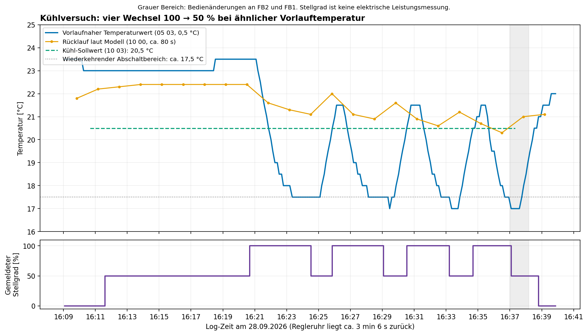

# Kühlversuch vom 28.09.2026

Ausgewertet: `ebusd.cool.log`, 11:11:23.408–16:43:56.142, insbesondere
16:09–16:40; dazu `aktuelle_einstellungen.txt` und die lokalen
Telegrammdefinitionen. Ergänzend: Betreiberbericht zur elektrischen
Leistungsmessung mit etwa 5 s Zeitauflösung. Die Messreihe selbst liegt hier
nicht vor; ihre einzelnen Schaltzeitpunkte wurden nicht mit dem Bus
abgeglichen. Keine Anlagenparameter wurden verändert.

## Ergebnis

Die vier vom Betreiber beobachteten Kühlzyklen entsprechen vier Abschnitten
mit **100 % gemeldetem Stellgrad**, unterbrochen durch **50 %**. Die
Wärmeerzeugermeldung geht zwischen diesen Abschnitten nicht auf „aus“.
Die ersten drei Rückschaltungen erfolgen bei einem übertragenen
vorlaufnahen Temperaturwert von **17,5 °C**, die vierte bei **17,0 °C**.
Die drei Wiederzuschaltungen erfolgen jeweils bei **20,5 °C**.

Das spricht für temperaturabhängiges Schalten einer zusätzlichen Stufe bei
fortbestehender übergeordneter Betriebsfreigabe. Eine Störabschaltung ist
in den ausgewerteten Fehlerfeldern nicht gemeldet. Der konkrete
Firmware-Schaltalgorithmus und die Bedeutung des 50-%-Zustands
sind damit noch nicht bewiesen. **Ein laufender Abluftverdichter ist als
Erklärung für diesen Zustand durch die ergänzende Betreiberbeobachtung
ausgeschlossen.** Die kurzen Solezyklen sind nach Betreiberangabe anhand
der elektrischen Leistungsaufnahme erkennbar und damit keine bloßen
Anzeigeschwankungen im Busstatus.

## Ergänzende Betreiberbeobachtung zur Leistungsmessung

Der Betreiber berichtet eine Zeitauflösung von etwa **5 Sekunden** und
Leistungssprünge von **1,25 kW**, an denen er den Soleverdichterlauf erkennt.
Die **Abluftwärmepumpe war während des gesamten Versuchs ausgeschaltet**.
Deren Leistungssprünge wären 550–800 W.

Welche Heizkreispumpe lief, wurde in diesem Versuch nicht geprüft. Der
Betreiber vermutet **M4.1**, gestützt auf eine Prüfung vor einigen Wochen.
Das ist ein historischer Hinweis, kein aktueller Pumpennachweis. Auch bei
ausgeschaltetem Abluftverdichter könnte dessen Wärmetauscher im durchströmten
Leitungsweg liegen; Verdichterlauf und Pumpenweg sind getrennt zu betrachten.

## Zeitbasis und Datenqualität

Alle folgenden Zeiten sind **Log-Zeiten**, keine Zeiten der Bedieneinheit.
Um 16:36:14.792 überträgt `07 00` die Reglerzeit **16:33:09**; die
Regleruhr liegt hier rund **3 min 6 s zurück**. Die vom Betreiber genannten
ungefähren Zeiten werden deshalb nicht stillschweigend mit Reglerzeiten
gleichgesetzt.

18.469 Logzeilen enthalten 18.330 Telegramme mit gültiger Master-CRC.
139 kurze Fragmente ohne vollständigen Header wurden ausgeschlossen.
Es gibt keine vollständigen Telegramme mit fehlerhafter Master-CRC.
5.053 Transaktionen haben gültige Antwort-CRC und Quittierungen; 45 weitere
haben zwar gültige Masterdaten, aber unvollständige/ungewöhnliche Antworten
oder Quittierungen. Diese Antworten werden nicht als Parameterbelege verwendet.
Die unten genannten entscheidenden Einstellwerte haben gültige Antwort-CRC.

SHA-256 der Quelldatei:
`9c8f0f1aa884c0afea32f89eb7bfa2c287fd4659077d5eb23af24d812e6591f6`.

## Ablauf

| Ereignis | Erste entsprechende Meldung | Beleg in ebusd.cool.log |
|---|---|---:|
| Kühl-Sollwert 20,5 °C in `10 03` | 16:10:40.376 | 16477 |
| Pumpenbit in `03 → 10 / 05 03` aktiv, Stellgrad noch 0 % | 16:11:11.848 | 16502 |
| Stellgrad 50 %, Statusbits `48` | 16:11:35.880 | 16526 |
| Erste Zuschaltung auf 100 % | 16:20:41.088 | 17004 |
| Bedienänderung an FB2 abgefragt | 16:37:01.115 | 18094–18095 |
| Sollwert in `10 03` auf 0, Raum-Sollwertfeld auf 10 °C | 16:37:20.377 | 18113 |
| Bedienänderung an FB1 abgefragt | 16:38:11.209 | 18157–18158 |
| Stellgrad auf 0 %, Betriebsbit aus, Pumpenbit bleibt zunächst aktiv | 16:38:47.896 | 18192 |
| Auch Pumpenbit aus | 16:39:44.819 | 18245 |

Die Bedienänderungen und das Zurücknehmen der Sollwerte passen zum berichteten
Standby-Eingriff. Die vierte Rückschaltung liegt unmittelbar bei der ersten
Bedienänderung und darf daher nicht als sicher unbeeinflusster vierter
Abschaltversuch behandelt werden.

| Zyklus | 50 → 100 % | 100 → 50 % | Dauer laut Meldungen | Pause bis nächster Zuschaltung | Temperatur bei Rückschaltung |
|---|---|---|---|---|---|
| 1 | 16:20:41.088 | 16:24:31.950 | 3 min 50,9 s | 1 min 19,9 s | 17,5 °C |
| 2 | 16:25:51.872 | 16:29:04.859 | 3 min 13,0 s | 1 min 27,0 s | 17,5 °C |
| 3 | 16:30:31.880 | 16:33:11.861 | 2 min 40,0 s | 1 min 29,1 s | 17,5 °C |
| 4 | 16:34:40.992 | 16:37:04.958 | 2 min 24,0 s | anschließend Standby | 17,0 °C |

Die Meldungen kommen ungefähr alle 7–10 Sekunden. Das sind Zeitpunkte der
ersten Beobachtung des neuen Zustands, keine sekundengenauen Messungen der
Schützkontakte. Belegzeilen für die Wechsel: 17004/17243, 17501/17672,
17756/17896, 17972/18101. Der Temperaturwert in `05 03` hat 0,5 °C Auflösung.
Er stimmt im Verlauf mit den vorläufig als Vorlauf bezeichneten Werten
der TEM-Temperaturblöcke überein.

## Was bei den kurzen Pausen bestehen bleibt

`03 → 10 / 05 03` meldet während der Zyklen durchgehend Statusnummer **0**
und Statusbits **0x48**: nach aktuellem Modell Betriebs-/Flammenbit und
Umwälzpumpenbit gesetzt, Alarmbit nicht gesetzt. Bei einer Wärmepumpe ist
„Flamme“ nur der Name des standardisierten Protokollfeldes.

Der gemeldete Stellgrad wechselt zwischen `64` = 100 % und `32` = 50 %.
Das sind weder gemessene elektrische Leistung noch ein Beweis für den Lauf
eines bestimmten Verdichters. Die Zuordnung der 100-%-Abschnitte zum
Soleverdichter wird durch die Betreiberbeobachtung einschließlich der
Leistungsmessung und den Temperaturrückgang gestützt. Ein sekundengenauer
Abgleich mit den elektrischen Schaltflanken steht mangels Messreihe aus.

Da der Abluftverdichter durchgehend aus war und der Soleverdichter in den
Pausen ebenfalls aus ist, darf **50 % hier nicht als halbe reale
Verdichterleistung oder als laufender Abluftverdichter** gelesen werden.
Auch das fortbestehende Betriebs-/Flammenbit ist in diesem Versuch kein
Nachweis eines laufenden Verdichters. Eine interne Freigabe oder logische
Stufe bleibt als Deutung möglich; ein reiner Pumpenzustand ist ebenfalls
nicht nachgewiesen. Die Hypothese einer Stufenregelung beschreibt somit
zunächst die Reglerlogik, nicht zwei tatsächlich laufende Verdichter.

Im Statusblock `11 00` korreliert **Bit 2 des ersten Statusbytes** mit
diesen Abschnitten: `8a` ↔ `8e`. Wegen der Abtastung etwa alle 80 Sekunden
ist dieser Block für genaue Schaltzeiten schlechter geeignet. Die Beobachtung
ist eine Zuordnungshypothese, keine Änderung der bestehenden Bitdefinitionen.

In allen 292 Meldungen je Wärmeerzeuger zwischen 16:05 und Logende bleiben
Statusnummer und Alarmbit null. In allen 78 `08 02`-Meldungen dieses Fensters
bleiben `errorDevice` und `errorCode` null. Zwischen 16:05 und 16:40 sind
auch keine expliziten Fehlerdienste `FE 01` oder `FF 02` aufgezeichnet.
Damit ist kein gemeldeter Fehler belegt; eine nicht auf dem Bus gemeldete
Schutzreaktion ist dadurch nicht ausgeschlossen.

## Bezug zu den Einstellungen

Der Mitschnitt enthält um 16:24–16:25 eine Rücklesung der Einstellungen.
Sie bestätigt insbesondere:

| Parameter | Wert | Logzeile | Einordnung |
|---|---|---:|---|
| 07-14 HK1/HK2 | 3/3 | 17339/17340 | Kühlfunktion bereits aktiviert; der alte Dokumentationsstand 0/0 gilt für diesen Versuch nicht |
| 09-07 WP | 6 | 17363 | Wärmepumpe mit Kühlfunktion |
| 09-11 WP | 0 | 17367 | Bedingte Freigabe unverändert; daraus folgt kein bewiesener Konfigurationsfehler |
| 09-21 WP | 5 K | 17377 | WE-Abschaltdifferenz; STE-Hilfe beschreibt den Heizfall |
| 09-23 WP | 12 min | 17379 | Minimale Stillstandszeit |
| 09-31 WP | 9 min | 17384 | Minimale WE-Laufzeit |
| 09-34 WP | 9 min | 17386 | Einschaltverzögerung der zweiten Stufe |
| 09-35 WP | −3 K | 17389 | Schaltdifferenz der zweiten Stufe |

**Stufenverzögerung:** Vom ersten 50-%-Zustand um 16:11:35.880 bis zur
ersten 100-%-Meldung vergehen **9 min 5,2 s**. Das passt innerhalb des
Meldeintervalls auffällig gut zu 09-34 = 9 min. Es stützt die Interpretation
als zusätzliche Stufe.

**Temperaturschwelle:** 20,5 °C minus 3 K ergibt 17,5 °C. Die wiederholten
Schaltpunkte passen damit numerisch zu 09-35 = −3 K. Die STE-Hilfe benennt
eine Stufenschaltdifferenz, dokumentiert aber weder die genaue Kühlgleichung
noch die Auswahl des maßgeblichen Fühlers/Sollwerts. Der Zusammenhang ist
eine starke Arbeitshypothese und keine bewiesene Firmwareformel.

Insbesondere gibt es mehrere Sollwertfelder: `10 03` enthält 20,5 °C,
`10 02` enthält im entsprechenden Temperaturwort 21,0 °C, passend zu den
Kühltemperaturen HK2/HK1. Das standardisierte Kessel-Sollwertfeld in
`08 02` enthält währenddessen **19,0 °C**. Diese Werte dürfen nicht ohne
Nachweis als identischer Regelsollwert behandelt werden.

**Lauf-/Stillstandszeiten:** Die beobachteten kurzen Solezyklen entsprechen
nicht 9 min Mindestlaufzeit und 12 min Mindeststillstand. Das beweist aber
keinen Ausfall dieser Funktionen: Die übergeordnete Meldung bleibt bei
50 % aktiv. Es ist plausibel, dass die Zeiten auf eine andere Freigabeebene
wirken und die zusätzliche Stufe separat schaltet. Der genaue Geltungsbereich
der Zeiten für die Sonderbeschaltung ist offen. Die ergänzende
Leistungsmessung macht diese Unterscheidung besonders relevant: Laut
Betreiber schaltet der reale Soleverdichter tatsächlich kurz aus und wieder
ein, obwohl die Regleranzeige nicht auf 0 % fällt. Die 50-%-Anzeige darf
deshalb nicht als Beleg für durchgehenden Verdichterlauf oder eine dadurch
eingehaltene physische Mindeststillstandszeit verwendet werden.

**Kühlgrenze:** Mit Heizgrenze 20 °C und Kühlgrenzenabstand 2 K liegt die
berechnete Grenze bei 22 °C. Die gemittelte Außentemperatur wird um 16:10
und 16:20 mit 22,0 °C, um 16:30 mit 22,1 °C zurückgelesen. Zusammen mit
den stabilen Kühl-Sollwerten spricht das gegen wiederholtes Verlassen des
Kühlbetriebs an der Außentemperaturgrenze. Die exakte Überschreitung beim
Start ist wegen der Auflösung nicht feststellbar.

## Grenzen der Diagnose und nächster sinnvoller Abgleich

Der vorlaufnahe Wert fällt von etwa 23,5 °C auf 17,5 °C, während der in
`10 00` als Rücklauf modellierte Wert zunächst um 21–22 °C bleibt und erst
langsam sinkt. In den Pausen erwärmt sich der Vorlauf rasch wieder. Das
passt zu einer lokalen Vorlaufregelung bei noch wärmerem Anlagenwasser.
Aktives Gegenheizen durch den Abluftverdichter ist nach der ergänzenden
Betreiberbestätigung ausgeschlossen. Die Wiedererwärmung des Vorlaufs ist
weiterhin mit wärmerem zurückströmendem Anlagenwasser vereinbar. Ein
bestimmter Pumpenweg, ausreichender Volumenstrom oder die genaue
Fühlerposition lässt sich daraus nicht ableiten.

Damit ist das Takten nun auch nach der Wiederherstellung belegt. Nicht
bewiesen ist, dass es dieselbe Ursache wie das früher berichtete Problem
ohne Warmwasserbedarf hat. Insbesondere fehlen Nachweise für den realen
Pumpenweg M4.1/M4.2 sowie K4/K11 während der Pausen. Die frühere offene
Frage nach dem Abluftverdichterlauf ist für diesen Versuch beantwortet:
Er war durchgehend aus. Ein hydraulischer Einfluss des vermuteten Wegs über
M4.1 bleibt möglich, ist aber weder nachgewiesen noch als Abschaltursache
belegt.

Zur Eingrenzung wären synchron zum Bus besonders hilfreich:

- aktive Heizkreispumpe während 100 % und 50 %; M4.1 ist aktuell nur vermutet;
- sofern verfügbar, Zeitstempel der elektrischen 1,25-kW-Schaltflanken zum
  Abgleich mit den Buswechseln und zur Bestätigung ihrer genauen Zuordnung;
- TEM-Istwerte 00-07 (TWV), 00-08 (TWR), 00-02 HK1/HK2 und die Sollwerte
  01-07 sowie 01-02 HK1/HK2;
- HK2-Stellbefehl 01-21 und, falls ein Störverdacht bleibt, Quellen- und
  Kältekreistemperaturen 00-70 bis 00-75;
- ein Vergleich mit dem nach Betreiberbericht funktionierenden Kühlbetrieb
  während gleichzeitiger Warmwasserbereitung.

Aus diesem Mitschnitt allein folgt keine belastbare Empfehlung, 09-35,
09-11 oder Schutzgrenzen zu ändern.

## Dateien und Methode

- [Dekodierte Messwerte mit Logzeilen und Rohdaten](../cooling-output/values.csv)
- [Temperaturgrafik](../cooling-output/cooling-cycles.png)
- [Aktuelle Einstellungen](../aktuelle_einstellungen.txt)
- [Lokale Parametertexte](../ste-output/Parameter.md)
- [Bisherige Anlagen- und Verdrahtungsanalyse](Heating-Control-Analysis.md)

Offline-Dekodierung mit `unescape` und `crc` aus
`scripts/analyze_master_log.py`; Dateibilanz mit `analyze` aus
`scripts/analyze_status_frequency.py`. Felder nach `broadcast.tsp`,
`burner1.tsp` und `hautec.tsp`: Temperatur `05 03` als D1C (Byte / 2),
TEM-Temperaturen als vorzeichenbehaftete Little-Endian-Wörter / 10,
`08 02`-Sollwert als D2B (Little-Endian / 256). Der CSV-Auszug umfasst
16:09–16:40 und enthält nur Daten aus Telegrammen mit gültiger Master-CRC.
