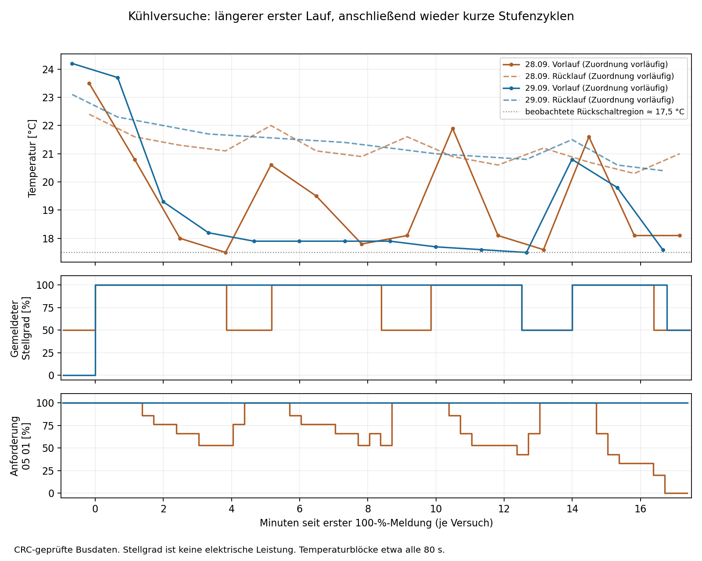

# Vergleich der Kühlversuche vom 28. und 29.09.2026

Ausgewertet: `ebusd.cooltest.log`, 29.09.2026 22:19:16.595–22:43:31.688,
gegen den Kühlabschnitt in `ebusd.cool.log` vom 28.09. Alle Zeiten sind
Log-Zeiten. Die Regleruhr liegt im neuen Mitschnitt etwa 8 Minuten zurück:
um 22:25:56.058 meldet `07 00` 22:17:49. Es wurden keine Anlagenparameter
übertragen; die Auswertung ist ausschließlich offline.

## Ergebnis

Die Rückstellung von 09-35 WP auf −3 K wird im neuen Mitschnitt geschrieben,
quittiert und zurückgelesen. Rund acht Sekunden nach dem Schreiben steigt
der gemeldete Stellgrad von 0 auf 100 %. Das stützt zusammen mit der
Betreiberbeobachtung sehr deutlich den Zusammenhang zwischen der positiven
Schaltdifferenz und dem zuvor ausbleibenden Start. Der vorherige Wert +2 K
stammt aus `aktuelle_einstellungen.txt` und dem Betreiberbericht, nicht aus
einer Rücklesung von 09-35 vor der Änderung im neuen Mitschnitt.

**Das kurze Stufenschalten ist jedoch erneut vorhanden.** Der erste
100-%-Abschnitt dauert diesmal 12 min 30,9 s. Danach folgt eine Pause auf
50 % von 1 min 29,2 s und ein weiterer 100-%-Abschnitt von nur 2 min 46,7 s.
Beide Rückschaltungen erfolgen bei 17,5 °C im 0,5-°C-Temperaturfeld; die
Wiederzuschaltung erfolgt bei 20,5 °C. Das entspricht dem vorherigen Muster.
Die elektrische Leistungsaufnahme des neuen Versuchs liegt nicht vor:
Bus-Stellgrad und tatsächlicher Verdichterlauf sind getrennt zu betrachten.

| Ereignis am 29.09. | Log-Zeit | Zeile |
|---|---|---:|
| 09-35 WP = −3 K geschrieben, Master-ACK vorhanden | 22:25:54.242 | 545 |
| Erste Meldung 0 → 100 %, Temperatur 24,0 °C | 22:26:02.269 | 552 |
| 09-35 WP = −3 K gültig zurückgelesen | 22:26:06.249 | 557 |
| 100 → 50 %, Temperatur 17,5 °C | 22:38:33.202 | 1227 |
| 50 → 100 %, Temperatur 20,5 °C | 22:40:02.426 | 1310 |
| 100 → 50 %, Temperatur 17,5 °C | 22:42:49.174 | 1461 |
| Letzte WE1-Meldung: weiterhin 50 % | 22:43:29.190 | 1497 |

## Warum der erste Lauf länger dauert

Der feinere Temperaturblock `10 00` zeigt am 29.09. einen schnellen
Vorlaufrückgang von 24,2 °C vor dem Start auf 18,2 °C um 22:29:21.692.
Anschließend bleibt die Temperatur von 22:30:41.677 bis 22:34:41.696 bei
17,9 °C. Sie fällt erst danach über 17,7 und 17,6 auf 17,5 °C um 22:38:41.684.
Der Rücklauf liegt währenddessen noch bei etwa 21,6 bis 20,8 °C.

Am 28.09. fiel der Vorlauf nach der ersten Zuschaltung innerhalb von etwa
3 min 51 s bis in die Rückschaltregion. Am 29.09. wird diese Region zunächst
knapp nicht erreicht. Das erklärt die längere erste Laufzeit wesentlich
besser als eine nachgewiesene neue Mindestlaufzeit: Der nächste Lauf ist
bereits wieder kürzer als drei Minuten.

**Auflösung beachten:** Das `05 03`-Temperaturfeld meldet schon ab 22:30:33
17,5 °C, während `10 00` noch 17,9 °C liefert. Eine Meldung von 17,5 °C in
`05 03` darf daher nicht als exakter physischer Schaltpunkt behandelt werden.
Die feineren Blöcke kommen nur ungefähr alle 80 Sekunden. Auch eine exakte
Firmware-Gleichung lässt sich daraus nicht beweisen.

## Unterschiede und mögliche Ursachen

- **Wärmerer Anfangszustand:** Unmittelbar vor dem ersten Start sind Vorlauf
  und Rücklauf am 29.09. bei 24,2/23,1 °C, am 28.09. bei 23,5/22,4 °C.
  Mehr Wärmezufuhr aus dem Rücklauf kann das Erreichen der unteren Grenze
  verzögern. Eine alleinige Erklärung der gesamten Laufzeitdifferenz durch
  diese 0,7 K ist nicht nachgewiesen.
- **Andere Vorgeschichte der Leistungsregelung:** Nach Betreiberangabe lag
  die Anforderung am 29.09. bereits seit Stunden an. Im gesamten neuen
  Mitschnitt bleibt das Stellgrad-Anforderungsfeld in `10 → 03 / 05 01`
  auf 100 %. Am 28.09. sinkt es während des ersten Laufs über 86, 76 und
  66 auf 53 %. Ein anderer interner Reglerzustand ist daher plausibel.
  Der vorhandene I-Anteil (06-11 = 20 min laut Einstellungsdatei) passt
  grundsätzlich zu einer Abhängigkeit von der Vorgeschichte; seine
  interne Größe wird nicht ausgelesen. Damit ist weder ein Integratorproblem
  noch dessen Einfluss auf die tatsächliche Kühlleistung bewiesen.
- **Die lokale Rückschaltung bleibt wirksam:** Am 29.09. sinkt der gemeldete
  Stellgrad trotz unverändert 100 % Anforderung auf 50 %. Ein Zurücknehmen
  der übergeordneten Leistungsanforderung ist für diese Rückschaltung also
  nicht erforderlich. Das stärkt die Hypothese einer zusätzlichen lokalen
  Temperatur-/Stufenbegrenzung.
- **Möglicher hydraulischer Unterschied:** Ein anderer Volumenstrom,
  geöffnete Heizkreise oder ein anderer Pumpenweg könnten das Plateau
  oberhalb der Rückschaltregion erklären. Pumpenweg, Ventilpositionen und
  Durchfluss werden hier aber nicht gemessen. Eine hydraulische Reparatur
  oder Änderung ist nicht belegt.
- **Kühl-Sollwerte:** In beiden Versuchen kommen 20,5 und 21,0 °C vor;
  ihre Zuordnung zu `10 02` und `10 03` ist jedoch vertauscht. Im neuen
  Mitschnitt enthält `10 02` 20,5 °C und `10 03` 21,0 °C. Das gemeinsame
  `08 02`-Sollwertfeld bleibt während beider Kühlphasen bei 19,0 °C.
  Die frühere zahlenmäßige Beziehung 20,5 − 3 = 17,5 darf deshalb nicht
  zu einer bewiesenen Regelung ausschließlich nach `10 03` erklärt werden.
- **Kein beobachteter Warmwasserwechsel:** Der Speichertemperaturwert sinkt
  im neuen Mitschnitt von 49,2 auf 49,0 °C. Das derzeit als Warmwasserstatus
  modellierte Bit in `11 01` bleibt in beiden Vergleichsabschnitten null.
  Es gibt damit keinen Beleg für eine neu einsetzende Speicherladung als
  Erklärung. Das beweist nicht den Stillstand eines bestimmten Verdichters.

Der beim früheren Versuch ausgeschaltete Abluftverdichter war durch den
Betreiber bestätigt. Sein Zustand im neuen Versuch ist noch nicht bestätigt.
Für eine eindeutige physische Einordnung der neuen 50-%-Phasen wären die
Leistungsaufnahme um 22:38:33 und 22:42:49 sowie der aktive Pumpenweg hilfreich.

## Fehlerfelder und Beleggrenzen

Alle 182 WE1- und 182 WE2-Meldungen `05 03` melden Statusnummer 0 und kein
Alarmbit. WE1 behält durchgehend die Statusbits `0x48`, selbst bei 0 % zu
Beginn. WE2 meldet durchgehend 0 % und Statusbits 0. Sämtliche 49 `08 02`
melden `errorDevice = 0` und `errorCode = 0`. Aus dem Betriebsbit allein
folgt deshalb auch in diesem Versuch kein tatsächlicher Verdichterlauf.

Das historisch berichtete Abschalten nach etwa einer Minute und die im
Mitschnitt vom 28.09. nachgewiesenen Stufenzyklen sind nicht automatisch
identisch. Für das historische Ereignis fehlt ein vergleichbarer Mitschnitt.
Der neue Mitschnitt belegt ein Wiederauftreten des Bus-Schaltmusters vom
28.09.; die Ursache jedes älteren Abschaltvorgangs bleibt damit offen.

## Datenqualität und Dateien

1.500 Logzeilen, 1.470 Telegramme mit gültiger Master-CRC, 30 ausgeschlossene
kurze Fragmente. Keine vollständigen Telegramme mit fehlerhafter Master-CRC.
496 Transaktionen besitzen gültige Antwort-CRC und Quittierungen; fünf weitere
haben gültige Masterdaten, aber unvollständige/ungewöhnliche Antworten oder
Quittierungen. Solche Antworten wurden nicht als Parameterbelege verwendet.
SHA-256: `f08be6cc2efc01124dca89ac21d3d91ca14cdb57535ae7faa0f025ec38e1fd7f`.

Dekodierung nach den lokalen Telegrammdefinitionen mit `unescape` und `crc`
aus `scripts/analyze_master_log.py`, Dateibilanz mit
`scripts/analyze_status_frequency.py`. Die Temperaturzuordnung der
Broadcasts bleibt vorläufig; die Werte vor dem Start stimmen mit den direkten
TEM-Abfragen 00-07 und 00-08 überein. Keine vollständige aktuelle
Konfigurationsrücklesung nach der Änderung liegt vor.

- [Vergleichswerte mit Quelldatei, Zeile und Zeit](../cooling-test-output/comparison-values.csv)
- [Grafik als SVG](../cooling-test-output/comparison.svg)
- [Auswertung vom 28.09.](Cooling-Log-Analysis.md)
- [Lokale Hilfe zum I-Anteil 06-11](../ste-output/Parameter.md#datensatz-90)
- [Hautec HSC 6001, S. 47](https://hautec.eu/wp-content/uploads/2023/08/Bedienungsanleitung-Controller-HSC6001.pdf):
  beschreibt die Abhängigkeit der Leistungsanforderung vom I-Anteil bei einem
  verwandten Regler; kein Nachweis des internen Zustands dieser Anlage.
