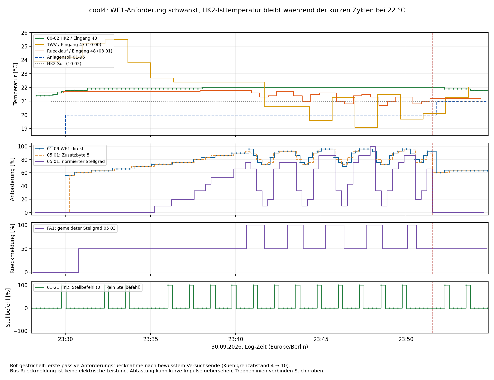

# Kühlversuch cool4: direkte HK2- und WE1-Abfragen

Quelle: `ebusd.cool4.log`, 30.09.2026, 23:28:01.475–23:54:49.053.
Zeiten sind Log-Zeiten, als Europe/Berlin eingeordnet. Auswertung am 01.10.2026;
ausschließlich offline, keine Schreibzugriffe auf die Anlage.

**Folgevergleich:** Die [cool5-Auswertung](Cooling-Test-2026-10-01-cool5.md)
ordnet `Status0a.Bit2` mit 376 übereinstimmenden Stichproben über fünf
Kühlmitschnitte der 100-%-Stufe zu. Das Bit ist kein physischer Laufnachweis.

## Ergebnis

Der Mitschnitt grenzt die Kurzzyklen weiter ein: **Die gemeinsame
WE1-Anforderung fällt vor jeder Rückschaltung stark ab, während der direkt
abgefragte HK2-Fühler bei 22,0 °C bleibt und HK2 weiter positive Stellimpulse
liefert.** Ein negativer HK2-Stellbefehl ist in keiner Stichprobe vorhanden.
Das spricht für eine Begrenzung durch die gemeinsame Anforderungs-/Stufenkette,
nicht für einen beobachteten HK2-Zu-Befehl als Abschaltursache.

Das beweist noch keinen Montagefehler und keine bestimmte interne
Reglergleichung. Besonders wichtig bleiben der tatsächliche Einbauort von
Eingang 48 und die Versorgung/Freigabekette von KT15/K3. Die Fehlerhypothese
„HK2 erreicht sein Temperaturziel und schaltet deshalb sofort wieder ab“
wird durch diesen Versuch nicht gestützt: HK2 misst während aller kurzen
Zyklen 22,0 °C bei einem übertragenen HK2-Sollwert von 21,0 °C.

## Ablauf und bewusstes Versuchsende

| Ereignis | Erste beobachtete Log-Zeit | Belegzeile |
|---|---|---:|
| Warmwassersoll in 08 02 steigt von 10 auf 50 °C | 23:29:03.624 | 112 |
| Warmwassersoll in 08 02 fällt auf 40 °C | 23:29:34.796 | 150 |
| Anlagensoll 01-96 HK1 erreicht 20 °C | 23:30:00.566 | 183 |
| WP-Soll 01-07 HK1 erreicht 19 °C | 23:30:15.826 | 214 |
| FA1 meldet erstmals 50 % | 23:30:45.289 | 252 |
| Warmwasser-Bit 11 00 erstmals wieder gelöscht | 23:33:39.313 | 503 |
| Erste kurze 100-%-Phase | 23:40:37.158 | 1095 |
| Passive Anforderung: Zusatzbyte 5 fällt 90 → 60, normiert 66 → 0 % | 23:51:32.898 | 2025 |
| HK1-Soll in 10 02 erstmals 0 statt 20,5 °C | 23:51:39.739 | 2033 |
| Anlagensoll 01-96 HK1 erstmals 21 statt 20 °C | 23:51:45.494 | 2038 |

**Betreiberbestätigung:** Gegen 23:51 Uhr wurde das Experiment bewusst durch
Änderung des Kühlgrenzabstands von **4 auf 10** beendet. Der Einbruch der
Anforderung und die Sollwertänderungen in diesem Abschnitt werden deshalb
nicht als zusätzliche spontane Fehlfunktion interpretiert. Die konkrete
4→10-Änderung ist eine Betreiberangabe, keine im Rohlog direkt zurückgelesene
Parameteränderung. HK2-Soll bleibt im Broadcast 21 °C, WP-Soll bleibt 19 °C;
FA1 meldet bis zum Log-Ende 50 %. Das ist keine nachgewiesene vollständige
Abschaltung aller Anlagenfunktionen.

Vorher sind während der fünf Kurzzyklen 01-96 = 20 °C und 01-07 = 19 °C
in beiden abgefragten Kontexten konstant. HK1/HK2-Soll in 10 02/10 03 liegen
bei 20,5/21 °C. Der kurze Warmwasserstatus zu Beginn ersetzt keinen längeren
Vergleich mit stabiler paralleler Warmwasserbereitung wie in `cool3`.

## Fünf kurze Rückmeldungsphasen

Die Tabelle nennt die erste beobachtete FA1-Rückmeldung aus `03 → 10 / 05 03`,
keine direkt gemessenen Schützkontakte oder elektrischen Leistungen. Die
Meldungen kommen ungefähr alle acht Sekunden. Normierter Stellgrad ist jeweils
die letzte passive Anforderung vor der Rückschaltung; direkte WE1-Abfragen
sind zeitlich versetzt. Alle genannten Belegzeilen beziehen sich auf `ebusd.cool4.log`.

| FA1 100 % ab | Zurück auf 50 % | Dauer | Normierte Anforderung davor | Letzte direkte 01-09 WE1 davor | Belegzeilen an/aus |
|---|---|---:|---:|---:|---|
| 23:40:37.158 | 23:41:41.158 | 64,0 s | 10 % | 73 % | 1095 / 1182 |
| 23:43:01.226 | 23:43:57.280 | 56,1 s | 10 % | 76 % | 1295 / 1373 |
| 23:45:17.164 | 23:46:21.161 | 64,0 s | 10 % | 70 % | 1497 / 1581 |
| 23:47:41.181 | 23:48:37.146 | 56,0 s | 10 % | 73 % | 1689 / 1767 |
| 23:50:05.151 | 23:50:37.163 | 32,0 s | 20 % | 80 % | 1897 / 1942 |

Die vier vollständigen Zwischenpausen betragen rund 80,1 / 79,9 / 80,0 / 88,0 s.
Die 05-03-Vorlaufwerte bei der Rückschaltung sind 20 / 21 / 20,5 / 20,5 / 21 °C.
Eine stets erreichte untere Grenze von 17,5 °C erklärt diese Rückschaltungen
nicht. Der Rücklauf aus 08 01 sinkt während der Kühlphasen und erholt sich
in den Pausen; über den gesamten Mitschnitt bewegt er sich zwischen etwa
20,7 und 21,8 °C. Wegen unterschiedlicher Abtastzeiten sind daraus keine
sekundengenauen festen Rücklaufschaltschwellen abzuleiten.

## Fühler 43: direkte HK2-Messung und Broadcast-Zuordnung

107 gültige Antworten auf `00-02 HK2` über Selektor `08 82 10 00` liegen vor.
Der Wert steigt zunächst von 21,4 auf 22,0 °C und fällt erst später leicht ab.
**Alle 47 direkten Abfragen zwischen 23:40:00 und 23:51:32 zeigen 22,0 °C.**
Die Rücklauf- und Vorlaufwerte anderer Eingänge ändern sich gleichzeitig.

Das dritte Temperaturwort nach Selektor `10 01`, aktuell `Status1b.tr`,
stimmt in **allen 20 Paaren** mit der jeweils zeitlich nächsten direkten
HK2-Abfrage exakt überein; größter Zeitabstand 6,634 s. Damit ist seine
Zuordnung zu THV2 / Eingang 43 für diesen Mitschnitt gut belegt. Es ist
nicht mit dem Eingang-48-Rücklauf gleichzusetzen. Der Wertebereich ist klein;
der Vergleich ersetzt keine Sensor-Kalibrierung. Die Dekoderänderung besteht
nur aus einem Kommentar; Namen, Datentypen und Offsets bleiben unverändert.

Laut Betreiber sitzt 43 am Eingang der Solewärmepumpe. Welche konkrete
Leitung bzw. welches Medium gemeint ist, wurde noch nicht ausdrücklich
geklärt. Die Konstanz kann eine andere hydraulische Lage, geringe thermische
Kopplung oder eine andere Messaufgabe widerspiegeln; sie beweist weder einen
defekten noch einen falsch montierten Fühler. Für die Erklärung der schnellen
Leistungsrücknahme ist der veränderliche Rücklaufwert und damit die noch
unbekannte Lage von Eingang 48 der wichtigere nächste Abgleich.

## HK2 liefert weiter positive Stellimpulse

108 gültige Antworten auf `01-21 HK2`: **91-mal 0, 17-mal +100, kein −100**.
Der Typ `c1` wird als vorzeichenbehaftetes Byte an Antwortoffset 8 dekodiert;
das folgende Byte ist Padding. 0 bezeichnet keinen Stellbefehl, keine
Ventilstellung und keine bestätigte Verdichterabschaltung.

Die positiven Stichproben erscheinen auch während der Kurzzyklen, ab 23:36
häufig etwa im Abstand von 75 s. Beispiel: um **23:48:31.609** meldet HK2
**+100** (Zeile 1762); nur **5,537 s später** meldet FA1 wieder **50 %**
(Zeile 1767). Der direkte WE1-Wert ist schon um 23:48:31.100 auf 73 %
gefallen (Zeile 1758). Das spricht gegen einen beobachteten HK2-Zu-Befehl
als Auslöser. Auch das bereits zugeordnete `Mixer_Close`-Bit ist in allen
20 Broadcast-Stichproben von 11 01 aus. Die Abtastung etwa alle 15 bzw.
80 s kann kurze Zwischenimpulse übersehen und beweist keinen dauerhaft
bestimmten elektrischen Ausgangszustand.

Nach dem dokumentierten Schaltplan führt TEM 15 zu KT15-Y1, TEM 26 versorgt
KT15-A1; KT15 schaltet K3. Bei tatsächlich anliegenden wiederholten Auf-Impulsen
und dauerhafter Versorgung wäre die vom Betreiber abgelesene Rückfallzeit
von 1000 s wesentlich länger als die beobachteten Pausen. Das ABB-Datenblatt
beschreibt für diese Funktion die nötige kontinuierliche Versorgung und
das Rücksetzen der Zeit durch erneutes Schließen des Steuereingangs.
[ABB CT-MFE, Seite 2](https://library.e.abb.com/public/10c49196c23c80a0c12575f400340e36/2CDC111032D0201.pdf)

**Arbeitshypothese:** Die gemeinsame Stufenanforderung könnte eine weitere
Freigabe bzw. die Versorgung von KT15 zurücknehmen, obwohl die HK2-Funktion
weiter Auf-Impulse erzeugt. Eine solche Versorgungsunterbrechung ist im Log
nicht gemessen. Die tatsächlichen Zustände von TEM 26, KT15 und K3 sind
daher der gezielte elektrische Prüfpunkt. Die Bezeichnung des Ausgangs als
WE2 ist nicht mit dem Menü-Kontext `01-09 WE2` oder einem bewiesenen
Bus-Stellgradfeld gleichzusetzen.

## Expert-Freigabe und Vergleich von 01-09 mit 05 01

Sechs Schreibtelegramme `31 → 10 / 06 23 / 00 00 51 00` um 23:32, 23:36,
23:40, 23:44, 23:48 und 23:52 sind jeweils mit `00` quittiert. Das entspricht
der besprochenen Freigabe; ob der Aufruf über MQTT oder ebusctl kam, ist
am Bus nicht unterscheidbar. Vierminütige Erneuerung reichte in diesem Lauf:
**107 gültige 01-09-WE1-Antworten, keine Antwort mit Kennung `ff1f`.**
Es gibt einzelne unvollständige Transaktionen mit anschließenden gültigen
Antworten, aber keinen dauerhaften Verlust des Expert-Zugriffs wie in `cool3`.
Daraus folgt keine allgemeine Garantie für jeden Freigabetimer.

Die passive Normierung wird erneut bestätigt. In allen 80 Telegrammen
`10 → 03 / 05 01` gilt für Nutzdatenbyte 4 (`S`) und Byte 5 (`B`, nullbasiert):

`S ≈ max(0, (B − 70) / 30 × 100)`

Größte Abweichung: 0,667 Prozentpunkte. Beispiel: B=73 ergibt normiert
10 %, B=93 ergibt 76 %. Die direkte WE1-Abfrage folgt derselben Größenordnung
und Stufung wie B, nicht wie S. Zwischen 23:30 und 23:51:30 stimmen
43 von 64 nächstgelegenen Wertepaaren exakt überein; die übrigen unterscheiden
sich um höchstens 7 Prozentpunkte bei maximal 6,810 s Zeitabstand. Das stützt
B als passiven Vergleichswert für die unnormierte WE1-Anforderung deutlich.
Wegen der zeitlichen Unterschiede und möglicher interner Aktualisierung ist
es weiterhin kein nachgewiesen zu jedem Zeitpunkt identisches Aliasfeld.

Am bewussten Versuchsende meldet die direkte Abfrage um 23:51:31.149 noch
93 %, das passive B um 23:51:32.898 bereits 60 %. Solche Übergänge dürfen
nicht durch eine Gleichsetzung zeitversetzter Stichproben verschwinden.

Zu Beginn enthalten sechs gültige WE1-Antworten rechnerisch **−127 %**
(Rohwert `0a fb`), außerhalb der in der Antwort enthaltenen Grenzen −100…100.
Diese werden als Sonder-/ungültiger Leistungswert behandelt, nicht als reale
negative Anforderung. Die genaue Bedeutung ist ungeklärt. Im Diagramm sind
sie ausgelassen; die CSV-Dateien erhalten die Rohdaten. Das ist von einer
ungültigen Antwortkennung `ff1f` zu unterscheiden.

## Konsequenz für die Fehlersuche

1. **Gemeinsame Anforderung und Stufenfreigabe zuerst verfolgen:** Der direkte
   WE1-Wert bestätigt nun die schnelle Leistungsrücknahme. Es ist kein bloßes
   Artefakt der passiven Normierung. HK2 liefert gleichzeitig weiter Impulse.
2. **Eingang 48 räumlich zuordnen:** Lage zu Wärmetauschern, Zusammenführungen
   und den beiden Pumpenwegen klären. Das trennt einen örtlichen schnellen
   Temperaturwechsel von einer repräsentativen Heizkreistemperatur.
3. **Eingang 43 thermisch einordnen:** Konkrete Leitung/Medium und tatsächliche
   Rohrtemperatur mit dem konstanten Menüwert vergleichen. Seine Bezeichnung
   allein reicht nicht für die Diagnose „falsch montiert“.
4. **KT15-Versorgung/Freigabekette abgleichen:** Eine fachkundige Beobachtung
   der tatsächlichen Schaltzustände bei den Flanken kann die Versorgungshypothese
   von einer anderen Verdichtersperre unterscheiden. Das Log misst sie nicht.

06-10/06-11 und die Mindestleistung 11-03 bleiben relevante Regelparameter,
sind in diesem Mitschnitt aber nicht erneut ausgelesen. Eine gezielte
Einstellungsänderung oder eine Fühlerverlegung lässt sich noch nicht begründen.
Ein neuer Strommitschnitt liegt nicht vor; die Zuordnung der 100-%-Phasen
zum Soleverdichter wird aus den früheren Versuchen gestützt, nicht in diesem
Lauf elektrisch erneut bewiesen.

## Datenqualität und Artefakte

- 2300 Log-Zeilen, 2259 vollständige Mastertelegramme mit gültiger CRC.
- 41 kurze Fragmente ausgeschlossen. Zusätzlich 41 vollständige Mastertelegramme
  mit unvollständiger/ungewöhnlicher Antwort; ihre Antworten nicht ausgewertet.
- 1145 Transaktionen mit gültiger Antwort-CRC und Quittierung.
- FA1: 201 Rückmeldungen, FA2: 200 Rückmeldungen, jeweils Statusnummer 0.
  FA2 meldet durchgehend 0 %. Alle 54 Fehlergerät/-code-Paare aus 08 02 sind 0/0.
  Das schließt nicht jede interne Begrenzung aus.

[Buswerte](../cooling4-output/bus-values.csv),
[direkte Parameterantworten](../cooling4-output/parameter-values.csv),
[Schaltflanken mit vorausgehenden Werten](../cooling4-output/edges.json),
[HK2-Vergleich](../cooling4-output/HK2_candidate_1001-comparison.csv),
[WE1-Vergleich](../cooling4-output/FA1_extra_byte5-comparison.csv),
[Datenqualität und Freigabetelegramme](../cooling4-output/bus-summary.json),
[Diagramm als SVG](../cooling4-output/overview.svg).

SHA-256: `7daffb6bc1b3c28959dc3ae16438c47676c591cde534ea465c5bd028474a88c9`
