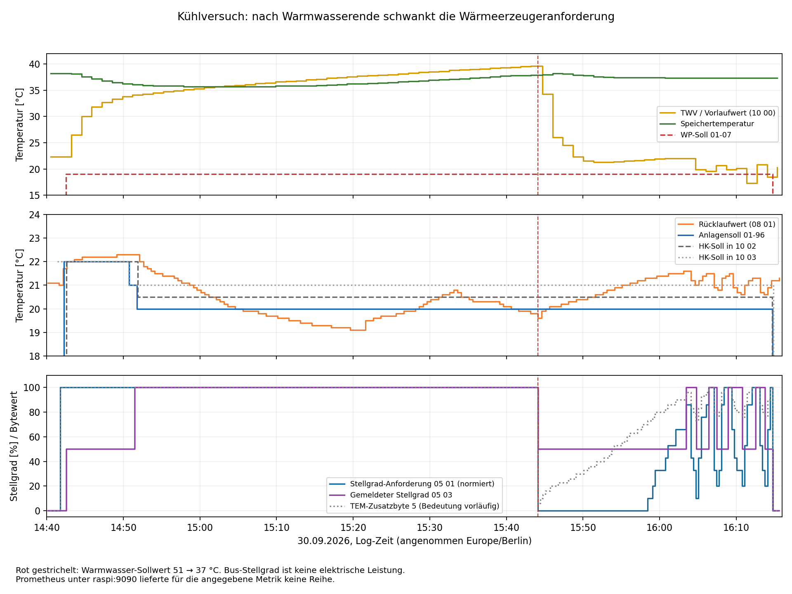
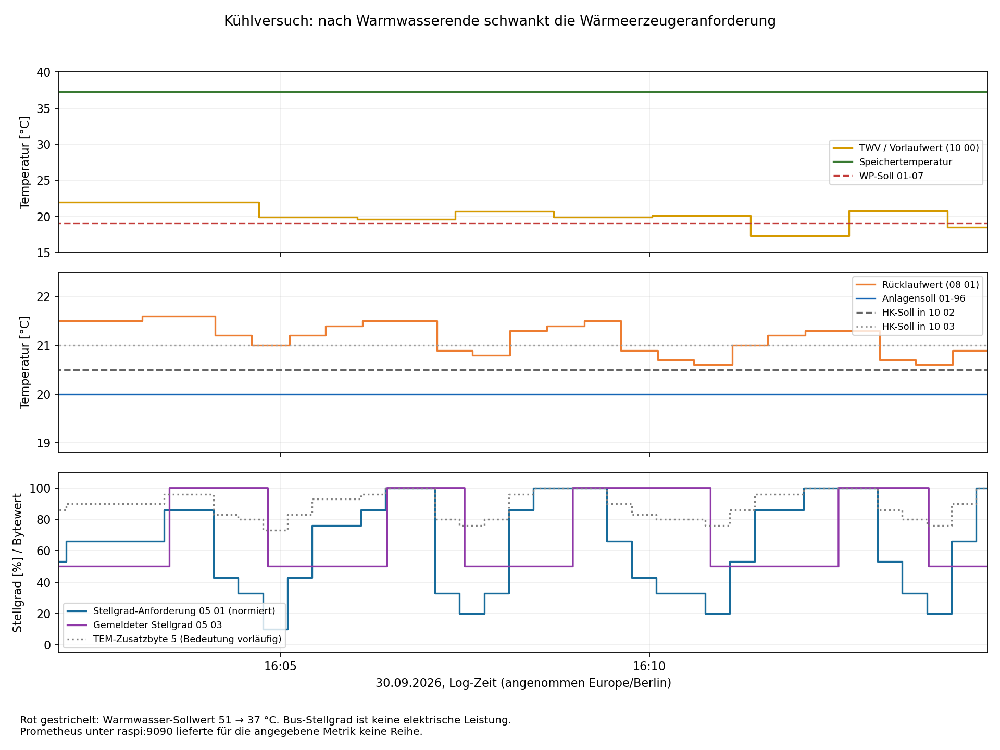
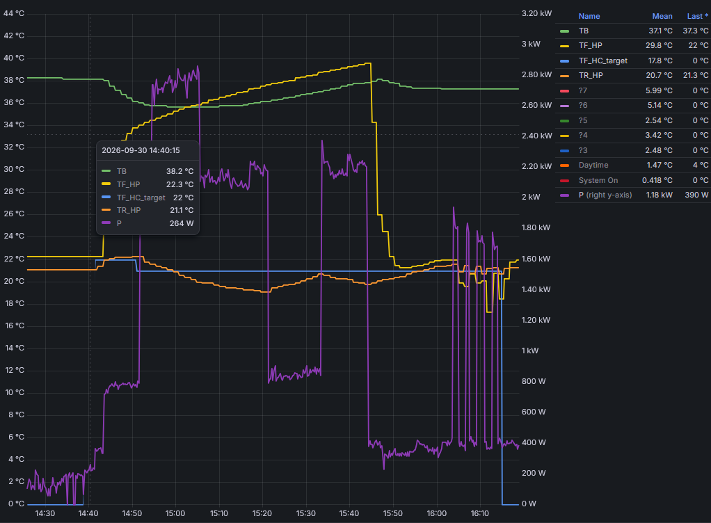

# Kühlversuch vom 30.09.2026: Übergang von Warmwasser zu reiner Kühlung

Quelle: `ebusd.cool3.log`, 14:40:06.106–16:15:45.510 am 30.09.2026.
Alle Ereigniszeiten unten sind Log-Zeiten, als Europe/Berlin eingeordnet.
Die Regleruhr liegt rund 8 min 7 s zurück: um 14:40:27.379 wird 14:32:20
übertragen. Die Auswertung liest ausschließlich vorhandene Daten; keine
Anlagenparameter wurden verändert.

**Folgeversuch cool4, 23:28–23:54:** Die [neue Auswertung](Cooling-Test-2026-09-30-cool4.md)
belegt gültige direkte WE1-Abfragen und eine während der Kurzzyklen konstante
HK2-Isttemperatur von 22,0 °C. HK2 liefert weiter positive Stellimpulse, während
die gemeinsame Anforderung zurückgeht. `Status1b.tr` stimmt mit `00-02 HK2`
überein. Das bewusste Versuchsende gegen 23:51 durch Kühlgrenzabstand 4→10
ist getrennt von den fünf vorherigen Kurzzyklen eingeordnet.

## Ergebnis

Die neuen Abfragen zeigen: Nach Ende der Warmwasserbereitung entsteht das
Takten **bei unveränderten Temperatursollwerten**. 01-96 bleibt auf 20 °C,
01-07 auf 19 °C. Anders als beim Versuch vom 29.09. schwankt jetzt aber der
passiv übertragene Stellgrad des Reglers an FA1. Vor jeder kurzen
Rückschaltung auf 50 % ist diese Anforderung bereits deutlich gefallen.
Die Rückschaltungen erfolgen diesmal bei unterschiedlichen Vorlaufwerten
von 17,5 bis 20 °C, nicht durchgehend bei 17,5 °C.

Damit reicht eine feste Vorlauf-Abschaltschwelle als alleinige Erklärung
nicht mehr aus. Der Mitschnitt stützt zusätzlich ein Zusammenspiel der
übergeordneten Leistungsregelung mit der Stufenschaltung. Der Zusammenhang
zwischen Warmwasserende, hydraulischem Weg und tatsächlichen Verdichterläufen
ist trotz des nachgereichten Leistungsdiagramms noch nicht vollständig
geklärt: Die numerische Leistungsreihe, der Volumenstrom und der genaue
Einfluss der Fühler-/Freigabekette fehlen. Der Betreiber bestätigt inzwischen
beide Pumpenzustände: ohne Warmwasserbereitung M4.1, mit Warmwasserbereitung
M5 und M4.2. Die jeweilige Heizkreispumpe M4.1 bzw. M4.2 läuft auch während
der Kühlverdichterpausen weiter. Diese Nachbeobachtungen sind keine synchronen
Pumpenmessungen für jede Phase des ursprünglichen Logs.
Das Diagramm zeigt während Warmwasser eine deutliche Leistungspause um
15:21–15:33, obwohl beide betrachteten FA1-Stellgrade bei 100 % bleiben.
Ein durchgehender 100-%-Buszustand bildet den tatsächlichen Soleverdichterlauf
in dieser Betriebsart folglich sehr wahrscheinlich nicht ab; die Zuordnung
der Leistungspause wird durch den gleichzeitigen Rücklaufanstieg gestützt.

## Ablauf und unveränderte Sollwerte

| Ereignis | Log-Zeit | Belegzeile |
|---|---|---:|
| Erste 100-%-Anforderung in direkter Abfrage 01-09 WE1 | 14:41:31.311 | 114 |
| Erste 50-%-Rückmeldung von FA1 | 14:42:33.748 | 202 |
| Erste 100-%-Rückmeldung von FA1 | 14:51:29.738 | 886 |
| 01-96 erreicht 20 °C | 14:51:45.723 | 915 |
| Warmwasser-Sollwert im Block 10 02 von 51 auf 37 °C geändert | 15:44:02.430 | 4908 |
| Normierter Stellgrad in 05 01 fällt von 100 auf 0 % | 15:44:05.526 | 4912 |
| FA1-Rückmeldung 100 → 50 % | 15:44:09.776 | 4916 |
| Warmwasser-Bit im Status 11 00 erstmals gelöscht | 15:47:21.690 | 5159 |
| Warmwasser-Bit im Status 11 01 erstmals gelöscht | 15:47:31.674 | 5174 |
| Erste erneute 100-%-Rückmeldung | 16:03:29.809 | 6381 |
| Anforderung zurückgenommen, 01-96 und 01-07 auf 0 °C | 16:14:45–16:14:47 | 7242/7244/7246 |
| FA1-Rückmeldung auf 0 %, Pumpenbit bleibt aktiv | 16:14:49.820 | 7251 |

Die beiden Warmwasser-Bits kommen ungefähr alle 80 Sekunden. Ihr tatsächlicher
Umschaltzeitpunkt liegt zwischen der letzten gesetzten und ersten gelöschten
Stichprobe. Der Verlauf ist mit dem zuletzt ausgelesenen dreiminütigen
Warmwassernachlauf vereinbar, belegt aber allein keinen konkreten Pumpenlauf.
Die abschließende Sollwertrücknahme wird nicht als spontane Störabschaltung
gedeutet; der genaue Bedienvorgang ist nicht angegeben.

Von 14:51:45 bis zur abschließenden Abschaltung bleibt **01-96 = 20 °C**.
**01-07 = 19 °C** liegt schon ab 14:42:30.828 an und bleibt ebenso bestehen.
Die automatischen Abfragen erfolgen etwa alle 15 Sekunden; die beiden
HK-Kontexte liefern jeweils identische Werte. Die HK-Kühltemperaturen in
10 02/10 03 bleiben ab etwa 14:52 bei 20,5/21 °C. Beim Warmwasserende wird
also weder der Anlagen- noch der WP-Kühlsollwert hoch- oder heruntergesetzt.

## Kurze Zyklen nach Ende der Warmwasserbereitung

Die Tabelle nennt Bus-Rückmeldungen, keine direkt gemessenen Schützkontakte.
Vorlauf aus 05 03 mit 0,5-°C-Auflösung; Rücklauf aus der zeitlich nächsten
08-01-Meldung mit maximal 14 Sekunden Abstand. Rücklaufwerte sind auf 0,1 °C
gerundet. Die Anforderung stammt jeweils aus der letzten 05-01-Nachricht
vor der Rückschaltung, 1,5–4,2 Sekunden davor.

| 100 % ab | Zurück auf 50 % | Dauer | Vorlauf bei Rückschaltung | Rücklauf nahe Rückschaltung | Normierter Stellgrad davor |
|---|---|---|---:|---:|---:|
| 16:03:29.809 | 16:04:49.795 | 80,0 s | 19,0 °C | 21,0 °C | 10 % |
| 16:06:26.785 | 16:07:29.813 | 63,0 s | 20,0 °C | 20,8 °C | 20 % |
| 16:08:57.835 | 16:10:49.832 | 112,0 s | 17,5 °C | 20,6 °C | 20 % |
| 16:12:33.838 | 16:13:47.226 | 73,4 s | 19,0 °C | 20,6 °C | 20 % |

Belegzeilen der Rückschaltungen: 6484, 6680, 6944, 7164.
Belegzeilen der vorausgehenden Anforderungen: 6477, 6677, 6936, 7158.
Vor den Zuschaltungen liegt der zuletzt übertragene normierte Stellgrad bei
86 bzw. 100 %. Der Rücklauf liegt in den nächsten Stichproben bei etwa
21,3–21,6 °C. Eine exakt feste Rücklaufschaltschwelle bei 21 °C ist damit
nicht belegt. PI-Reglerzustand und Stufenlogik können bewegliche scheinbare
Temperaturschaltpunkte ergeben.

## Was das über die Ursache aussagt

### 1. Unterschiedliche Anforderung bei gleichen Kühlsollwerten

Während der Warmwasserphase bleibt der normierte Stellgrad in 05 01 bei
100 %. Nach Absenken des Warmwasser-Sollwerts fällt er unmittelbar auf 0 %
und steigt später wieder an. Das zusätzliche TEM-Byte 5 geht dabei von
100 auf 6 und steigt anschließend stufenweise. Es zeigt damit auch während
der scheinbar unveränderten 0-%-Anforderung noch Veränderungen; zur
Bedeutung und Normierung siehe unten.

Die erste Rückschaltung um 15:44 erfolgt bei einem Vorlaufwert von 39,5 °C,
also nicht an der vorher beobachteten unteren Kühlgrenze. Sie folgt unmittelbar
der Änderung des Anforderungs-Telegramms. Für den anschließenden reinen
Kühlbetrieb ist ein Wechsel von warmwasserbestimmter zu kühlungsbestimmter
Leistungsanforderung die naheliegende Arbeitshypothese.

Die spätere Schleife lautet nach den beobachteten Feldern: Rücklauf sinkt,
Anforderungs-Stellgrad fällt stark, Stufe wird zurückgeschaltet; Rücklauf
steigt wieder, Anforderung steigt und Stufe wird zugeschaltet. Die zuletzt
bekannten Einstellungen 06-10 = 3 K, 06-11 = 20 min und 11-03 WE1 = 70 %
sind dafür relevante Prüfpunkte. Im aktuellen Mitschnitt wurden diese
Einstellungen jedoch nicht erneut ausgelesen. Keine davon wird hier als
bewiesen falsch bezeichnet oder zur Änderung empfohlen.

### 2. Der Vorlauffühler sieht während Warmwasser eine andere thermische Situation

Von etwa 14:52 bis 15:43 steigt der als TWV/Vorlauf modellierte Wert von
34,3 auf 39,6 °C, während der Rücklauf zunächst von ungefähr 22 auf
19,1 °C fällt. Nach dem Warmwasserende fällt der Vorlaufwert innerhalb
weniger Minuten von knapp 40 auf rund 21–22 °C.

Die beiden Temperaturen können in der Parallelphase deshalb nicht ohne
Weiteres als Vor- und Rücklauf desselben alleinigen Kühl-Wärmetauschers
interpretiert werden. Die gemeinsame Fühlerverwendung und die dokumentierten
Wege über M4.1/M4.2 sowie die Warmwasserladepumpe M5 sind relevant.
Dass im Parallelbetrieb ein warmer Anlagenteil erfasst wird, kann zugleich
verhindern, dass eine vorlaufbezogene untere Kühlgrenze erreicht wird.
Die unterschiedlichen aktiven Pumpen sind inzwischen durch die
Nachbeobachtungen bestätigt. Der genaue Umschaltzeitpunkt und die
Relaiszustände wurden nicht synchron aufgezeichnet. Ob die Auswahl M4.1
im reinen Kühlbetrieb der vorgesehenen Nachrüstschaltung entspricht, bleibt
offen; der vorhandene K4-Kontakt kann K11 zusätzlich beeinflussen.
„Warmwasser aus = zwingend falsche Pumpe“ ist weiterhin nicht bewiesen.

### Fühlerhypothese R3 und nahezu gleiche Felder tf_hp/tf_hc

Der Betreiber vermutet den als `tf_hp` übertragenen Messwert in der Nähe
der handschriftlichen Markierung **R3** in
[hydraulik.png](../input/hydraulik.png). Der visuell geprüfte Plan zeigt R3
am oberen Anschluss des Abluft-Wärmetauschers der HWAL, vor dem mit „HzV“
beschrifteten Bauteil. Die Markierung allein belegt keine TEM-Klemme und
keinen tatsächlich dort montierten Fühler.

Die [lokale Fühlerliste](../input/soll_und_istwerte.md) ordnet jedoch
**TWV (00-07), TEV (00-07 im anderen Kontext) und THV1 (00-02 HK1)** demselben
Steckplatz **47** zu. THV2 (00-02 HK2) liegt dagegen auf 43,
TWR/TKx auf 48. Damit ist eine gemeinsame Eingangsquelle für die als
`tf_hp` und `tf_hc` bezeichneten Werte gut gestützt. Eine unabhängige
Messung des Fußbodenheizungs-Vorlaufs folgt aus dem Namen `tf_hc` nicht.

Verglichen wurden das erste und dritte Temperaturwort innerhalb desselben
CRC-geprüften Broadcasts `10 FE 10 0A / 10 00`, nicht zeitlich versetzte
Grafana-Stützstellen:

| Mitschnitt | Telegramme | Beide Werte exakt gleich | Größte absolute Differenz |
|---|---:|---:|---:|
| ebusd.cool.log, gesamte Datei | 249 | 234 | 0,3 K |
| ebusd.cooltest.log | 18 | 15 | 0,2 K |
| ebusd.cool3.log | 72 | 60 | 0,3 K |

Während des Parallelbetriebs am 30.09. von 14:52 bis 15:44 stimmen 38 von
39 Wertepaaren überein; das übrige unterscheidet sich um 0,1 K.
Unterschiede treten besonders bei Temperaturänderungen auf: um 15:44:42.274
werden beispielsweise 34,3/34,5 °C übertragen (Zeile 4952), um 16:07:22.326
20,7/21,0 °C (Zeile 6674). Das ist mit getrennten Aktualisierungszeitpunkten
oder unterschiedlicher interner Verarbeitung eines gemeinsamen Fühlers
vereinbar; der konkrete Firmwaremechanismus ist nicht nachgewiesen.
Die Werte sind also nahezu gleich, aber keine bitidentischen Duplikate.

**Bedeutung für die Kühlanalyse:** Wenn der gemeinsame Fühler bei R3 sitzt,
erfasst er während Warmwasser den warmen Abluft-Wärmepumpen-/Ladekreis.
Mit dem beobachteten M5/M4.2-Betrieb kann dann der Fußbodenheizkreis gekühlt
werden, während `tf_hp` und `tf_hc` steigen. Im M4.1-Betrieb liegt dieser
Bereich dagegen laut Plan im durchströmten Heizungsweg. Das erklärt die
unterschiedliche thermische Aussage der gleichen Felder, ohne einen
Sensorwechsel durch die Software vorauszusetzen. Es bleibt eine durch
Plan, Fühlerliste und Verlauf gestützte Positionshypothese.

Im Parallelbetrieb dürfen `tf_hp` und `tr_hp` damit nicht ungeprüft zur
Temperaturspreizung desselben Kühl-Wärmetauschers kombiniert werden.
Ebenso ist `tf_hc` kein unabhängiger Beleg für die Temperatur am
Fußbodenheizungsverteiler. Ob die Reglerfirmware den warmen Messwert dennoch
für Freigaben oder Begrenzungen verwendet, folgt nicht aus seiner fehlenden
Eignung als direkte Kühlvorlaufmessung.

Die Kommentare in `broadcast.tsp` sind entsprechend präzisiert. Feldnamen,
Offsets, Typen und die getrennte Dekodierung der beiden Wörter bleiben
bestehen. THV2 an Klemme 43 ist für einen unabhängigen Temperaturvergleich
interessant. Der Betreiber hat dessen Lage inzwischen am Eingang der
Solewärmepumpe bestätigt (siehe folgende Tabelle); die Zuordnung zum
Broadcast-Feld ist weiterhin durch die direkte Abfrage zu prüfen.

### Fühlerbelegungsplan aus der Anleitung ist für diese Anlage nicht zutreffend

Der Betreiber hat ergänzend
[fühlerbelegungsplan.jpg](../input/fühlerbelegungsplan.jpg) aus der Anleitung
bereitgestellt (Abschnitt 12.5, „mit Heizen Kühlen bzw. Quellenüberwachung“).
Die Bezeichnungen wurden in der Abbildung gelesen und mit dem vorhandenen
[Foto des TEM SE 6000 WPC](../input/tem_se_6000_wpc.png) verglichen:

| Anschluss | Neu beigefügter Plan | Beschriftung am fotografierten SE 6000 WPC |
|---|---|---|
| 42 | Brauchwasserfühler | Raumtemperatur 2 |
| 43 | Kesselfühler | Vorlauf HK2 / Mischer |
| 44 | Vorlauffühler Heizkreis | Außentemperatur |
| 46 | Wärmequellenaustrittsfühler, mit Zusatztext zu Heizen/Kühlen | Warmwasser |
| 47 | Wärmequelleneintrittsfühler, Sonderfunktion getrennte WW-WP | WP Vorlauf |
| 48 | Rücklauffühler Wärmepumpe | WP Rücklauf |

Der Betreiber bestätigt nach Prüfung der Anlage ausdrücklich, dass dieser
Fühlerplan nicht korrekt ist. Er wird daher nicht als Anschlussplan für die
vorliegende Anlage verwendet. Das erneuerte, lesbare Reglerfoto und die
vor Ort geprüften Positionen sind unten getrennt dokumentiert. Der genaue Grund
(Reglergeneration, Ausführung oder andere Dokumentzuordnung) ist aus den
Unterlagen noch nicht festgestellt. Die Abweichung allein beweist keinen
Verdrahtungsfehler der Anlage. Der Aufdruck stützt die bisherige Klemmenliste
an den für diese Untersuchung wichtigen Eingängen 43, 46, 47 und 48.

Der Anschlussplan enthält außerdem keine räumliche Position der Fühler im
Hydraulikweg. Die R3-Positionshypothese bleibt daher offen. Die zusätzliche
Zuordnung von THV1 zum Eingang 47 stammt weiterhin aus der lokalen
Soll-/Istwertliste und dem Wertevergleich, nicht aus einem separaten
THV1-Aufdruck am Gerät.

### Vor Ort geprüfte Sensorpositionen und erneuertes Reglerfoto

Quelle: Betreiberprüfung vom 30.09.2026 und erneuertes
[Foto des TEM SE 6000 WPC](../input/tem_se_6000_wpc.png).
Die Gerätebeschriftung beschreibt die vorgesehene Eingangsfunktion; die
Positionsangaben stammen aus der Prüfung des Betreibers. `nc` bezeichnet
hier einen laut Betreiber nicht angeschlossenen Eingang.

| Eingang | Lesbare Gerätebeschriftung | Vor Ort festgestellte Lage / Belegung | Zugehöriger Menüwert laut lokaler Liste |
|---|---|---|---|
| 43 | Vorlauf HK2 / Mischer | Eingang Solewärmepumpe | 00-02 HK2, THV2 |
| 44 | Außentemperatur | Außentemperatur | 00-00, TA |
| 45 | TVD Sep. WW-WP | nc | 00-81, WW-TVD |
| 46 | Warmwasser | Wassertank | 00-04, TBO |
| 47 | WP Vorlauf | Vorlauf; Zuordnung zu R3 noch mit Fragezeichen | 00-07, TWV/TEV; 00-02 HK1, THV1 |
| 48 | WP Rücklauf | Unklar | 00-08, TWR; 00-96/01-96, TKx/TWR |
| 49 | WQ Eintritt | nc | 00-71, TWE |
| 50 | WQ Austritt | Sole Austritt | 00-70, TWA |
| 51 | Kondensator Austritt | Kondensator | 00-73, TKA |
| 52 | Verdampfer Eintritt | nc | 00-74, TVD |
| 53 | Sauggas | nc | 00-75, TSG |
| 54 | Heißgas | Inneres der Solewärmepumpe | 00-72, THG |

**Folgerungen für die nächste Messung:**

- **43 ist eine eigenständige Messstelle am Eingang der Solewärmepumpe.**
  `00-02 HK2` darf deshalb nicht allein wegen des Menünamens als gemessener
  Vorlauf am Fußbodenheizungsverteiler interpretiert werden. Welche Leitung
  bzw. welches Medium mit „Eingang Solewärmepumpe“ gemeint ist, ist in der
  Positionsangabe noch nicht ausdrücklich festgehalten. Eine Bewertung als
  falsch montierter Fühler wäre daher verfrüht. Die direkte Messung soll
  außerdem das bisher nur vorläufig zugeordnete HK2-Broadcast-Feld bestätigen.
- **47 ist als Vorlauf bestätigt, R3 bleibt eine Positionshypothese.**
  Die gemeinsame Zuordnung von TWV und THV1 zu Eingang 47 bleibt mit den
  nahezu gleichen Buswerten vereinbar. Die Beobachtung bestätigt nicht,
  dass dieser Messwert in beiden Pumpenwegen dieselbe Kühltemperatur erfasst.
- **48 bleibt die wichtigste offene Fühlerposition für die Anlagenregelung.**
  Geräteaufdruck und Werteliste ordnen ihm WP-Rücklauf bzw. TKx/TWR zu.
  Die Position relativ zu Wärmetauschern, Zusammenführungen und den beiden
  Pumpenwegen muss noch geklärt werden. Erst damit lässt sich beurteilen,
  ob der schnelle Temperaturwechsel die Temperatur des gesamten Heizkreises
  oder vor allem einen örtlichen Effekt am Fühler abbildet.
- **45, 49, 52 und 53 liefern keine physisch angeschlossenen Messstellen.**
  Eventuelle angezeigte Temperaturen dieser Eingänge dürfen ohne weiteren
  Nachweis nicht als reale Prozessmessungen interpretiert werden. Eingang 54
  ist als Heißgas beschriftet; „im Inneren“ bestätigt noch keine bestimmte
  Montageposition an der Heißgasleitung.

Die Positionsprüfung beweist weiterhin weder einen vertauschten Eingang
noch eine falsche Berücksichtigung durch die Firmware. Sie macht aber den
Vergleich zwischen **43, 47 und 48** aussagekräftiger: Entscheidend ist,
welcher Messwert zusammen mit `01-09 WE1` bzw. `01-21 HK2` unmittelbar vor
dem Abschalten reagiert, und wie sich das beim Wechsel M4.2 → M4.1 ändert.
Auch eine solche zeitliche Korrelation wäre zunächst ein Hinweis auf den
wirksamen Regelpfad und kein alleiniger Kausalitätsnachweis.

### Nachbeobachtungen: Pumpenauswahl in beiden Kühlbetriebsarten bestätigt

Der Betreiber hat beide Zustände erneut geprüft:

| Betriebszustand | Bestätigte laufende Pumpen | Verhalten in Kühlverdichterpausen |
|---|---|---|
| Kühlen ohne Warmwasserbereitung | M4.1 | M4.1 läuft durchgehend weiter |
| Kühlen während Warmwasserbereitung | M5 und M4.2 | M4.2 läuft auch bei ausgeschaltetem Kühlverdichter weiter |

Die Aussage zum Weiterlaufen in der zweiten Zeile bezieht sich ausdrücklich
auf M4.2; für M5 wird daraus keine zusätzliche Aussage zum zeitlichen
Nachlauf abgeleitet. Die Nachbeobachtungen werden nicht rückwirkend als
synchrone Pumpenmessungen der früheren Mitschnitte behandelt.

**Damit ist die unterschiedliche Pumpenauswahl zwischen den Betriebsarten
bestätigt.** Laut vorhandenen Plänen führt M4.1 über den Heizungsweg unter
Einbeziehung des Abluft-Wärmetauschers, M4.2 über den Erdwärmepumpenweg unter
Umgehung dieses Wärmetauschers. Die Beobachtung belegt den Lauf der Pumpen;
die Interpretation des vollständigen Wasserwegs stammt aus den Plänen.

Die kurzen Verdichterzyklen im reinen Kühlbetrieb werden im beobachteten
Zustand nicht durch wiederholtes Ein- und Ausschalten von M4.1 ausgelöst.
Auch während der längeren Pausen im Parallelbetrieb bleibt mit M4.2 eine
Heizkreispumpe in Betrieb. Fehlender Pumpenweiterlauf unterscheidet diese
beiden Zustände deshalb nicht.

Bei fortbestehender Umwälzung ist die schnelle Wiedererwärmung des
Vorlauffühlers nach Ende der Kälteerzeugung mit wärmerem zurückströmendem
Wasser vereinbar. Pumpenlauf allein belegt weder den Volumenstrom noch einen
korrekten hydraulischen Weg. Die Durchströmung des Abluft-Wärmetauschers
bedeutet nicht automatisch, dass der Abluftverdichter läuft oder aktiv
gegenheizt; die Pumpenbeobachtungen beantworten diese Verdichterfrage nicht.

Die Beobachtungen grenzen den Vergleich auf zwei gleichzeitig veränderte
Einflüsse ein: **anderer hydraulischer Weg und andere Zusammensetzung der
Wärmeerzeugeranforderung bei Warmwasserende**. Deshalb ist noch nicht
bewiesen, dass allein M4.1 oder allein die Leistungsregelung das Takten
verursacht. Unterschiede in Volumenstrom, durchströmtem Volumen und
thermischer Einbindung der Fühler können sich auf die Regelung auswirken.

Die nächsten sinnvollen Abgleiche betreffen den tatsächlichen Volumenstrom
beider Wege und die thermische Einbindung von TWV/THV1 (Klemme 47),
TWR/TKx (48) und THV2 (43) in beiden Betriebsarten sowie die Freigabekette
zum Soleverdichter. Die oben dokumentierte Betreiberprüfung lokalisiert 43
am Eingang der Solewärmepumpe und 47 im Vorlauf; offen bleiben insbesondere
die genaue Lage von 48 und die Bestätigung der R3-Zuordnung von 47.
Die Pumpenbeobachtungen allein rechtfertigen weder ein erzwungenes Umschalten
auf M4.2 noch eine Änderung von Schutz- oder Hystereseeinstellungen.

### 3. Einordnung der Hysterese-Hypothese und früheren Versuche

Die Beobachtung schneller Wiedererwärmung und Wiederzuschaltung wird
bestätigt. Eine einfach fehlende Hysterese um einen Rücklaufsollwert von
21 °C ist aber weiterhin nicht belegt: 21 °C ist hier ein HK-Vorlaufsollwert;
der unmittelbar abgefragte Anlagensollwert ist 20 °C.

Am 29.09. blieb die passive Anforderung bei 100 %, während die Rückmeldung
zwischen 100 und 50 % wechselte. Dort war eine zusätzliche lokale
Temperaturbegrenzung plausibel. Am 30.09. fällt die passive Anforderung vor
allen vier kurzen Rückschaltungen stark ab, auch bei Vorlauftemperaturen
oberhalb 17,5 °C. Es gibt daher mindestens Hinweise auf zwei mögliche
Einflüsse: übergeordnete Leistungsregelung und lokale Temperatur-/Stufenlogik.
Die bisherigen Vorlauf-Schaltpunkte dürfen nicht als einzige Ursache aller
Versuche verallgemeinert werden.

## 01-09 ohne dauerhafte Expert-Abfrage ersetzen: Beleg und Grenzen

Die direkte Abfrage 01-09 WE1 liefert bis 14:49:01.160 gültige Werte.
Ab 14:49:16.302 kommen 346 Antworten mit der Kennung `ff1f` statt der
angefragten Kennung. Diese sind keine Nullwerte und wurden nicht als
Leistungsdaten interpretiert. Das ist mit der abgelaufenen Expert-Freigabe
vereinbar; der konkrete Ablauf des Zugriffstimers ist nicht eigens bewiesen.

Unabhängig davon sendet der Regler weiter etwa alle 20 Sekunden
`10 → 03 / 05 01`. Das vorhandene Modell heißt
`Burner1.Betriebsdaten1`, dessen Feld `betriebsdaten.Stellgrad` ist bereits
definiert. Dieser passive Datenstrom lässt sich ohne Expert-Freischaltung
beobachten. Er ist aber **nicht als numerisch identischer Ersatz für 01-09
bestätigt**.

Der Stellgrad ist zwischen Mindest- und Höchstleistung normiert. In allen
286 neuen 05-01-Nachrichten gilt bis auf Rundung von höchstens einem
Prozentpunkt für Nutzdatenbyte 4 (`S`) und das zusätzliche Byte 5 (`B`):

`S ≈ max(0, (B − 70) / 30 × 100)`

Beispiele: B = 100 → S = 100; B = 96 → S = 86; B = 80 → S = 33;
B = 76 → S = 20; B = 73 → S = 10; B ≤ 70 → S = 0.
Das passt zu der zuletzt ausgelesenen Mindestleistung von 70 %.
**0 % im normierten Stellgrad bedeutet somit nicht automatisch keine
übergeordnete Anforderung oder einen ausgeschalteten Wärmeerzeuger.**
Byte 5 ist im lokalen Modell noch nicht benannt. Seine Interpretation als
unskalierte interne Anforderung ist eine gut gestützte Hypothese, aber
keine bestätigte Gleichsetzung mit 01-09. In der Überlappung mit den gültigen
direkten 01-09-Abfragen gibt es nur 100-%-Anforderungen und den ausgeschalteten
Zustand; eine Bestätigung bei wechselnden Zwischenwerten fehlt.

Auch das 08-02-Feld `expectedPerformance` ist davon zu unterscheiden:
Es bleibt während des Kühlabschnitts auf 100, während 05 01 schwankt.
Es ist für diesen Mitschnitt kein Ersatz für die Einzelanforderung an FA1.
Keine Telegrammdefinitionen wurden anhand dieser Hypothese verändert.

### Geplante Vergleichsmessung mit aufrechterhaltener Expert-Freigabe

Für die nächste begrenzte Vergleichsmessung ist die direkte Abfrage
**01-09 WE1 zusätzlich zu 00-02 HK2 und 01-21 HK2 sinnvoll**. Sie soll
bei wechselnden Zwischenwerten klären, ob 01-09 dem TEM-Zusatzbyte 5 in
05 01 entspricht und wie die Normierung des bereits dekodierten Stellgrads
mit der Stufenschaltung zusammenhängt. Der bisherige zeitliche Überlapp
umfasste nur 100 % und den ausgeschalteten Zustand und reicht dafür nicht.

Empfohlenes Messraster: die fünf Werte 00-02 HK2, 01-21 HK2, 01-09 WE1,
01-96 und 01-07 ungefähr alle 10–15 Sekunden mit tatsächlichen Antwortzeiten
aufzeichnen; Rohlog mit passiven Nachrichten durchgehend mitschneiden.
Die vorhandene Automation für 01-96/01-07 kann dafür weiterlaufen; deren
Abfragen müssen nicht dupliziert werden. Besonders relevant sind die
Minuten vor und nach dem Warmwasserende und mehrere anschließende Kühlzyklen.
Die Expert-Freigabe zu Beginn und etwa alle 60 Sekunden erneuern, wie im
vorhandenen `scripts/read_menu_block.py`. Dies ist eine Empfehlung für die
Aufzeichnung, keine in dieser Auswertung ausgeführte Live-Aktion.

`ff1f` oder Lesefehler als ungültig behandeln; keinen Nullwert und keinen
unmarkiert fortgeschriebenen alten Wert daraus machen. 01-21 ist ein
Stellbefehl der HK2-Funktion, keine gemessene Ventilposition oder direkte
Verdichterlaufmeldung. Die vorläufige Frage lautet, ob HK2 beim Rücknehmen
der gemeinsamen WE-Anforderung weiterhin eine Kühlfreigabe bewirken würde;
die Wirkrichtung des Befehls im Kühlbetrieb ist dabei gesondert zu beachten.
Eine dauerhafte Expert-Sitzung außerhalb dieser Diagnose wird damit nicht
vorgeschlagen. Telegrammdefinitionen und physische Fühlerzuordnungen wurden
auf Basis des abweichenden Plans nicht geändert.

## Nachgereichter Stromabgleich aus Grafana

Quelle ist der vom Betreiber bereitgestellte Screenshot
`Screenshot 2026-09-30 163916.png`. Die violette Kurve zeigt den
Gesamtverbrauch der Wohnung; laut Betreiber erzeugen weitere Verbraucher
zusätzliche Stufen. Zeiten und Leistungen in diesem Abschnitt sind daher
ungefähre Ablesungen aus dem Bild, keine exportierten Messpunkte. Die
Buszeiten in den übrigen Tabellen behalten ihre eigenständige Präzision.
Die große Flanke um 15:44 und die Folge ab 16:03 passen zur Log-Zeitachse;
eine sekundengenaue Synchronisierung folgt aus dem Screenshot nicht.

| Abschnitt, ungefähr | Elektrische Beobachtung im Screenshot | Zeitgleiche Bus-/Temperaturbeobachtung | Einordnung |
|---|---|---|---|
| 15:21–15:33 | Leistung fällt von etwa 2,2 auf 0,85 kW und steigt nach etwa zwölf Minuten wieder an | Anforderung 05 01 und Rückmeldung 05 03 bleiben bei 100 %; Rücklauf steigt von etwa 19,1 auf 20,7 °C; Warmwasserspeicher erwärmt sich weiter | Starker Hinweis auf Soleverdichterpause bei fortbestehender Warmwasserbereitung; der gemeinsame Bus-Stellgrad zeigt diese Pause nicht |
| Ab etwa 15:33 bis 15:44 | Wieder etwa 2,1–2,2 kW | Rücklauf fällt wieder; beide FA1-Stellgrade bleiben bei 100 % | Mit erneutem Soleverdichterlauf vereinbar |
| Um 15:44 | Leistung fällt auf etwa 0,35–0,4 kW | Warmwasser-Sollwert sinkt, normierte Anforderung fällt und FA1 meldet 50 % | Auch elektrisch deutlicher Betriebswechsel nach Ende der Warmwasserbereitung |
| Etwa 16:03–16:14 | Vier kurze Leistungsblöcke mit etwa 1,3 kW Abstand zum jeweiligen Grundverbrauch | Vier kurze 100-%-Abschnitte mit 63–112 s Dauer | Bestätigt das reale kurze Schalten sehr deutlich; keine bloße Änderung einer Busanzeige |

Die Sprunghöhe um 15:21 entspricht ungefähr dem früher vom Betreiber
angegebenen Leistungsanteil des Soleverdichters (1,25 kW). Zusammen mit dem
Richtungswechsel des Rücklaufverlaufs stützt das die Verdichterzuordnung.
Aus einer Gesamtverbrauchskurve allein ist sie jedoch nicht eindeutig.
Zusätzliche Stufen, beispielsweise um etwa 15:05, werden keinem bestimmten
Verbraucher zugeordnet.

**Neue Folgerung:** Im Parallelbetrieb gab es eine lange Kühlphase und eine
lange Pause, während Warmwasser weiterlief. Der Gesamtzustand 100 % kann
daher von der Warmwasserfunktion aufrechterhalten werden, während die reale
Kühlmaschine über eine weitere Regel-/Freigabekette schaltet. Nach Ende der
Warmwasserbereitung korrelieren die kurzen Leistungsblöcke dagegen mit den
FA1-Stellgradwechseln. Diese Betriebsarten müssen getrennt untersucht werden.
Es ist nicht belegt, dass derselbe Regelpfad nur mit einer anderen Hysterese
arbeitet.

Die ungefähr zwölfminütige Pause passt auffällig zur zuletzt ausgelesenen
minimalen WP-Stillstandszeit 09-23 = 12 min. Das ist ein Prüfhinweis, kein
Nachweis ihrer Wirkung auf diesen Verdichter: Weder die elektrischen Flanken
noch die tatsächlich wirksame Freigabekette sind exakt aufgezeichnet.
Im reinen Kühlbetrieb liegen die beobachteten Pausen hingegen nur bei etwa
1½ Minuten. Damit bleibt besonders relevant, welche Freigabeebene die
Stillstandszeit überwacht und welche Ebene die realen Kurzzyklen auslöst.

Im Status 11 01 ist `Mixer_Close` um 15:20:41.652 und erneut um 15:27:21.657
aktiv (Zeilen 3121 und 3626). Die erste Beobachtung liegt nahe der elektrischen
Abschaltung; der erneute Impuls liegt innerhalb der Pause. Die Bitzuordnung
zum Anzeigesymbol ist bestätigt, die direkte Wirkung auf K3 jedoch nicht.
Nach dokumentierter Verdrahtung ist der Zu-Ausgang 16 unbeschaltet. Die
Zu-Impulse sind deshalb kein Nachweis einer unmittelbaren Verdichterabschaltung.
Für die KT15/K3-Kette sind Auf-Ansteuerung und Versorgung entscheidend.

### Stand des numerischen Abrufs

Der genannte Server `http://raspi:9090` ist erreichbar, liefert aber für
`senec_ENERGY_GUI_HOUSE_POW` im Zeitraum 12:38–14:18 UTC
(14:38–16:18 Europe/Berlin) keine Reihe. Die Metrikliste enthält keine
passenden SENEC-/HOUSE-/ENERGY-/POWER-Namen. Der Grafana-Explore-Link nennt
dieselbe Metrik und Datenquelle `000000010`; beide lesenden API-Zugriffe
(Datenquelleninformation und Query-Proxy) antworteten mit HTTP 403 Forbidden.
Es wurden keine Zugangsdaten verwendet oder angefordert. Der Screenshot
ermöglicht den obigen qualitativen Abgleich; eine numerische Leistungsreihe
liegt weiterhin nicht vor.

## Datenqualität und weitere Abgrenzung

7.316 Zeilen, 7.299 vollständige Telegramme mit gültiger Master-CRC,
17 ausgeschlossene kurze Fragmente. 3.172 Transaktionen besitzen gültige
Antwort-CRC und Quittierungen. 327 weitere Nachrichten besitzen gültige
Masterdaten, aber unvollständige/ungewöhnliche Antworten oder Quittierungen;
deren Antworten wurden nicht als Parameterbelege verwendet. Gültige
`ff1f`-Antworten sind zusätzlich semantisch ausgeschlossen, siehe oben.

Alle 717 Rückmeldungen je FA melden Statusnummer 0, kein Alarmbit.
Alle 191 Broadcasts 08 02 melden Fehlergerät/-code 0/0. Das beweist keine
Abwesenheit jeder internen Schutzfunktion. FA2 meldet durchgehend 0 %;
daraus folgt keine sichere Zuordnung zum physischen Abluftverdichter.

Der Rücklaufwert aus 08 01 stimmt bei zeitnahen Stichproben mit dem zweiten
Temperaturwort in 10 00 innerhalb von 0,2 K überein (48 Paare mit weniger
als 6 s Abstand). Die Standardbezeichnung des ersten 08-01-Felds ist
Kesseltemperatur; die tatsächliche Zuordnung zum TEM-Rücklauf folgt hier
lokalem Modell und Vergleich, nicht allein dem eBUS-Standard.

SHA-256 des Logs:
`9ce084d5545435db6c8c7f731706523181bf497e0909a1799cf5442b44c7fe4f`.

- [Dekodierte Werte mit Quelldaten und Logzeilen](../cooling3-output/bus-values.csv)
- [Dateibilanz und abgewiesene Expert-Abfragen](../cooling3-output/bus-summary.json)
- [Prometheus-Abfrage und leere Antwort](../cooling3-output/prometheus-house-power.json)
- [Detailgrafik als SVG](../cooling3-output/cycles.svg)
- [Anlagenbeschaltung](Heating-Control-Analysis.md)
- [Vergleichsversuch vom 29.09.](Cooling-Test-2026-09-29.md)
- [eBUS-Standardmodelle für 08 01 und 08 02](https://github.com/john30/ebusd-configuration/blob/master/src/opdata_inc.tsp)
