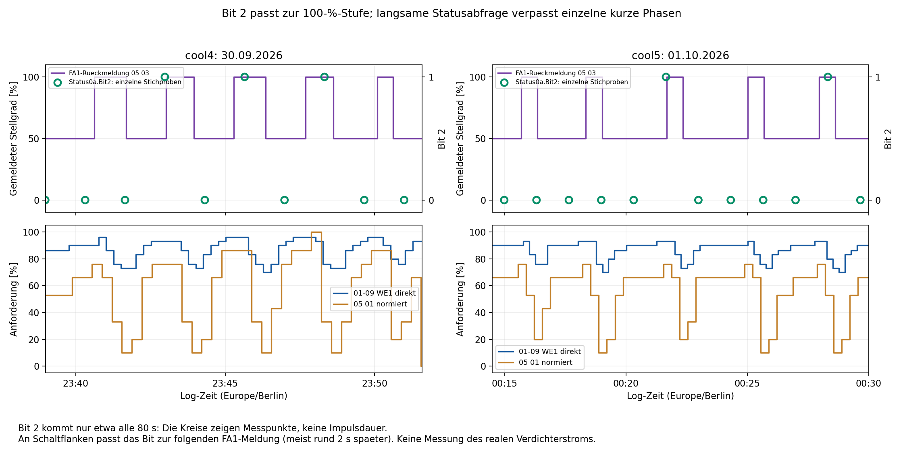

# Kühlversuch cool5 und Bedeutung von Status0a.Bit2

Quelle: `ebusd.cool5.log`, 01.10.2026, 00:09:24.020–00:32:15.627.
Vergleich mit `cool4`, `cool3`, `cooltest` und `cool`. Zeiten sind Log-Zeiten
(Europe/Berlin). Ausschließlich Offline-Auswertung; keine Anlagenparameter geändert.

## Ergebnis

**Status0a.Bit2 ist sehr wahrscheinlich ein Status der zweiten Leistungsstufe
bzw. ihrer Freigabe.** In sämtlichen 376 Status-Stichproben der fünf
Kühlmitschnitte gilt: Bit 2 ist genau dann gesetzt, wenn die unmittelbar
folgende FA1-Rückmeldung 100 % meldet. Bei 0 oder 50 % ist es gelöscht.
Das ist eine aus den Logs abgeleitete Bedeutung, keine offizielle TEM-Feldbeschreibung.

Die Zuordnung ist stärker als die bloße Ähnlichkeit zweier Kurven: An neun
Stichproben nahe Schaltflanken unterscheidet sich das Bit von der vorherigen
FA1-Stufe und passt bereits zur folgenden. Trotzdem belegt es weder den
realen Verdichterlauf noch unmittelbar den elektrischen Zustand von TEM 26.



## Welches Bit wird betrachtet?

Das lokale Modell `Status0a` dekodiert den Broadcast `10 FE 10 0A` mit
Selektor **11 00**. Nach dem Selektor folgen zwei Temperaturbytes und dann
das erste Statusbyte. Dessen Maske **0x04** ist `Bit2`:

```text
11 00 | Temperatur (2 Bytes) | Statusbyte A | Statusbyte B | ...
                                   ^ Bit 2, Maske 04
```

Damit ist es Nutzdatenbyte 4 bei nullbasierter Zählung einschließlich Selektor.
Beispiel: `8a` = `10001010`, `8e` = `10001110`; allein Bit 2 wechselt.
Es ist nicht Bit 2 des nachfolgenden Statusbytes (`Bit10` im Modell).

## Vergleich über alle Kühlmitschnitte

Für jede gültige Status-Stichprobe wurde die zeitlich folgende CRC-gültige
FA1-Rückmeldung `03 → 10 / 05 03` verwendet. Größter Abstand über alle
Mitschnitte: 4,797 s; in den relevanten Kurzzyklen meist etwa 2 s.

| Mitschnitt | Status-Stichproben | Bit 2 = 1, folgende FA1-Stufe 100 % | Bit 2 = 0, folgende FA1-Stufe 0/50 % | Widersprüche |
|---|---:|---:|---:|---:|
| cool | 249 | 32 | 217 | 0 |
| cooltest | 18 | 12 | 6 | 0 |
| cool3 | 72 | 43 | 29 | 0 |
| cool4 | 20 | 3 | 17 | 0 |
| cool5 | 17 | 2 | 15 | 0 |
| Gesamt | 376 | 92 | 284 | 0 |

Beispiele für den zeitlichen Versatz:

| Log | Status-Stichprobe | Bit 2 | Vorherige FA1-Stufe | Folgende FA1-Meldung |
|---|---|---:|---:|---|
| cool4 | 23:41:39.038, Zeile 1179 | 0 | 100 % | 50 % um 23:41:41.158, Zeile 1182 |
| cool4 | 23:42:59.038, Zeile 1288 | 1 | 50 % | 100 % um 23:43:01.226, Zeile 1295 |
| cool5 | 00:16:19.041, Zeile 478 | 0 | 100 % | 50 % um 00:16:21.300, Zeile 482 |
| cool5 | 00:21:39.045, Zeile 918 | 1 | 50 % | 100 % um 00:21:41.165, Zeile 921 |
| cool5 | 00:25:39.246, Zeile 1254 | 0 | 100 % | 50 % um 00:25:41.183, Zeile 1256 |

Dies passt zu einem reglerseitigen Stufen-/Freigabestatus, der vor der
folgenden FA1-Rückmeldung veröffentlicht wird. Der Versatz beweist keine
feste interne Verzögerung zwischen Steuerbefehl und physischem Schalten.
Ein vorläufiger beschreibender Name wäre **„zweite Leistungsstufe aktiv“**;
der vorhandene Name `Bit2` bleibt erhalten, ergänzt um den Befund im Kommentar.

Die naheliegende Erweiterung „Bit 1 = erste Stufe läuft“ ist nicht ebenso
sicher: In `cooltest` ist Bit 1 in fünf Stichproben bereits gesetzt, obwohl
FA1 noch 0 % meldet. Solche Unterschiede sind mit Freigabe-/Anlaufzuständen
vereinbar, verhindern aber eine ungeprüfte Gleichsetzung beider Bits mit
laufenden Verdichtern.

## Warum das Muster in Grafana täuschen kann

`Status0a` kommt ungefähr alle **80 Sekunden**, FA1-Rückmeldungen etwa alle
acht Sekunden. In `cool5` dauern die fünf 100-%-Phasen jeweils nur etwa
**40 Sekunden**. Drei davon werden deshalb von keiner gesetzten Bit-Stichprobe
erfasst; nur die dritte und fünfte Phase enthalten einen beobachteten Wert 1.

Ein Dashboard, das den letzten Bitwert fortschreibt, kann aus einem einzigen
Wert 1 einen etwa 80 Sekunden langen Balken machen und andere reale Busphasen
vollständig auslassen. Auch lineare Verbindung stellt keine gemessene
Einschaltdauer dar. Im Vergleichsdiagramm wird Bit 2 deshalb nur als einzelne
Messpunkte gezeigt. Zur Ermittlung der Phasendauern dient die häufigere
FA1-Rückmeldung; sie bleibt ihrerseits eine Busmeldung.

## Warum Bit 2 kein Verdichter-Laufnachweis ist

Im früheren Versuch `cool3` zeigt das nachgereichte Stromdiagramm während
Warmwasser eine mit dem Soleverdichter vereinbare Pause etwa 15:21–15:33.
In allen **neun** Status0a-Stichproben in diesem Fenster ist Bit 2 weiterhin
1; FA1 meldet ebenfalls weiter 100 %. Die Einordnung des Stromsprungs wird
durch den damaligen Rücklaufanstieg gestützt, ist aber keine Schützmessung.

Damit kann Bit 2 eine interne Stufenfreigabe bzw. einen zusammengefassten
Wärmeerzeugerzustand anzeigen, während eine nachgelagerte Kette den Soleverdichter
unterbricht. Für eine Zuordnung zu einem bestimmten Relaisausgang fehlen
weiterhin synchrone elektrische Beobachtungen. Der Bitverlauf allein belegt
auch keine Hysterese- oder Schutzfunktion.

## Verändertes Schaltmuster in cool5

| FA1 100 % ab | FA1 zurück auf 50 % | Dauer | Letzte normierte Anforderung davor | Belegzeilen an/aus |
|---|---|---:|---:|---|
| 00:15:41.177 | 00:16:21.300 | 40,1 s | 20 % | 426 / 482 |
| 00:18:21.163 | 00:19:01.288 | 40,1 s | 10 % | 649 / 700 |
| 00:21:41.165 | 00:22:21.197 | 40,0 s | 20 % | 921 / 980 |
| 00:25:01.355 | 00:25:41.183 | 39,8 s | 10 % | 1207 / 1256 |
| 00:27:57.243 | 00:28:37.185 | 39,9 s | 10 % | 1443 / 1499 |

Die vier vollständigen Zwischenpausen betragen **119,9 / 159,9 / 160,2 /
136,1 s**, gegenüber etwa 80–88 s in `cool4`. Dort dauerten die
100-%-Phasen 32–64 s. Das neue Muster ist also gleichmäßiger und hat längere
Pausen, enthält aber weiterhin kurze Schaltphasen. Fünf ähnliche Dauern
belegen noch keinen eigens eingestellten 40-Sekunden-Timer.

Die gemeinsame Anforderung steigt vor den Zuschaltungen an und fällt vor
allen Rückschaltungen erneut auf normiert 10/20 %. Direkte 01-09-WE1-Abfragen
stützen den Verlauf. HK2 meldet weiterhin positive Stellimpulse und keinen
negativen Befehl. Sein Istwert liegt bei 21,8–21,9 °C. Die zeitnahen
Vergleiche mit `Status1b.tr` stimmen in allen 14 Paaren exakt überein
(maximal 6,738 s Abstand). Drei frühere Broadcasts liegen vor Beginn der
direkten Abfragen und werden nicht als zeitnahe Bestätigung gezählt.

Der Anlagen-Sollwert **01-96 beträgt nun 21 °C**, gegenüber 20 °C während
der Kurzzyklen in `cool4`. WP-Soll 01-07 bleibt 19 °C. Der geänderte
Anlagen-Sollwert ist eine plausible Mitursache für kürzere Kühlphasen und
längere Erholung der Anforderung; eine isolierte kausale Wirkung allein des
Kühlgrenzabstands lässt sich aus zwei Versuchen nicht bestimmen.

## Bedienquelle und noch offene HK-Zuordnung

Der Betreiber berichtet, den kleinen Kühlgrenzabstand nur für HK1 gesetzt
zu haben, und bestätigt auf Nachfrage **Bedienung über FB1**, vermutlich
Adresse 90. Die Adresse und die beiden tatsächlich wirksamen Parameterwerte
sind damit nicht zurückgelesen. Im lokalen Modell ist Remote1 zwar an 90
definiert; das allein bestätigt keine vollständige Zuordnung von physischer
Bedieneinheit, internem HK-Kontext und allen Broadcast-Feldern.

Im Mitschnitt gilt durchgehend:

- Drittes Temperaturwort in **10 02**: **0 °C**, bisher HK1-Soll zugeordnet.
- Drittes Temperaturwort in **10 03**: **21 °C**, bisher HK2-Soll zugeordnet.
- Direkte 01-96-Abfrage: **21 °C** in beiden abgefragten Kontexten.

Das passt nicht unmittelbar zu „allein HK1 fordert Kühlung an“ unter den
bisherigen Feldzuordnungen. Deshalb werden weder die Betreiberangabe noch
die Feldnamen stillschweigend umgedreht. Für die Auflösung wären direkte
Rücklesungen von **03-35 HK1/HK2** (FB-Bediennummer 03-05) und
**01-02 HK1/HK2** sowie deren Vergleich mit 10 02/10 03 sinnvoll.
Die sichere Bit-2-/FA1-Korrelation hängt von dieser noch offenen HK-Zuordnung
nicht ab.

## Datenqualität und Dateien

1800 Zeilen, 1781 vollständige CRC-gültige Mastertelegramme. 19 kurze
Fragmente ausgeschlossen; zusätzlich 19 gültige Mastertelegramme mit
unvollständiger/ungewöhnlicher Antwort, deren Antworten nicht verwendet werden.
845 Transaktionen mit gültiger Antwort-CRC und Quittierung.

Die direkten Diagnoseabfragen beginnen erst etwa 00:13:15. Die erste
01-09-WE1-Abfrage um 00:13:16.255 liefert `ff1f`. Nach quittierter
Expert-Freigabe um 00:13:30.460 folgen 75 gültige WE1-Antworten; weitere
Freigaben sind um 00:16, 00:20, 00:24, 00:28 und 00:32 quittiert.
Der einzelne ungültige Beginn wird nicht als Nullwert interpretiert.

Alle 172 FA1- und 172 FA2-Rückmeldungen haben Statusnummer 0. Alle 46
Fehlergerät/-code-Paare sind 0/0. Keine neue elektrische Leistungsreihe liegt vor.

[Bitvergleich über fünf Mitschnitte](../cooling5-output/bit2-comparison.csv),
[Buswerte](../cooling5-output/bus-values.csv),
[direkte Parameter](../cooling5-output/parameter-values.csv),
[Schaltflanken](../cooling5-output/edges.json),
[Datenqualität](../cooling5-output/bus-summary.json),
[Diagramm als SVG](../cooling5-output/bit2-comparison.svg).

SHA-256: `ce73f87f12aa53f368d2a9dd0d2f5fc47b9bbc6c7abe30341b6185c47a05465f`
