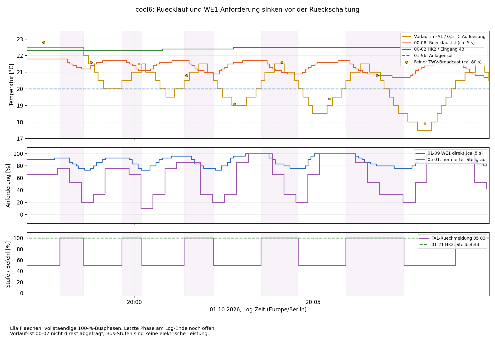
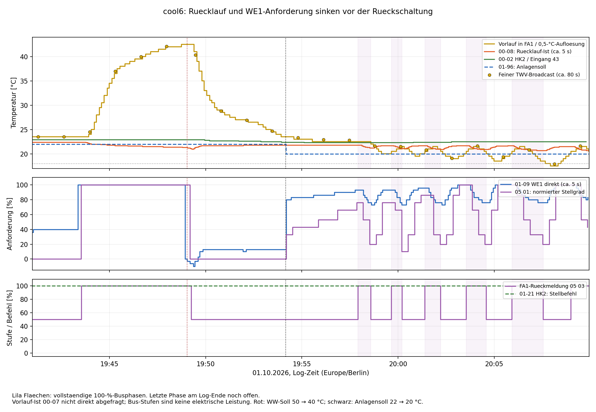

# Kühlversuch cool6: Rücklaufabfragen im Fünfsekundentakt

Quelle: `ebusd.cool6.log`, 01.10.2026, 18:40:30.955–20:09:56.296
(Europe/Berlin), sowie das im Gespräch angehängte Grafana-Diagramm.
Ausschließlich Offline-Auswertung; keine Anlagenänderungen.

## Ergebnis

**Die neuen Rücklaufabfragen stützen die gemeinsame Leistungs-/Stufenregelung
als unmittelbaren Auslöser der Rückschaltungen.** Vor jeder vollständigen
kurzen Rückschaltung sinken Rücklauf und direkte WE1-Anforderung. HK2 meldet
dabei durchgehend +100. Die ersten vier Abschaltungen erfolgen bei gemeldeten
Vorlauftemperaturen von 22 bis 20 °C. Eine feste 18-°C-Vorlaufgrenze erklärt
sie damit nicht ohne zusätzliche, bisher unbelegte Annahmen.

In der fünften Phase meldet FA1 die Rückschaltung bei 18,5 °C. Erst danach
werden Vorlaufwerte unter 18 °C übertragen. Ein Temperaturminimum nach dem
Strom-/Stufenabfall darf deshalb nicht ohne Prüfung als Abschaltauslöser
interpretiert werden. Sensorträgheit, Transport- und Aktualisierungszeiten
bleiben als Grenzen dieser zeitlichen Zuordnung bestehen.

Es gibt zudem eine bestätigte Bedienänderung zwischen Warmwasserende und
Beginn der Oszillation: Gegen **19:54 Uhr wurde die Kühltemperatur abgesenkt**.
Das ist ein zusätzlicher Einfluss neben dem Ende der Warmwasserbereitung.



## Welche zusätzlichen Werte tatsächlich vorliegen

| Messwert | Gültige direkte Antworten | Typischer Abstand | Bedeutung |
|---|---:|---:|---|
| 00-08, Selektor 08 05 | 1060 | 4,984 s | Rücklauf-Ist, Eingang 48 |
| 00-08, Selektor 08 85 10 00 | 1064 | etwa 5 s | Zweite Abfragevariante des Rücklaufwerts |
| 00-02 HK2 | 1044 | 5,000 s | Temperatur Eingang 43 |
| 01-09 WE1 | 1056 | 4,998 s | Direkte Leistungsanforderung |
| 01-21 HK2 | 1064 | etwa 5 s | Stellbefehl |
| **00-07 WP** | **0** | — | **Vorlauf-Ist wurde nicht direkt abgefragt** |

Statt 00-07 wird weiterhin **01-07, der Sollwert**, gelesen. Dieser beträgt
ab 18:46:35.882 19 °C. Die direkte TWV-Istwertabfrage wäre im aktuellen
Projekt `P00_07_WP`, Selektor `08 04`; MQTT bei Standardpräfix:

```text
Topic:   ebusd/15/P00_07_WP/get
Payload: leer
```

Es ist ein Leseaufruf, hier nicht ausgeführt. Bei einer weiteren Messung
kann eine doppelte Abfrage derselben Temperatur zugunsten dieses fehlenden
Istwerts entfallen. Auch eine häufige Abfrage garantiert keine ebenso
schnelle interne Aktualisierung.

Vorlauf liegt im vorhandenen Log als FA1-Temperatur ungefähr alle acht
Sekunden mit 0,5-°C-Auflösung vor, als feiner TWV-Broadcast ungefähr alle
80 Sekunden. Diese Quellen sind getrennt dargestellt. Der direkte Rücklauf
bestätigt das bisherige 08-01-Feld: 177 zeitnahe Paare unterscheiden sich
um höchstens 0,1 K bei höchstens 3,686 s Abstand. HK2 stimmt in allen 67
zeitnahen Paaren mit `Status1b.tr` überein (höchstens 1,612 s Abstand).

## Ablauf und Bedienänderungen

| Ereignis | Erste beobachtete Log-Zeit | Zeile |
|---|---|---:|
| Anlagensoll 01-96 erreicht 22 °C | 18:44:25.584 | 669 |
| FA1 meldet 50 % | 18:47:08.396 | 1178 |
| Beginn der 100-%-Phase während Warmwasser | 19:43:32.809 | 11714 |
| Warmwasserbit 11 00 erstmals aktiv | 19:43:57.293 | 11793 |
| Direkte WE1-Anforderung erstmals 0 statt 100 % | 19:48:56.220 | 12737 |
| Warmwassersoll in 08 02 erstmals 40 statt 50 °C | 19:49:02.440 | 12756 |
| FA1 zurück auf 50 %, Vorlaufmeldung 42,5 °C | 19:49:15.344 | 12790 |
| Warmwasserbit 11 00 erstmals wieder aus | 19:53:27.117 | 13590 |
| Anlagensoll 01-96 erstmals 20 statt 22 °C | 19:54:10.570 | 13725 |
| HK2-Soll in 10 03 erstmals 20,5 statt 22 °C | 19:54:17.861 | 13752 |
| Beginn der ersten kurzen 100-%-Phase | 19:57:55.256 | 14427 |

Der Betreiber bestätigt das Beenden der Warmwasserbereitung durch Absenken
der Zieltemperatur und auf Nachfrage die zusätzliche Kühltemperaturänderung
gegen 19:54. Die Tabelle nennt erste übertragene Werte, nicht sekundengenaue
Bedienzeitpunkte. Das spätere Löschen des Warmwasserbits ist wegen der
80-s-Abtastung kein genauer Pumpen-Nachlaufnachweis.

Während der anschließenden Kurzzyklen bleiben Anlagensoll 20 °C, WP-Soll
19 °C und HK2-Soll 20,5 °C konstant. Der bisher HK1 zugeordnete Sollwert
in 10 02 bleibt im gesamten Log 0 °C. Eine umfassende physische HK-/FB-Zuordnung
folgt daraus weiterhin nicht.



## Fünf vollständige kurze Phasen und eine offene Phase

Die Zeiten beziehen sich auf die erste beobachtete FA1-Rückmeldung, nicht
auf direkt erfasste Schützkontakte. Rücklauf und WE1 sind jeweils die letzte
direkte Abfrage davor, höchstens 3,374 bzw. 3,874 s alt. Vorlauf stammt aus
derselben FA1-Rückmeldung wie die Rückschaltung.

| 100 % ab | Zurück auf 50 % | Dauer | Vorlauf | Rücklauf davor | WE1 direkt davor | Normierte Anforderung davor |
|---|---|---:|---:|---:|---:|---:|
| 19:57:55.256 | 19:58:35.257 | 40,0 s | 22,0 °C | 21,2 °C | 76 % | 20 % |
| 19:59:39.371 | 20:00:12.820 | 33,4 s | 21,5 °C | 21,1 °C | 73 % | 10 % |
| 20:01:23.747 | 20:02:12.822 | 49,1 s | 20,5 °C | 20,9 °C | 76 % | 20 % |
| 20:03:32.827 | 20:04:35.261 | 62,4 s | 20,0 °C | 20,9 °C | 76 % | 20 % |
| 20:05:55.282 | 20:07:32.825 | 97,5 s | 18,5 °C | 20,7 °C | 76 % | 20 % |

Rückschaltzeilen: 14548, 14859, 15230, 15677, 16242.
Die vollständigen Zwischenpausen betragen 64,1 / 70,9 / 80,0 / 80,0 s.
Eine sechste 100-%-Phase beginnt **20:08:59.252** (Zeile 16505) und ist
bei der letzten FA1-Meldung **20:09:55.264** noch aktiv: mindestens 56,0 s
bis zu dieser Stichprobe. Der Screenshot reicht über das Rohlog hinaus;
spätere Flanken darin sind nicht als vollständige Log-Zyklen gezählt.

## Reihenfolge statt alleiniger Temperaturschwelle

**Erste Phase:** Bis 19:58:06.992 beträgt WE1 direkt 93 %. Danach werden
86, 83, 80 und 76 % gelesen. Währenddessen sinkt der direkte Rücklauf von
21,8 auf 21,2 °C. Um 19:58:35.257 folgt die Rückschaltung bei noch 22 °C
Vorlaufmeldung. Damit ist eine gemeinsame Anforderungsrücknahme bei deutlich
wärmerem Vorlauf als 18 °C unmittelbar beobachtet.

**Fünfte Phase:**

| Zeit | FA1-Stufe | Grober Vorlaufwert | Einordnung |
|---|---:|---:|---|
| 20:07:23.747 | 100 % | 18,5 °C | WE1 direkt bereits 76 % |
| 20:07:32.825 | 50 % | 18,5 °C | Rückschaltung |
| 20:07:39.341 | 50 % | 18,0 °C | Weiter sinkender gemeldeter Vorlauf |
| 20:07:55.247 | 50 % | 17,5 °C | Niedriger Wert erst nach der Rückschaltung |
| 20:08:07.905 | — | TWV-Broadcast 17,9 °C | Feinere Bestätigung; FA1 bleibt in dieser Phase bei 50 % |

Es gibt kein belegtes einheitliches Vorlauf-Schaltniveau für alle Phasen.
Die WE1-Werte an der Rückschaltung bleiben hingegen nahe 73–76 %, normiert
10–20 %. Das stärkt die Hypothese einer Stufenschaltung aus der gemeinsamen
Anforderung. Der genaue Regelalgorithmus, die Gewichtung von Vor-/Rücklauf
und die Ursache der schnellen Änderung sind damit noch nicht bewiesen.
Eine zusätzliche TWV-Untergrenze kann existieren; sie wird hier nicht als
alleiniger oder nachgewiesener Auslöser bestätigt.

HK2 steht bereits ab 18:44:22.107 durchgehend auf **+100**; vorher gab es
0 und −100. In den Kurzzyklen ab 19:57 liegen 155 positive Stellbefehle vor,
kein negativer und kein Nullwert. Der HK2-Istwert liegt zugleich bei
22,3–22,5 °C. Der im Log sichtbare HK2-Stellbefehl nimmt die Kühlung also
nicht zurück. Seine elektrische Umsetzung und die weitere KT15/K3-Freigabekette
sind nicht direkt gemessen.

## Abgleich mit dem Stromdiagramm

Das vom Betreiber angehängte Grafana-Diagramm zeigt einen deutlichen
Leistungsanstieg mit Warmwasser um 19:43, den Abfall nach dessen Beendigung
und kurze Leistungsblöcke ab etwa 19:58. Diese Abfolge passt zur Busauswertung.
Es handelt sich um Gesamtverbrauch der Wohnung; genaue Verdichterleistung
und sekundengenaue Schaltzeiten werden daraus nicht abgeleitet.

Die gelbe Temperaturkurve im Screenshot zeigt teilweise besonders niedrige
Werte nach einer elektrischen Abschaltung. Der Rohlogvergleich oben erklärt,
warum diese Minima zeitlich vom Abschaltauslöser getrennt werden müssen.
Es bleibt offen, welcher Anteil auf reales Nachkühlen/Transport und welcher
auf Fühler- bzw. Übertragungsverzögerungen entfällt.

## Zusatzbefunde zu den Dekodierungen

### Zusatzbyte 5 kann vorzeichenbehaftet sein

Bei der Rücknahme nach Warmwasser meldet die direkte WE1-Abfrage auch
**−3, −6 und −10 %**. Diese liegen innerhalb der übertragenen Wertebegrenzungen;
sie sind nicht mit dem früheren Sonderwert −127 % gleichzusetzen.

Um 19:49:11.141 enthält das Zusatzbyte 5 in 05 01 **fa**, als vorzeichenloser
Wert 250, als vorzeichenbehaftetes Byte **−6**. Um 19:49:11.409 bestätigt
die direkte Abfrage −6 % (Zeile 12781). Eine weitere passive Stichprobe hat
`fd` = −3. Das stützt die vorzeichenbehaftete Interpretation dieses Zusatzbytes.
Seine genaue interne Semantik bleibt abgeleitet; es ist kein Wert von 250 %.

Mit vorzeichenbehaftetem B gilt in allen **269** passiven Telegrammen weiterhin:

`S ≈ max(0, (B − 70) / 30 × 100)`

Größte Abweichung: 0,667 Prozentpunkte. Der Export enthält sowohl das rohe
unsigned Byte als auch `FA1_extra_byte5_signed`; bestehende Telegrammdefinitionen
wurden nicht verändert.

### Bit 2: die bisherige zeitliche Faustregel hat eine Ausnahme

66 von 67 Status0a-Stichproben stimmen mit „nächste FA1-Stufe = 100 %“ überein.
Um **20:00:07.153** ist Bit 2 noch 1 (Zeile 14843); die folgende FA1-Meldung
5,667 s später meldet bereits 50 %. Das Bit passt dort zur vorherigen
100-%-Phase. Der bisherige Befund aus fünf Logs war korrekt, darf aber nicht
als zeitlich universelle Regel oder garantierte Vorankündigung interpretiert
werden. Die Zuordnung zum Stufenstatus bleibt plausibel; ein physischer
Verdichterlauf folgt weiterhin nicht daraus.

## Datenqualität und Dateien

16.680 Zeilen, 16.010 vollständige Mastertelegramme mit gültiger CRC.
670 kurze Fragmente ausgeschlossen; zusätzlich 1917 vollständige Mastertelegramme
mit unvollständiger/ungewöhnlicher Antwort. Diese Antworten werden nicht
als Messwerte verwendet. Viele Leseversuche erscheinen kurz darauf erneut;
die Ursache der Fragmente bzw. Wiederholungen ist aus dieser Auswertung
nicht bestimmt. 10.514 Transaktionen besitzen gültige Antwort-CRC und ACK.

Keine gültige Parameterantwort trägt `ff1f`. 23 Expert-Freigabeschreibungen
`00 00 51 00` sind im Log erfasst. FA1 und FA2 melden in jeweils 671
Rückmeldungen Statusnummer 0; alle 179 Fehlergerät/-code-Paare sind 0/0.
Das schließt nicht jede interne Begrenzung aus.

[Buswerte](../cooling6-output/bus-values.csv),
[Parameterantworten](../cooling6-output/parameter-values.csv),
[Zyklentabelle](../cooling6-output/cycles.csv),
[Schaltflanken mit vorausgehenden Werten](../cooling6-output/edges.json),
[Datenqualität](../cooling6-output/bus-summary.json).

SHA-256: `ed83b0fb4191fd388e70f522dcc6a47974c1960bce79a66f68494b32f9492620`
