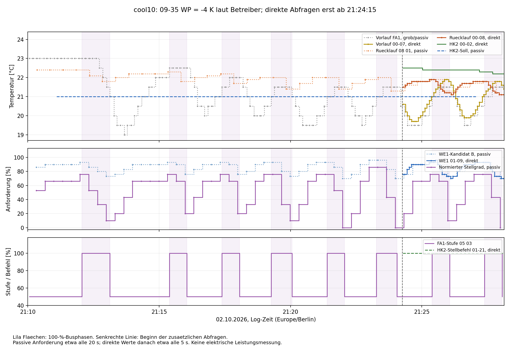
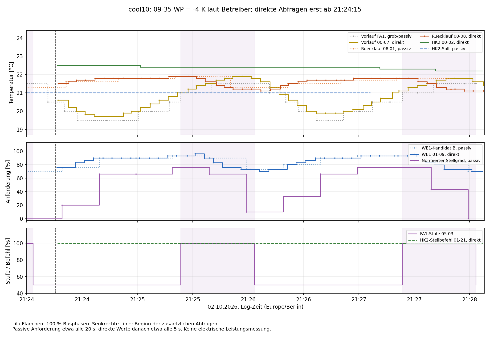

# Kühlversuch cool10: 09-35 WP auf −4 K

Quelle: `ebusd.cool10.log`, 02.10.2026, 21:10:00.277–21:28:07.768
(Europe/Berlin). Offline-Auswertung, keine Anlagenänderungen ausgeführt.
09-35 WP = −4 K laut Betreiber; die Einstellung wurde im Mitschnitt nicht
neu gelesen oder als Schreibzugriff erfasst.

## Ergebnis

**Auch −4 K beseitigt das kurze Takten nicht.** Acht vollständige
100-%-Busphasen sind erfasst: zunächst **64,0 s**, danach überwiegend
**40,0 s**, zweimal **47,4 s**. Die erste lange Phase aus cool8 tritt nicht auf.

Die letzten passiven WE1-Anforderungswerte vor Zuschaltung liegen bei
**93–96 %**, vor Rücknahme bei **70–76 %**. Das ähnelt dem Muster bei −2 K
in cool9. Der spätere direkte Zugriff bestätigt in zwei vollständigen Phasen:
Zuschaltung jeweils bei zuletzt 93 %, Rücknahme bei 73 bzw. 70 %.

Die direkten Vorlaufwerte unmittelbar vor diesen beiden Rücknahmen betragen
**21,8 und 21,6 °C**. Eine unmittelbar wirksame feste 18-°C-Untergrenze an
diesem Messwert erklärt auch diese Vorgänge nicht. Die Zuordnung der kurzen
Phasen zu fallender gemeinsamer Anforderung bleibt deutlich plausibler als
ein ausschließliches Abschalten an einer festen unteren Vorlauftemperatur.
Die interne Reglergleichung ist dadurch nicht bewiesen.

## Was trotz des späten Messbeginns auswertbar ist

Die zusätzlichen regelmäßigen Abfragen beginnen **21:24:15.539** mit 01-96.
Die erste gültige direkte WE1-Abfrage folgt um **21:24:16.379**, die erste
00-07-Messung um **21:24:16.882**. Bis dahin sind bereits **sechs vollständige
100-%-Phasen** aufgetreten. Danach werden zwei weitere vollständig erfasst.

Vorher stehen bereits passive Daten zur Verfügung:

| Größe | Quelle | Typischer Abstand |
|---|---|---:|
| FA1-Stufe und grober Vorlauf | 05 03 | etwa 8 s |
| Normierte Anforderung und WE1-Kandidat B | 05 01 | etwa 20 s |
| Rücklauf | 08 01 | etwa 30 s |
| Feiner Vorlauf | Status0b / 10 00 | etwa 80 s |

Die Zuordnung des Bytes B zur direkten WE1-Anforderung wurde in früheren
Versuchen gestützt. Hier wird B ausdrücklich als passiver Wert ausgewiesen,
nicht als rückwirkend vorhandene direkte 01-09-Abfrage.

**Der Beginn der zusätzlichen Fünfsekunden-Abfragen ist nicht der Auslöser
des Taktens:** Das gleiche Grundmuster besteht bereits vorher. Das schließt
nicht sämtliche Einflüsse vorhandener Buskommunikation aus; Expert-Freigaben
und andere Abfragen liefen bereits im frühen Abschnitt.

Die fehlenden direkten Vorlaufwerte werden weder interpoliert noch durch
bis zu 80 s alte Status0b-Werte als vermeintlich zeitgleiche Messung ersetzt.
Alle zeitlichen Abstände stehen in der [Zyklustabelle als CSV](../cooling10-output/cycles.csv).

## Schaltphasen

Die folgende Tabelle verwendet für alle acht Phasen dieselbe passive Quelle
für die Anforderung. Angegeben sind jeweils die letzten Werte vor der ersten
beobachteten Stufenmeldung. Vor Rücknahme sind diese Anforderungswerte
4,235–8,250 s alt. Die Zeitauflösung erlaubt keine Behauptung einer exakt
40 s langen Verdichterlaufzeit oder eines entsprechend gesetzten Zeitparameters.

| Nr. | 100 % ab | Zurück auf 50 % | Busdauer [s] | Passiver WE1-Kandidat bei Ein → Aus [%] | Normierte Anforderung vor Aus [%] | Direkte Werte für ganze Phase vorhanden |
|---|---|---|---:|---:|---:|---|
| 1 | 21:12:03 | 21:13:07 | 64.0 | 93 → 73 | 10 | nein |
| 2 | 21:15:23 | 21:16:03 | 40.0 | 93 → 76 | 20 | nein |
| 3 | 21:17:23 | 21:18:03 | 40.0 | 93 → 76 | 20 | nein |
| 4 | 21:19:16 | 21:20:03 | 47.4 | 93 → 73 | 10 | nein |
| 5 | 21:21:23 | 21:22:03 | 40.0 | 93 → 70 | 0 | nein |
| 6 | 21:23:15 | 21:24:03 | 47.4 | 96 → 70 | 0 | nein |
| 7 | 21:25:23 | 21:26:03 | 40.0 | 93 → 73 | 10 | ja |
| 8 | 21:27:23 | 21:28:03 | 40.0 | 93 → 70 | 0 | ja |

Belegzeilen der Rücknahmen: **172, 328, 433, 548, 658, 768, 1120, 1501**.
Vor Zuschaltung liegt die normierte Anforderung siebenmal bei 76 % und einmal
bei 86 %. Vor Rücknahme beträgt sie 0–20 %. In allen 54
Anforderungstelegrammen gilt weiterhin näherungsweise
`S = max(0, (B − 70) / 30 × 100)`, mit höchstens 0,667 Prozentpunkten Abweichung.

Das bestätigt unterschiedliche Anforderungsbereiche bei Ein- und Rückschaltung.
Es beweist keine exakten internen Schaltschwellen: Abtastung, Verzögerungen und
weitere Freigaben können die beobachteten Werte beeinflussen. Die Rücknahme
von FA1 auf 50 % wird hier als Buszustand bezeichnet; für cool10 liegt keine
zusätzliche elektrische Leistungsmessung vor.

## Die beiden direkt erfassten Phasen

| Beginn | Rücknahme | Vorlauf vor Rücknahme | Rücklauf bei Ein → Aus | WE1 direkt bei Ein → Aus | Kleinster direkter Vorlauf während der 100-%-Phase |
|---|---|---:|---:|---:|---:|
| 21:25:23.397 | 21:26:03.398 | 21,8 °C | 21,9 → 21,2 °C | 93 → 73 % | 21,2 °C |
| 21:27:23.383 | 21:28:03.415 | 21,6 °C | 21,8 → 21,1 °C | 93 → 70 % | 21,3 °C |

Es gibt jeweils acht direkte Vorlaufmessungen innerhalb der Phase.
Die letzten Vorlaufwerte vor Rücknahme sind 1,780 bzw. 1,687 s alt.

Im ersten dieser beiden Zyklen steigt der Vorlauf nach Zuschaltung zunächst
von 21,2 auf **21,9 °C**, während Rücklauf und WE1-Anforderung bereits fallen.
Das ist erneut kein Verlauf, bei dem der Verdichter wegen eines bereits
zu kalten, unmittelbar reagierenden Vorlaufs ausgeschaltet würde.

Nach der Rücknahme um 21:26:03 fällt der Vorlauf weiter und erreicht erstmals
um **21:26:36.884** sein Pausenminimum von **19,9 °C**: **33,5 s später**.
Der Rücklauf steigt in dieser Pause dagegen schon wieder. Transportzeit,
thermische Einbindung und Messwertverarbeitung bleiben mögliche Ursachen
dieser unterschiedlichen zeitlichen Verläufe; der Mitschnitt trennt sie nicht.
Die letzte Pause endet mit dem Log nach wenigen Sekunden und ist unvollständig.

Im gesamten spät direkt erfassten Abschnitt beträgt das Vorlaufminimum
19,7 °C. Die früheren passiven Vorlaufstichproben liegen ebenfalls oberhalb
18 °C (FA1 grob mindestens 19,0 °C; Status0b mindestens 19,9 °C).
Für den frühen Abschnitt besteht jedoch keine lückenlose direkte Messreihe;
kurze Zwischenverläufe dürfen daraus nicht ausgeschlossen werden.

## Bedeutung des Vergleichs −2 / −3 / −4 K

- **−2 K, cool9:** sechs vollständige Phasen von etwa 40 s; direkte WE1-Werte
  vor Ein/Aus jeweils 93/73 %.
- **−4 K, cool10:** acht Phasen von etwa 40–64 s; ähnlich niedrige Anforderung
  vor den Rücknahmen, in den beiden direkt beobachteten Phasen 73 bzw. 70 %.
- **−3 K, cool8:** zunächst 12 min 48,6 s bei anfangs gesättigter Anforderung,
  später ebenfalls kurze Phasen und Rücknahmen bei WE1 = 73–76 %.

**Eine erkennbare Beruhigung durch −4 K oder eine einfache, mit 09-35
mitwandernde Abschalttemperatur zeigt dieser Versuch nicht.** Die Änderung
von −2 auf −4 K verschiebt das Problem also nicht sichtbar in einen stabilen
Betrieb. Das ist kein Nachweis, dass 09-35 wirkungslos oder falsch umgesetzt ist:
Eine weitere Anforderungs-/Freigabebedingung kann vorher begrenzend wirken.

Die früher diskutierte erste Abschaltung nahe 17,5 °C bei noch 90 % WE1 in
cool8 lässt sich damit weiterhin nicht gezielt vergleichen. Eine entsprechende
lange Phase mit hoher Anforderung fehlt in cool9 und cool10; Ausgangstemperaturen
und gespeicherter Reglerzustand unterscheiden sich. Die Parameterwerte −2/−4 K
stammen außerdem aus der Betreiberangabe, nicht aus Rücklesungen in diesen Logs.

Für die kurzen Phasen ist die gemeinsame Anforderungsbildung der nächste
sinnvolle Ansatz: Bei den zwei direkten Zyklen fällt der Rücklauf jeweils
um 0,7 K, während WE1 um 20 bzw. 23 Prozentpunkte fällt. Das ist größenordnungsmäßig
mit der zuvor diskutierten Empfindlichkeit von 06-10 = 3 K vereinbar, aber
keine alleinige Identifikation der internen Reglerfunktion oder ihres Fühlers.

## Nächster Vergleich

**09-35 WP auf die Ausgangseinstellung −3 K zurückstellen**, Ausgangswerte
möglichst mit im Log zurücklesen und einen kurzen Vergleich bei ähnlichen
Temperaturen erfassen. Anschließend **nur 06-10 von 3 auf 6 K ändern**.
07-14 bleibt in beiden Heizkreisen auf 2, 06-11 auf 20 min; Kühltemperaturen
und Kühlgrenzenabstände ebenfalls unverändert. Nach dem Vergleich 06-10 wieder
zurückstellen. Siehe [Parameter-Testplan](Cooling-Parameter-Testplan.md).

Zu prüfen ist, ob bei ähnlicher Rücklaufänderung die WE1-Anforderung weniger
stark abfällt und dadurch die höhere Stufe länger bestehen bleibt.
Eine Verbesserung ist nicht zugesichert; 06-10 wirkt global auch auf andere
Betriebsarten. Weitere Versuche mit immer negativerem 09-35 sind anhand dieser
Daten weniger gezielt als der Vergleich der Anforderungsempfindlichkeit.

## Betriebsbedingungen und Datenqualität

- Passive HK-Sollwerte in 10 02 und 10 03 jeweils konstant **21 °C**;
  08-02-Anlagentelegramm mit Sollwert **19 °C**.
- Ab Beginn der direkten Abfragen: 01-96 in beiden Kontexten **21 °C**,
  01-07 in beiden Varianten **19 °C**.
- Warmwassersoll konstant **50 °C**, Warmwasserbit in allen 14 Stichproben aus.
- HK2-Stellbefehl ab Messbeginn **46-mal +100**, passend zu 07-14 = 2;
  kein unabhängiger Beleg für eine temperaturabhängig berechnete HK2-Anforderung.
- 00-02 HK2 in den 45 direkten Abfragen: **22,5 → 22,2 °C**.
- Fünf erfasste 06-23-Schreibungen, ausschließlich Expert-Freigaben
  `00 00 51 00`. Keine Rücklesung von 09-35, 06-10, 06-11 oder 07-14.
- Status0a.Bit2 passt in allen **14** Stichproben zur folgenden FA1-Stufe.
  Die Abtastung von etwa 80 s erfasst die kurzen Phasen nicht vollständig.
- Je 136 FA1-/FA2-Statusnummern und alle 37 Fehlergerät/-code-Paare sind 0;
  FA2 meldet durchgehend Stufe 0. Nicht gemeldete interne Begrenzungen sind
  dadurch nicht ausgeschlossen.

1515 Logzeilen, 1475 vollständige CRC-gültige Mastertelegramme und 40
kurze ausgeschlossene Fragmente. 699 Transaktionen mit gültiger Antwort-CRC
und ACK. Bei 52 gültigen Mastertelegrammen ist die Antwort unvollständig oder
ungewöhnlich; solche Antworten wurden nicht zur Parameterdekodierung verwendet.
Keine `ff1f`-Antwort. 47 direkte Vorlaufwerte, Median-Abstand 5,001 s,
größter Abstand 6,609 s. Das Log beginnt bereits mit FA1 = 50 %;
der Anfang dieser Freigabephase liegt außerhalb des Mitschnitts.

[Buswerte](../cooling10-output/bus-values.csv),
[direkte Parameter](../cooling10-output/parameter-values.csv),
[Zyklen mit Quellen und Messwertalter](../cooling10-output/cycles.csv),
[Flanken](../cooling10-output/edges.json),
[Datenqualität](../cooling10-output/bus-summary.json),
[Gesamtdiagramm als SVG](../cooling10-output/overview.svg).

SHA-256 des Rohlogs:
`3622978a529edab078990afd091ad2639dfb813b2700ed7d7fbed10813061ac8`
