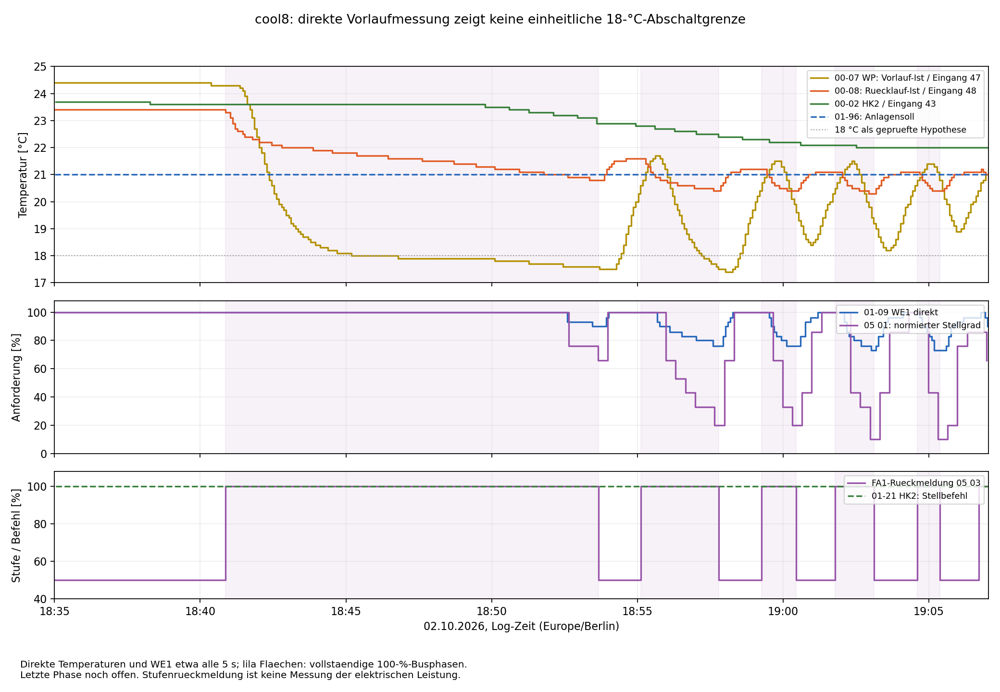
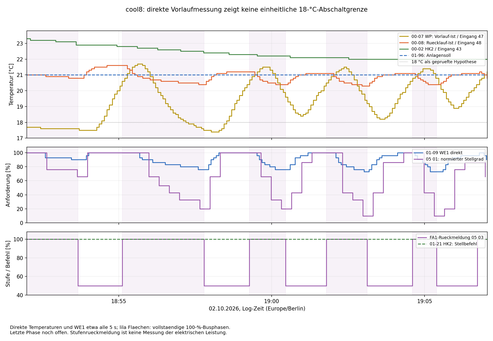

# Kühlversuch cool8: Vorlauf-Ist erstmals direkt im Fünfsekundentakt

Quelle: `ebusd.cool8.log`, 02.10.2026, 18:34:56.757–19:07:02.882
(Europe/Berlin), sowie das vom Betreiber im Gespräch angehängte Grafana-Diagramm.
Offline-Auswertung ohne Anlagenänderungen.

## Ergebnis

**00-07 ist jetzt enthalten: 386 gültige direkte Vorlaufmessungen.** Der
Median-Abstand beträgt 4,984 s, der größte Abstand 6,079 s. Die frühere
Messlücke zwischen Sollwert 01-07 und Istwert 00-07 ist damit geschlossen.

**Eine unmittelbar wirksame feste 18-°C-Grenze auf diesem Vorlaufwert wird
klar nicht bestätigt:** Während der ersten langen 100-%-Phase liegen
83 direkte Messungen bereits unter 18 °C. Von der ersten Unterschreitung
um 18:46:47.625 bis zur Rückschaltung um 18:53:40.238 vergehen 6 min 52,6 s.
Auch im Grafana-Diagramm bleibt der Verbrauch in diesem Abschnitt erhöht.

Später erfolgen drei Abschaltungen bei direkt gemessenen **19,6 / 19,2 /
20,8 °C**, ohne dass die gültigen Fünfsekunden-Stichproben innerhalb der
jeweiligen Laufphase zuvor unter 18 °C liegen. Damit erklären weder eine
feste 18-°C-Grenze noch der in der STE-Datei gespeicherte Wert 14 °C diese
Kurzzyklen allein. Eine zusätzliche, anders bedingte Vorlaufbegrenzung wird
dadurch nicht ausgeschlossen.

Die erste Rückschaltung unterscheidet sich allerdings von den späteren:
Sie erfolgt nahe 17,5–17,6 °C bei noch **90 % direkter WE1-Anforderung**
(normiert 66 %). Die späteren Rückschaltungen erfolgen bei **73–76 %**
(normiert 10–20 %). Das passt weiterhin zu mehreren möglichen Begrenzungen:
einer temperaturabhängigen Stufenlogik und der gemeinsamen Leistungsregelung.
Es ist kein Beweis, dass zwei bestimmte Firmwarefunktionen implementiert sind.

## Betriebsbedingungen

Im gesamten erfassten Zeitraum sind die Sollwerte konstant:

- 01-96 Anlagensoll: **21 °C**, beide abgefragten Kontexte.
- 01-07 WP-Soll: **19 °C**, beide abgefragten Varianten.
- Bisher HK1/HK2 zugeordnete Sollwerte in 10 02/10 03: jeweils **21 °C**.
- Warmwassersoll in 08 02: **50 °C**; Warmwasserbit 11 00 durchgehend aus.
- 01-21 HK2: **383-mal +100**, kein 0 und kein −100.

Im Mitschnitt gibt es acht Expert-Freigabeschreibungen `00 00 51 00`,
keine weiteren erfassten 06-23-Schreibungen. Eine neue Rücklesung der
Einstellparameter 09-32/09-35 oder 06-10/06-11 liegt nicht vor.
Das Log beginnt bereits mit FA1=50 %; der Beginn dieser Freigabephase liegt
vor dem Mitschnitt. Aus der Zeit bis zur ersten Zuschaltung lässt sich daher
keine neue Einschaltverzögerung bestimmen.

## Schaltphasen und direkte Temperaturen

Die Tabelle nennt erste beobachtete FA1-Stufenmeldungen. Vorlauf, Rücklauf
und direkte Anforderung sind die jeweils letzten gültigen Abfragen davor.
Die Vorlaufwerte sind dabei 0,515–3,420 s alt. Buszeiten bleiben von den
nur ungefähr ablesbaren elektrischen Flanken im Screenshot getrennt.

| 100 % ab | Zurück auf 50 % | Dauer | Vorlauf 00-07 davor | Rücklauf 00-08 davor | WE1 direkt davor | Normierte Anforderung davor |
|---|---|---:|---:|---:|---:|---:|
| 18:40:51.682 | 18:53:40.238 | 12 min 48,6 s | 17,6 °C | 20,8 °C | 90 % | 66 % |
| 18:55:07.290 | 18:57:47.288 | 2 min 40,0 s | 17,5 °C | 20,4 °C | 76 % | 20 % |
| 18:59:16.168 | 19:00:27.290 | 1 min 11,1 s | 19,6 °C | 20,4 °C | 76 % | 20 % |
| 19:01:47.295 | 19:03:07.307 | 1 min 20,0 s | 19,2 °C | 20,3 °C | 73 % | 10 % |
| 19:04:36.328 | 19:05:23.293 | 47,0 s | 20,8 °C | 20,4 °C | 73 % | 10 % |

Belegzeilen der Rückschaltungen: **3517, 4288, 4793, 5292, 5715**.
Die erneuten Zuschaltungen erfolgen nach dem ersten Lauf wiederholt bei
Vorlaufwerten um 20,4–20,6 °C in den letzten direkten Stichproben. Wegen der
Abtastung und möglicher anderer Freigaben ist das keine bewiesene exakte
Einschaltschwelle.

Eine sechste 100-%-Phase beginnt **19:06:43.283** (Zeile 5962) und ist in
der letzten FA1-Meldung um **19:07:00.295** noch aktiv. Ihre Dauer und ihr
Abschaltpunkt sind nicht vollständig aufgezeichnet.

## Die erste Phase widerlegt die einfache 18-°C-Erklärung

| Zeitpunkt | Direkter Vorlauf 00-07 | Status |
|---|---:|---|
| 18:45:11.608 | 18,0 °C | FA1 weiterhin 100 % |
| 18:46:47.625 | 17,9 °C | Erste direkte Messung unter 18 °C, Zeile 2214 |
| 18:50:06.580 | 17,8 °C | FA1 weiterhin 100 % |
| 18:51:16.770 | 17,7 °C | FA1 weiterhin 100 % |
| 18:52:26.785 | 17,6 °C | FA1 weiterhin 100 % |
| 18:53:36.818 | 17,6 °C | Letzte direkte Messung vor der Rückschaltung |
| 18:53:40.238 | — | FA1 erstmals 50 % |
| 18:53:42.568 | 17,5 °C | Erste direkte Messung nach der Rückschaltung |

Die WE1-Anforderung sinkt gegen Ende des langen Laufs von 100 auf 93 %
(ab 18:52:36.051) und auf 90 % (ab 18:53:27.067). Sie erreicht hier nicht
die 73–76 % der späteren Abschaltungen. Eine temperaturabhängige Rücknahme
nahe 17,5 °C bleibt für diesen ersten Lauf deshalb eine plausible zusätzliche
Hypothese. Die zwischen letztem und nächstem Messwert liegende Abschaltung
beweist jedoch weder eine exakte 17,5-°C-Grenze noch deren Zuordnung zu
09-32 oder 09-35.

## Spätere Temperaturminima liegen nach dem Ausschalten

| Rückschaltung | Vorlauf davor | Niedrigster direkter Wert in der folgenden Pause | Erste Messung dieses Minimums nach der Rückschaltung |
|---|---:|---:|---:|
| 18:53:40.238 | 17,6 °C | 17,5 °C | 2,3 s |
| 18:57:47.288 | 17,5 °C | 17,4 °C | 14,3 s |
| 19:00:27.290 | 19,6 °C | 18,4 °C | 29,5 s |
| 19:03:07.307 | 19,2 °C | 18,2 °C | 24,5 s |
| 19:05:23.293 | 20,8 °C | 18,9 °C | 33,5 s |

Hier ist der zeitliche Nachlauf erstmals mit direkten Vorlaufabfragen
sichtbar. Das bestätigt den bereits in cool6 vermuteten Unterschied zwischen
Temperatur am Abschaltzeitpunkt und späterem Kurvenminimum. Nicht entschieden
ist, ob vor allem Wassertransport, thermische Trägheit oder interne
Messwertfilterung/-aktualisierung den Versatz verursachen.

Auch nach dem Einschalten kann TWV zunächst weiter steigen: In der dritten
Phase geht 00-07 von 20,7 °C um 18:59:16.759 auf 21,5 °C um 18:59:42.134,
bevor der Wert deutlich fällt. Die Messstelle reagiert also zeitlich anders
als eine unmittelbare Kälteleistungsanzeige. Dies ist ein Hinweis auf ihre
thermische Einbindung, kein Nachweis einer vertauschten Verdrahtung.

## Folgerung für Regelung und Sensoren

Die späteren Rückschaltungen ähneln cool6: Rücklauf fällt, WE1-Anforderung
geht auf 73–76 % zurück, FA1 schaltet auf 50 %. HK2 liefert durchgehend
+100, sein eigener Temperaturwert fällt über den gesamten Versuch nur von
maximal 23,7 auf 22,0 °C. Für die unmittelbare Rücknahme ist weiterhin die
gemeinsame Anforderungs-/Stufenkette der stärkere Ansatz als ein negativer
HK2-Stellbefehl.

Die erste Abschaltung bei noch 90 % darf dabei nicht mit den späteren
Rückschaltungen gleichgesetzt werden. Es bleibt sinnvoll, die empirische
Temperaturregion 17,5–17,6 °C und den Anforderungsabfall getrennt zu betrachten.
Die bisher erwogene feste 18-°C-Grenze auf TWV ist als alleinige Erklärung
unvereinbar mit dem langen Betrieb unter dieser Temperatur und den späteren
Abschaltungen deutlich darüber.

Die direkten Temperaturen belegen die unterschiedlichen Verläufe an den
Eingängen 47/48/43, aber nicht deren genaue Lage in beiden Pumpenwegen.
Ein Montagefehler, unzureichender Volumenstrom oder eine falsche Firmware-
Zuordnung ist weiterhin nicht bewiesen. Auch 09-32 wird durch seine fehlende
Anzeige nicht zu einem nachgewiesenen versteckten 18-°C-Einsteller.

## Nachtrag zur Heizkreisfunktion

Der Betreiber bestätigte nach dieser Auswertung, 07-14 bereits vor einer Weile
von 3 auf 2 geändert und dabei keinen Unterschied beobachtet zu haben.
Die neu gespeicherten [aktuellen Einstellungen](../aktuelle_einstellungen.txt)
weisen für HK1 und HK2 jeweils 2 aus. Der genaue Änderungszeitpunkt ist nicht
bekannt; damit ist der Wert während cool8 nicht rückwirkend durch eine
Parameterabfrage belegt.

Die Beschreibung nennt 2 „Mischer auf“ und 3 „geregelt“. Das konstante
01-21 HK2 = +100 passt daher auch zu einer vorgegebenen Öffnungsfunktion und
belegt für sich allein keine temperaturabhängig berechnete Kühlanforderung.
Die beobachteten WE1-Rücknahmen und FA1-Stufenwechsel bleiben davon unberührt.
Für die weiteren [Parametervergleiche](Cooling-Parameter-Testplan.md) bleibt
07-14 in beiden Kontexten auf 2.

## Bestätigung bisheriger Dekodierungen

- **00-07 und Status0b.tf_hp:** 24 zeitnahe Paare, höchstens 0,770 s auseinander.
  18 Paare exakt gleich, die übrigen höchstens 0,1 K verschieden. Die Zuordnung
  des Feldes zu TWV ist damit direkt gestützt. Kein Feldname oder Datentyp geändert.
- **00-02 HK2 und Status1b.tr:** 24 Paare exakt gleich, höchstens 0,430 s Abstand.
- **00-08 und Rücklauf 08 01:** 64 Paare mit höchstens 2,358 s Abstand;
  größte absolute Differenz rund 0,102 K (einschließlich D2B-Auflösung).
- **Status0a.Bit2:** Alle 24 Stichproben passen zur folgenden FA1-Stufe
  (gesetzt bei 100 %). Die in cool6 dokumentierte Ausnahme an einer Flanke
  bleibt bestehen; daraus folgt keine universelle Zeitregel.
- In allen 97 Anforderungstelegrammen gilt weiterhin
  `S ≈ max(0, (B − 70) / 30 × 100)`, größte Abweichung 0,667 Prozentpunkte.

## Datenqualität und Dateien

6021 Zeilen, 5881 vollständige CRC-gültige Mastertelegramme. 140 kurze
Fragmente ausgeschlossen; zusätzlich 372 vollständige Mastertelegramme mit
unvollständiger/ungewöhnlicher Antwort, deren Antworten nicht verwendet werden.
4222 Transaktionen mit gültiger Antwort-CRC und ACK. Keine `ff1f`-Antwort.
Je 241 FA1-/FA2-Rückmeldungen haben Statusnummer 0; alle 65 Fehlergerät/-code-
Paare aus 08 02 sind 0/0. Eine nicht gemeldete interne Begrenzung bleibt möglich.

Der Screenshot zeigt Gesamtverbrauch der Wohnung. Der lange Leistungsblock
und die folgenden kurzen Blöcke passen zur Busfolge, ersetzen aber keine
numerische Leistungsreihe oder sekundengenaue Schützmessung.

[Buswerte](../cooling8-output/bus-values.csv),
[direkte Parameter](../cooling8-output/parameter-values.csv),
[Zyklen](../cooling8-output/cycles.csv),
[Flanken](../cooling8-output/edges.json),
[Vorlaufvergleich](../cooling8-output/flow_1000-comparison.csv),
[Datenqualität](../cooling8-output/bus-summary.json).

SHA-256: `d6db355d0557e474ef23718b6c00ef38264eeaa480fb386e7c4f534f6083b4e0`
