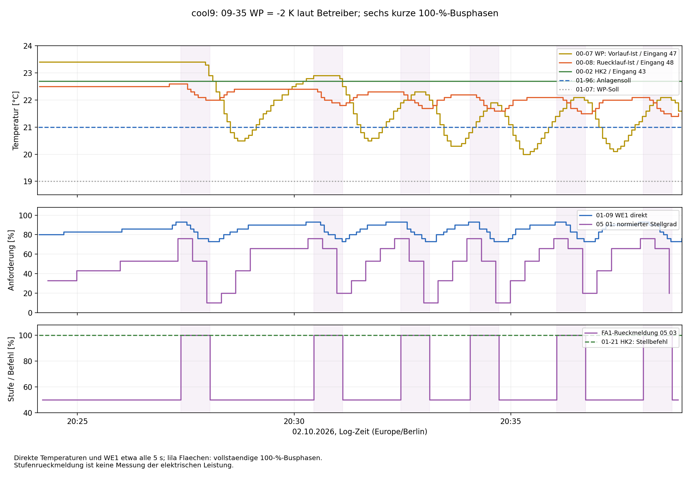

# Kühlversuch cool9: 09-35 WP auf −2 K

Quelle: `ebusd.cool9.log`, 02.10.2026, 20:24:05.264–20:38:56.973
(Europe/Berlin). Offline-Auswertung; keine Anlagenänderungen ausgeführt.
09-35 WP = −2 K ist die Angabe des Betreibers zum Versuch, keine im
Mitschnitt neu gelesene Einstellung.

## Ergebnis

**Das kurze Takten bleibt bestehen.** Es sind sechs vollständige
FA1-Phasen mit 100 % erfasst, jeweils etwa **40 Sekunden** lang.
Alle sechs Zuschaltungen erfolgen bei zuletzt direkt gemessenen **93 % WE1**,
alle sechs Rücknahmen auf 50 % bei **73 % WE1**. Die Rücklauftemperatur fällt
zwischen diesen Stichproben jeweils um **0,6 K**.

Der Vorlauf 00-07 liegt bei den Rücknahmen noch bei **21,8–22,9 °C**;
im gesamten Mitschnitt beträgt sein Minimum **20,0 °C**. Eine unmittelbare
Abschaltung durch Unterschreiten von 18 °C an diesem Messwert kann diese
sechs Vorgänge deshalb nicht erklären. Gleiches gilt für eine feste 14-°C-Grenze.
Eine zusätzliche Begrenzung unter anderen Betriebsbedingungen bleibt offen.

Die wiederholten Anforderungswerte passen zu einer Stufenfreigabe mit
unterschiedlichen Ein- und Rückschaltbedingungen. Das Muster spricht damit
gegen die einfache Vorstellung, es gebe überhaupt keine Hysterese. Es belegt
aber weder die exakten internen Schwellen noch deren Parameterzuordnung.

## Schaltpunkte

Vorlauf, Rücklauf und WE1 sind jeweils die letzten gültigen direkten Messungen
vor der beobachteten Busflanke. Vorlaufwerte vor der Rücknahme sind
0,514–1,593 s alt. Die Dauer bezieht sich auf erste beobachtete FA1-Meldungen,
nicht auf sekundengenau gemessene Verdichterlaufzeiten. FA1 meldet ungefähr
alle acht Sekunden; die nahezu gleichen 40 s beweisen keinen 40-s-Zeitparameter.

| 100 % ab | Zurück auf 50 % | Busdauer [s] | Vorlauf vor Rücknahme [°C] | Rücklauf bei Ein → Aus [°C] | WE1 bei Ein → Aus [%] | Letzte normierte Anforderung vor Aus [%] |
|---|---|---:|---:|---:|---:|---:|
| 20:27:23 | 20:28:03 | 40.016 | 22.9 | 22.6 → 22.0 | 93 → 73 | 10 |
| 20:30:27 | 20:31:07 | 39.969 | 22.5 | 22.4 → 21.8 | 93 → 73 | 20 |
| 20:32:27 | 20:33:07 | 40.032 | 22.0 | 22.3 → 21.7 | 93 → 73 | 10 |
| 20:34:03 | 20:34:43 | 39.985 | 21.8 | 22.2 → 21.6 | 93 → 73 | 10 |
| 20:36:03 | 20:36:43 | 40.001 | 22.0 | 22.1 → 21.5 | 93 → 73 | 20 |
| 20:38:03 | 20:38:43 | 40.032 | 22.0 | 22.1 → 21.4 | 93 → 73 | 20 |

Belegzeilen der Rücknahmen: **734, 1329, 1700, 1990, 2356, 2733**.
Vor jeder Zuschaltung liegt der letzte normierte Stellgrad bei **76 %**.
Vor der Rücknahme liegt er bei **10 oder 20 %**. Die Unterschiede zwischen
73 % direktem WE1 und teilweise noch 20 % normiert entstehen aus verschiedenen
Telegrammzeitpunkten: 20 % gehören im betreffenden Telegramm zu WE1 = 76 %.

In allen 44 Anforderungstelegrammen passt weiterhin die empirische Normierung
`S ≈ max(0, (B − 70) / 30 × 100)` mit höchstens 0,667 Prozentpunkten Abweichung.
93 % entsprechen damit rund 76,7 %, 73 % entsprechen 10 %.
Das ist eine Zuordnung von Anforderungswerten, keine elektrische Leistungsangabe.

## Rücklauf und verzögerter Vorlauf

Ein Beispiel aus dem ersten Zyklus:

- 20:27:21: Rücklauf 22,6 °C, WE1 93 %; erste 100-%-Meldung um 20:27:23.
- 20:28:01: Rücklauf 22,0 °C, WE1 73 %, Vorlauf noch 22,9 °C.
- 20:28:03: erste Rückmeldung auf 50 %.
- 20:28:41: Vorlauf erst jetzt bei seinem Pausenminimum von 20,5 °C.

In den ersten fünf vollständig erfassten Pausen liegen die Vorlaufminima
bei **20,5 / 20,5 / 20,3 / 20,0 / 20,1 °C**, erstmals etwa **29–38 s nach**
der Rücknahme. Die sechste Pause ist am Logende noch nicht vollständig erfasst.

In der vierten Phase steigt der Vorlauf während eines großen Teils der
100-%-Phase sogar, während Rücklauf und WE1-Anforderung bereits fallen.
Die Rücknahme folgt damit wesentlich besser dem Verlauf von Rücklauf und
Anforderung als einer festen unteren Vorlaufgrenze. Transportzeit, thermische
Einbindung und Messwertverarbeitung kommen für den Versatz infrage; aus dem
Buslog allein lässt sich ihre jeweilige Bedeutung nicht bestimmen.

Die Rücklaufabnahme um 0,6 K zusammen mit 20 Prozentpunkten weniger WE1 passt
zahlenmäßig zur üblichen proportionalen Interpretation von **06-10 = 3 K**:
`100 × 0,6 / 3 = 20`. Das stützt einen Vergleich von 06-10, beweist aber nicht
die vollständige interne Reglergleichung oder die ausschließliche Verwendung
dieses Fühlers. Der zeitlich wandernde Rücklaufwert an den Schaltpunkten ist
mit einem veränderlichen Reglerzustand vereinbar.

00-02 HK2 bleibt in allen **177** direkten Messungen bei **22,7 °C**.
Damit bleibt auch der Unterschied zwischen Eingang 43 und dem stark reagierenden
Eingang 48 auffällig. Ein träger oder hydraulisch anders eingebundener Messort
ist möglich; die Konstanz allein beweist weder einen defekten Fühler noch
seine falsche Montage.

## Was der Vergleich mit cool8 über 09-35 aussagt

| Merkmal | cool8, bisherige Ausgangsbasis −3 K | cool9, laut Betreiber −2 K |
|---|---|---|
| WE1 am Beginn des Mitschnitts | 100 % | 80 % |
| Rücklauf zu Beginn, erste direkte Messung | 23,4 °C | 22,5 °C |
| Erste vollständige 100-%-Busphase | 768,6 s | 40,0 s |
| Weitere vollständige Phasen | 160,0 / 71,1 / 80,0 / 47,0 s | fünfmal etwa 40 s |
| WE1 vor Zuschaltungen | meist 100 %, zuletzt 96 % | immer 93 % |
| WE1 vor Rücknahmen | zuerst 90 %, danach 73–76 % | immer 73 % |
| Vorlauf vor Rücknahmen | 17,5–20,8 °C | 21,8–22,9 °C |

**−2 K beseitigt das Problem in dieser Messung nicht.** Zugleich fehlen
vergleichbare Ausgangszustände: cool8 beginnt mit gesättigter Anforderung,
cool9 mit 80 %, und auch die Temperaturen unterscheiden sich. Die lange
Anlaufphase von cool8 nahe 17,5 °C wurde in cool9 nicht reproduziert.
Deshalb lässt sich weder eine direkte Verschiebung dieser Temperaturgrenze
noch eine kausale Verschlechterung durch −2 K aus dem Vergleich ableiten.
Insbesondere ist „22 statt 17,5 °C abgeschaltet“ keine nachgewiesene Wirkung
von 09-35 um mehrere Kelvin: Die Anforderung ist dann jeweils eine andere.

Eine Wirkung von 09-35 auf die Freigabe bleibt möglich. Nachgewiesen ist hier
vor allem das wiederholte Abfallen der gemeinsamen Anforderung vor der
Rücknahme, auch weit oberhalb der vermuteten Vorlauf-Untergrenze.

## Betriebsbedingungen und nächste Schritte

- 01-96: durchgehend **21 °C** in beiden abgefragten Kontexten.
- 01-07: durchgehend **19 °C** in beiden Varianten.
- Sollwerte in 10 02/10 03: jeweils **21 °C**.
- Warmwassersoll **50 °C**, Warmwasserbit in allen elf 11-00-Stichproben aus.
- 01-21 HK2: **179-mal +100**. Das passt zur vereinbarten Einstellung
  07-14 = 2 und ist kein unabhängiger Nachweis berechneten HK2-Kühlbedarfs.
- Nur drei erfasste 06-23-Schreibungen, jeweils Expert-Freigabe `00 00 51 00`.
  09-35, 06-10, 06-11 und 07-14 wurden im Mitschnitt nicht neu gelesen.
- Status0a.Bit2 stimmt in allen elf Stichproben mit der folgenden FA1-Stufe
  überein. Die grobe Abtastung macht es weiterhin ungeeignet zur vollständigen
  Erfassung der kurzen Laufphasen.

Als Abschluss von Versuch A zunächst **09-35 WP wieder auf −3 K** und einen
kurzen Vergleich bei ähnlichen Temperaturen und sonst gleichen Einstellungen
erfassen. Dabei sind besonders die WE1-Werte vor Ein-/Rückschaltung interessant.
Danach bleibt Versuch B sinnvoll: **nur 06-10 von 3 auf 6 K**, 09-35 dabei
auf −3 K, 07-14 in beiden Kontexten auf 2 und 06-11 auf 20 min belassen.
Eine geringere proportionale Empfindlichkeit wäre die zu prüfende Erwartung;
längere Laufzeiten sind keine Zusicherung. Nach dem Vergleich 06-10 zurückstellen.
Siehe [Testplan](Cooling-Parameter-Testplan.md).

## Datenqualität und Dateien

2774 Logzeilen, davon 2736 vollständige CRC-gültige Mastertelegramme und
38 ausgeschlossene kurze Fragmente. 1960 Transaktionen mit gültiger Antwort-CRC
und ACK. Bei 183 gültigen Mastertelegrammen ist die Antwort unvollständig oder
ungewöhnlich; diese Antworten wurden nicht zur Parameterdekodierung verwendet.
Keine `ff1f`-Antwort. Je 111 FA1-/FA2-Statusnummern und alle 29 Fehlergerät/-code-
Paare sind 0. FA2 meldet durchgehend Stufe 0.

179 gültige direkte Vorlaufwerte, Median-Abstand 5,000 s, maximal 6,188 s;
175 gültige direkte WE1-Werte. Der Mitschnitt beginnt bereits mit FA1 = 50 %,
daher ist die vollständige Wartezeit vor der ersten Zuschaltung unbekannt.
Für diesen Versuch liegt keine zusätzliche elektrische Leistungsreihe vor.

[Buswerte](../cooling9-output/bus-values.csv),
[Parameterwerte](../cooling9-output/parameter-values.csv),
[Schaltphasen](../cooling9-output/cycles.csv),
[Flanken mit vorhergehenden Messungen](../cooling9-output/edges.json),
[Pausenminima](../cooling9-output/post-stop-minima.csv),
[Datenqualität](../cooling9-output/bus-summary.json),
[Diagramm als SVG](../cooling9-output/overview.svg).

SHA-256 des Rohlogs:
`af6ba9ee5b15fbfc9b3cfdd4d08cdf5b70374c84d8b16703d0a1183889404ea6`
