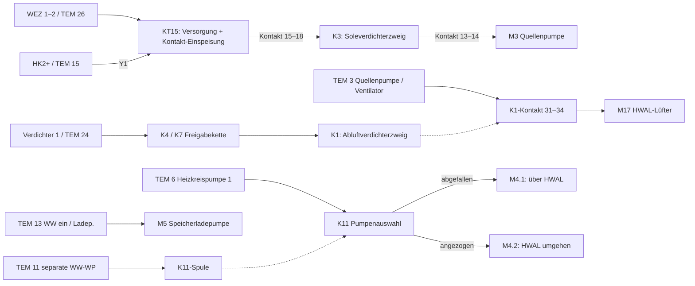

# Heizbetrieb, Warmwasser und Kandidaten für Klemmenzustände

Stand: 03.10.2026. Offline-Auswertung der vorhandenen Unterlagen und der elf
damals vorliegenden `ebusd*.log` (ohne den später ergänzten Versuch `test1`).
Nachtrag: [Auswertung von test1](Heating-Test-2026-10-03-test1.md), insbesondere
zum Standschutzimpuls trotz HK2-Standby, zur offenen KT15-Nachlaufzeit und zu M17.
Keine Einstellungen geändert, keine Buszugriffe ausgeführt.
Die Zusatzheizung ist ausgeklammert. Die Aussagen zur Verdrahtung beschreiben den
Plan, den der Betreiber weiterhin als Abbild der Anlage zugrunde legt.

**Vor-Ort-Klärung vom 03.10.2026:** Der Betreiber hat geprüft, dass die geschalteten
Ausgänge **7 und 8 nicht beschaltet** sind. Lediglich der **N-Anschluss des
Anschlussblocks 8** wird verwendet. Damit ist der zuvor anhand des Fotos
entstandene Verdacht zusätzlicher Pumpen- oder Relaisansteuerungen über 7/8
ausgeräumt. Die Nutzung des Neutralleiters stellt keine Schaltfunktion von HK2
bereit. Die Analyse folgt daher weiterhin dem Schaltplan: gemeinsame
Pumpenversorgung über TEM 6 und K11, HK2-Auf-Ausgang für KT15. Diese konkrete
Vor-Ort-Prüfung bestätigt die Nichtnutzung von 7/8; sie ist keine synchrone
Messung aller übrigen Verbindungen oder der eBUS-Klemmenzuordnungen.

## Ergebnis

Hydraulisch besteht ein gemeinsamer Fußbodenheizkreis. Die zwei TEM-Heizkreisfunktionen
erfüllen trotzdem unterschiedliche Aufgaben: HK1 passt zur gemeinsamen Pumpenfreigabe,
HK2 steuert mit seinem Mischer-Auf-Ausgang über KT15 den zweiten Verdichterzweig.
Ein physischer Heizkreismischer ist in diesen Unterlagen nicht nachgewiesen.

Die These „ein hydraulischer Heizkreis genügt“ trifft bereits auf den dargestellten
Aufbau zu. Die weitergehende These „eine TEM-Heizkreisfunktion kann ohne Ersatz
deaktiviert werden“ wird durch die Verdrahtung nicht gestützt. Eine alternative
Ein-Kreis-Regelung ist prinzipiell denkbar, benötigt aber einen Ersatz für die
entfallenden Steuerfunktionen; eine passende reine Parametrierung ist nicht belegt.

Für alle fünf gesuchten Klemmenfunktionen existieren eBUS-Kandidaten. Die neuen
Vergleiche stärken besonders `Status1a.Flag5` als Mischer-Auf-Meldung und
`Status0a.Running` als Heizkreispumpenmeldung. Kein Bit ist bisher durch eine
synchrone elektrische Messung als physischer Klemmenzustand bestätigt.

## Elektrische Funktionsketten

Grundlagen: [Steuerschaltplan](../input/steuerschaltplan.png),
[Reglerfoto](../input/tem_se_6000_wpc.png),
[Legende](../input/schaltplan_legende1.jpg),
[Hydraulik](../input/hydraulik.png), [Pumpenanordnung](../input/pumpenanordnung.png).

| Funktion / Bauteil | Aus dem Plan abgelesene Wirkung |
|---|---|
| **WEZ 1–2**, Kontakt 25–26 | Der geschaltete Anschluss 26 versorgt KT15 an A1 und dessen Kontaktanschluss 15. „WEZ 1–2“ ist die Beschriftung am Regler, nicht der Beweis für den eBUS-Kontext WE2 oder die Zusatzheizung. |
| **Mischer Heizkreis 2+**, TEM 15 | Führt zum Steuereingang Y1 von KT15. Der Gegenbefehl an TEM 16 ist im Plan unbeschaltet. |
| **KT15** | Sein Kontakt 15–18 schaltet die Spule von K3. Kontaktzahlen am Zeitrelais und TEM-Klemmennummern sind zu unterscheiden. |
| **K3** | Laut Legende Kompressorschütz WP2. Sein Arbeitskontakt 13–14 schaltet zusätzlich M3 aus der geschalteten Netzversorgung. |
| **Verdichter 1**, Kontakt 23–24 | Ausgang 24 führt über den K4-Öffner und die K7-Verriegelung zum Kompressorschütz K1. Ein geschlossener Reglerkontakt allein garantiert deshalb keinen Verdichterlauf. |
| **M17**, HWAL-Lüfter | Liegt hinter dem K1-Arbeitskontakt 31–34; dessen Einspeisung kommt von TEM 3, „Quellenpumpe / Ventilator“. Lüfterversorgung setzt sowohl diesen Ausgang als auch den geschlossenen K1-Kontakt voraus. |
| **M3**, Wärmequellenpumpe | Wird im dargestellten Zweig vom K3-Kontakt 13–14 geschaltet. Sie hängt hier nicht unmittelbar am TEM-Ausgang „Quellenpumpe“. |
| **Heizkreispumpe 1**, TEM 6 | Gemeinsame Einspeisung für M4.1 und M4.2 über die Kontakte von K11. |
| **K11** | Abgefallen: M4.1 über 41–42. Angezogen: M4.2 über 21–24. Beide benötigen zusätzlich Ausgang 6. |
| **WW ein / Ladep.**, TEM 13 | Schaltet M5, die Speicherladepumpe. |
| **Separate WW-Wärmepumpe**, TEM 11 | Führt zur K11-Spule. Zusätzlich ist der K4-Kontakt 21–24 angeschlossen; im normalen Heizbetrieb bei abgefallenem K4 ist dieser zusätzliche Zweig offen. |

Die Verbindung K1 → HWAL-Lüfter und K3 → Quellenpumpe stützt die Zuordnung
**K1 = Abluftverdichterzweig, K3 = Soleverdichterzweig**. Das ist eine Ableitung
aus dieser konkreten Schaltung. Die allgemeinen WP1/WP2-Namen der Legende oder
FA1/FA2-Namen im Busdecoder beweisen diese Zuordnung für sich allein nicht.
Die Hauptstromkontakte der Verdichter sind auf diesem Steuerschaltplan nicht dargestellt.



### KT15: zwei Voraussetzungen für den Solezweig

KT15 ist ein ABB CT-MFE. Laut dokumentierter Betreiberablesung ist eine
Ausschaltverzögerung von **1000 s = 16 min 40 s** eingestellt.

Bei vorhandener Versorgung zieht es mit aktivem Y1 sofort an. Nach Wegfall von
Y1 bleibt der Arbeitskontakt für die eingestellte Zeit geschlossen. Ein neues
Y1-Signal setzt den Ablauf zurück; erst der nächste Signalwegfall startet erneut
die volle Verzögerung. Ohne Versorgung besteht diese Haltefunktion nicht.
Quelle für die Zeitfunktion: [ABB-Datenblatt, Seite 2](https://library.e.abb.com/public/10c49196c23c80a0c12575f400340e36/2CDC111032D0201.pdf).
Der konkrete Einstellwert stammt aus der Betreiberablesung, nicht aus dem Datenblatt.

Im Anlagenplan fällt mit TEM 26 außerdem die Einspeisung des KT15-Kontakts weg.
Somit kann die WEZ-Freigabe K3 sofort abschalten, auch wenn der letzte Auf-Impuls
weniger als 1000 s zurückliegt. Die Zeit ist **keine garantierte Mindestlaufzeit**.
Bei dauerndem Auf-Befehl bleibt der Kontakt geschlossen; bei Auf-Impulsen mit
kürzeren Pausen kann KT15 die Impulsfolge in eine anhaltende Ansteuerung umsetzen.

Das erklärt eine plausible zweifache Freigabe:
übergeordnete Wärmeerzeuger-/Stufenfreigabe an 26 UND zeitlich gehaltene
HK2-Auf-Anforderung. Die genaue Regelgleichung vor diesen Ausgängen ist offen.

## Heizbetrieb und Warmwasser

Die folgende Zuordnung beschreibt stationäre Arbeitszustände, abgeleitet aus
Plan und dokumentierten Betreiberbeobachtungen. Anlauf, Nachlauf, Sperren und
Temperaturregelung können vorübergehend andere Kombinationen ergeben.

| Betriebsfall | Wärmeerzeugung | Heizwasser-/Ladekreis |
|---|---|---|
| Nur Raumheizung, Abluftleistung reicht | Abluftzweig K1, zugehöriger Lüfter M17 | TEM 6 ein, K11 abgefallen → M4.1; M5 aus |
| Raumheizung mit zusätzlichem Wärmebedarf | Zusätzlich K3 über WEZ/KT15, dazu M3 | Weiterhin M4.1; die Wärmetauscher können im gemeinsamen Wasserweg Wärme beitragen |
| Nur Warmwasser | Nach Betreiberbeschreibung vorrangig Abluft-WP | M5 über TEM 13; bei fehlender Heizanforderung und beendetem Heizungsnachlauf weder M4.1 noch M4.2 |
| Warmwasser und Raumheizung gleichzeitig | Abluft für Warmwasser, bei Bedarf Solezweig für Raumheizung | M5; bei aktivem TEM 11 zieht K11 an, TEM 6 versorgt nun M4.2 |
| Warmwasser endet, Raumheizung bleibt | Abluftwärme wird wieder für Raumheizung verfügbar | Nach Ende der jeweiligen Umschalt-/Nachlaufzustände M5 aus, K11 abgefallen, M4.1 statt M4.2 |

M4.1 bindet den HWAL-Wärmetauscher in den Heizungsweg ein. M4.2 umgeht ihn,
sodass die Sole-WP die Räume versorgen kann, während die Abluft-WP Warmwasser
bereitet. **M4.2 ist nicht an „Heizkreispumpe 2“ des TEM angeschlossen.**
Der geschaltete Ausgang TEM 8 ist auch nach der Vor-Ort-Prüfung unbeschaltet;
nur sein zugehöriger N-Anschluss wird genutzt. Die zwei Pumpen sind alternative Wege desselben
Heizkreises, nicht zwei unabhängig versorgte Heizflächenkreise.

M5 fördert Heizungswasser zur Speicherladung; sie ist von einer Trinkwasser-
Zirkulationspumpe zu unterscheiden. Die elektrische Schaltung erzwingt nicht,
dass ein laufender Verdichter und M5 immer gleichzeitig eingeschaltet sind.
Nachlauf ist möglich; auch die früher beobachtete Speicherabkühlung bei
weiterlaufender M5 ist deshalb elektrisch erklärbar, ohne ihre damalige Ursache
damit bewiesen zu haben.

In beiden vorhandenen Einstellungslisten (`aktuelle_einstellungen.txt` und
`eigentliche_einstellungen.txt`) stehen:

- 07-05 HK1/HK2 = **2/0**: Pumpenkreis / Dreipunktmischer.
- 05-02 = **0,1**: Laut STE-Hilfetext absoluter Parallelbetrieb. Die Ausgabe
  „0,1 h“ darf hier nicht als sechs Minuten Warmwasservorrang gelesen werden.
- 05-00 = 5 K, 05-03 = 3 min, 05-05 = 0: Warmwasser-Schaltdifferenz und
  zeitabhängiger Nachlauf. Die Solltemperatur unterscheidet sich mit 50/51 °C.
- 05-07 = 1: softwareseitig Umlenkventil, obwohl an TEM 13 tatsächlich M5
  gezeichnet ist. Diese Sonderverwendung ist bei einer Konfigurationsänderung
  zu beachten; der Bauteilname rechtfertigt keine automatische Umstellung auf 0.
- 07-03 = 15 min für beide HK-Funktionen.

Die Listen sind gespeicherte Momentaufnahmen ohne hier gesicherten Aufnahmezeitpunkt;
sie sind keine Live-Rücklesung vom 03.10.2026.

Die dokumentierte Beobachtung „nach Warmwasserende übernimmt Abluft die Heizung,
01-21 HK2 wechselt 0 → −100 %“ passt zur Rücknahme zusätzlicher Wärme.
−100 % ist ein Zu-Befehl, keine Ventilstellung. Weil TEM 16 unbeschaltet ist,
schaltet er K3 nicht direkt aus. Maßgeblich bleiben das Ausbleiben von
Auf-Impulsen, der KT15-Zeitablauf und die Versorgung an 26.

## Prüfung der Ein-Heizkreis-These

| Variante | Bewertung für die vorhandene Verdrahtung |
|---|---|
| Ein gemeinsamer hydraulischer Heizkreis | Bereits gegeben. |
| HK1 behalten, HK2 auf „kein Heizkreis“ setzen | Voraussichtlich entfällt die geregelte Auf-Anforderung an TEM 15. Damit fehlt dem Solezweig sein bisheriger KT15-Steuerweg. Weiterlauf im Sondermodus oder Restzeit wäre kein Nachweis vollständiger Funktion. |
| HK2 behalten, HK1 deaktivieren | Bei Verdrahtung gemäß Plan sind die bisherige Freigabe von TEM 6 und dessen Nachlauf nicht mehr gesichert. Der geschaltete HK2-Pumpenausgang 8 ist nach Vor-Ort-Prüfung unbeschaltet; die Nutzung seines N-Anschlusses ersetzt keine Pumpenansteuerung. |
| Nur ein Bediengerät benutzen | Eine andere Frage: ein Bediengerät, eine hydraulische Zone und eine interne HK-Funktion sind nicht gleichbedeutend. |
| Ein-Kreis-Regelung mit geänderter Ausgangsbelegung oder zusätzlicher Steuerung | Grundsätzlich möglich, aber bisher kein dokumentiertes, funktionsgleiches Schema für diese Anlage. Ersatz für KT15-Anforderung, Pumpenfreigabe, Warmwasserumschaltung und Schutz-/Nachlaufverhalten nötig. |

Der frühere Versuch **07-05 = 0/3** ist ein Gegenindiz zu einer einfachen
Deaktivierung: Warmwasser brach nach Betreiberbericht etwa bei 49 °C ab,
M5 lief weiter. Weil dabei zugleich HK1 von Pumpenkreis auf Mischer und HK2
auf „kein Heizkreis“ geändert wurde, ist das kein isolierter Beweis gegen jede
denkbare Ein-Kreis-Parametrierung. Eine Wiederholung ist für die zunächst
notwendige Zuordnung der Ausgänge nicht erforderlich.

## eBUS: konkrete Kandidaten und Gegenproben

Bei `10 FE 10 0A` wird das Nutzdatenbyte ab dem Selektor nullbasiert gezählt:

```text
11 00 bzw. 11 01 | Temperatur L H | Status A | Status B | ...
       p0 p1             p2 p3          p4         p5
```

| Gesuchte Klemme | Kandidat | Beleg und Grenze |
|---|---|---|
| **WEZ 1–2 / 26** | `Status0a.Bit2`: `11 00`, p4 & `04` | Sehr starke Korrelation mit FA1-Stufe 100 %. Plausibel als zweite Stufenfreigabe vor KT15; nicht als K3- oder Strommessung bestätigt. |
| **Verdichter 1 / 24** | `Status0a.Bit1`: `11 00`, p4 & `02` | Folgt fast immer FA1-Stufe > 0. In `cooltest` fünf Stichproben schon gesetzt bei FA1 = 0 %. Kandidat für erste Stufenfreigabe, kein Laufnachweis des Abluftverdichters hinter K4/K7. |
| **Mischer HK2+ / 15** | `Status1a.Flag5`: `11 01`, p4 & `20`; dazu direkt `P01_21_HK2` | Eng abgetastete neuere Logs stützen Auf-Meldung. Bit 6 desselben Bytes ist bereits als FB2-Zu-Symbol bestätigt. Physische Klemmen müssen noch verglichen werden. |
| **WW ein / Ladep. / 13** | `Status0a.BWR_Ventil`: `11 00`, p5 & `01`; zusätzlich `Status1a.BWR_Aktiv`: `11 01`, p5 & `01` | Wechseln im Zusammenhang mit Warmwasser und bleiben nach Sollwertrücknahme noch gesetzt. Kandidaten für Ladestellglied-/Nachlaufstatus. Ob sie 13, 11 oder einen gemeinsamen internen Zustand abbilden, ist offen. |
| **Heizkreispumpe 1 / 6** | **`Status0a.Running`: `11 00`, p4 & `80`**; zusätzlich `P01_20_HK1` prüfen | Der beobachtete lange Nachlauf passt zu 07-03 = 15 min. Die Bedeutung des direkt lesbaren Ein/Aus-Parameters 01-20 ist noch nicht belegt. |

### Stufenbits über elf Mitschnitte

Frische Auswertung mit gültiger Master-CRC; jeder `Status0a`-Wert wird mit der
unmittelbar folgenden FA1-Rückmeldung `03 → 10 / 05 03` verglichen, höchstens
10 s Abstand. Es sind **1257 Paare**:

- Bit 2 entspricht in **1255/1257** Paaren der Meldung „100 %“.
- Bit 1 entspricht in **1252/1257** Paaren einer positiven Stufenmeldung.
- Bit 3 entspricht in **1250/1257** Paaren dem FA1-Statusbit `uwp`.

Die zwei Bit-2-Abweichungen liegen je einmal in `ebusd.log` und `cool6`.
Schon der frühere cool6-Bericht zeigt, dass die Wahl „immer folgende FA1-Meldung“
an einer Flanke nicht universell passt. Die Quotienten belegen Korrelation,
keine exakten Schaltzeiten und keine elektrische Zuordnung.

Das Quellen-/Automatenpumpenbit `uwp` darf nicht automatisch zur
Heizkreispumpe 1 erklärt werden. Besonders aufschlussreich ist `ebusd.log`
am 27.09.2026:

| Erste beobachtete Log-Zeit | Zustand |
|---|---|
| 07:02:51.457, Zeile 19151 | Status0a = `88 02`: Stufenbits weg, Bit 3 und Bit 7 noch an |
| 07:02:53.437, Zeile 19153 | FA1-Stufe 0 %, `uwp` noch an |
| 07:03:49.469, Zeile 19199 | FA1-`uwp` aus |
| 07:04:11.333, Zeile 19217 | Status0a = `80 00`: Bit 3 aus, Bit 7 weiter an |
| 07:16:11.451, Zeile 19829 | Letzte noch gesetzte Bit-7-Stichprobe vor dem folgenden Löschen |
| 07:17:31.343, Zeile 19897 | Status0a = `00 00`: auch Bit 7 aus |

Rund 15 Minuten nach der ersten beobachteten Stufenrücknahme ist auch Bit 7
gelöscht. Dieses Muster passt wesentlich besser zur Heizkreispumpe mit langem
Nachlauf als das ungefähr eine Minute nachlaufende FA1-`uwp`/Status0a.Bit3.
Bit 3 bleibt als Quellen-/Wärmepumpen-Pumpenfreigabe interessant; eine bestimmte
Klemme ist damit noch nicht identifiziert.

Im Versuch `cool3` blieb Bit 2 in der mutmaßlichen Soleverdichterpause während
Warmwasser etwa 15:21–15:33 in allen neun Stichproben gesetzt. Das ist mit
einer weiter aktiven WEZ-Freigabe bei nachgelagerter Unterbrechung vereinbar.
Welche Stelle tatsächlich unterbrach, ist nicht gemessen. Siehe
[bisherigen Bit-2-Bericht](Cooling-Test-2026-10-01-cool5.md).

### Mischer-Auf-Bit: neuer direkter Abgleich

Direkte `06 21`-Antworten für `01-21 HK2` werden nur mit gültiger Antwort-CRC und
Quittierung benutzt. Verglichen wird jeweils der zeitlich nächste Wert mit
höchstens 10 s Abstand. Die Tabelle zeigt alle hierfür eng abgetasteten neueren Logs:

| Log | Paare | Größter absoluter Zeitabstand | Übereinstimmung von Bit 5/6 mit positivem/negativem Stellbefehl |
|---|---:|---:|---:|
| cool6 | 67 | 0,822 s | 67/67 |
| cool8 | 24 | 1,475 s | 24/24 |
| cool9 | 11 | 1,819 s | 11/11 |
| cool10 | 3 | 1,658 s | 3/3 |

Insgesamt 105/105: 102 Auf-, zwei Ruhe- und ein Zu-Zustand. Das stützt
`Flag5 = Auf`. Die vielen stabilen Auf-Zustände sind keine 102 unabhängigen
Schalttests. In cool4/cool5 mit gepulsten Befehlen und bis etwa 6,65 s Abstand
gibt es **11 Abweichungen unter 34 Paaren**. Ein Abtastversatz ist eine plausible
Erklärung, aber keine nachgewiesene Auflösung jeder Abweichung. Deshalb bleibt
die elektrische Zuordnung ein Messauftrag.

### Warmwasser und ungeeignete Abkürzungen

Im cool3-Versuch wurde der Warmwassersollwert erstmals um 15:44:02 reduziert;
die betrachteten Warmwasserbits wurden erst um 15:47:21 bzw. 15:47:31 gelöscht.
Das passt zum dreiminütigen Nachlauf plus Telegrammabtastung. Es unterscheidet
noch nicht Ausgang 11 von Ausgang 13. Für eine K11-Vorhersage ist gerade diese
Unterscheidung nötig.

Im Broadcast `08 01` kommt in den hier betrachteten Logs als Statusbyte nur
`00` oder `08` vor. Die vorhandenen Standardnamen `Ladepumpe` und `BW_Ladung`
liefern darin keine unabhängige wechselnde Ladepumpenanzeige; ihre Namen
beweisen keine TEM-Klemmenzuordnung. `08 02` enthält hauptsächlich Sollwerte
und Anforderung. Die früheren Bitdeutungen seiner Temperaturbytes sind korrigiert.
Auch `Status2b`/`10 02` enthält offenbar numerische Werte; seine alten
Warmwasser-Bitnamen sind keine belastbare Alternative.

Die Adressen `03`/`13`, die Menükontexte WE1/WE2, die beiden Stufen innerhalb
einer WP-Funktion und die realen Verdichter sind getrennt zu betrachten.
Insbesondere ist „FA1 = Sole, FA2 = Abluft“ nicht belegt.

## Messplan zur Klärung

Zunächst bei bestehender 2/0-Konfiguration normale Übergänge protokollieren:
Heizbeginn, Zuschalten der Sole-WP, Warmwasserbeginn bei laufender Heizung,
Warmwasserende und Heizungsende mit vollständigem Nachlauf. Für einen
Nachlaufversuch mindestens 20 Minuten über den letzten Stellimpuls hinaus
aufzeichnen. Zeiten mit der Log-Uhr synchronisieren; die Regleruhr wich in
früheren Mitschnitten um mehrere Minuten ab.

| Gleichzeitig erfassen | Welche offene Frage das beantwortet |
|---|---|
| TEM 26, KT15 A1/Y1/18, K3-Zustand und Verdichterstrom | Ist Bit 2 tatsächlich WEZ-Freigabe? Endet ein Lauf durch Versorgungsausfall oder durch den KT15-Zeitablauf? |
| TEM 24, K1, K4/K7 und Abluftverdichterstrom | Ist Bit 1 ein Reglerbefehl, der nachgelagert gesperrt werden kann? |
| TEM 15, FB2-Auf-Anzeige, Flag5 und 01-21 HK2 | Meldet das Bit den elektrischen Auf-Ausgang, und wie lang sind die realen Impulse? |
| TEM 6, K11, M4.1/M4.2, Running sowie 01-20 HK1/HK2 | Welche interne HK-Funktion schaltet die gemeinsame Pumpenklemme? Passt der 15-min-Nachlauf? Die Nichtnutzung der geschalteten Ausgänge 7/8 ist bereits vor Ort geklärt. |
| TEM 11 und 13 getrennt, K11, M5 und beide Warmwasserbits | Ladepumpe, hydraulische Pumpenumschaltung, Anforderung und Nachlauf auseinanderhalten |
| TEM 3, K1, M17 sowie K3/M3 | Quellenfreigabe und realen Lüfter-/Quellenpumpenlauf unterscheiden; etwaige Abweichung von der Planverdrahtung erkennen |

Spannungs- und Kontaktmessungen an diesen 230-V-Zweigen gehören in die Hände
einer Elektrofachkraft. Für erste Vergleiche genügen zugängliche Anzeigen,
KT15-LEDs und vorhandene Strommessungen; U zeigt beim CT-MFE die Versorgung,
R das angezogene Ausgangsrelais. Eine LED bestätigt keinen Volumenstrom.

Parallel passiv alle `10 0A`, `05 01`, `05 03`, `08 01` und `08 02` aufzeichnen.
Direkt in etwa 2–5 s Abstand eine begrenzte Auswahl lesen: 01-21 HK2,
01-20 HK1/HK2, 01-22 HK1/HK2 als noch unbenannte Ein/Aus-Kandidaten,
01-09 WE1, 00-09 WE1, 01-02/00-02 beider HK, 01-96, 00-07 WP, 00-08 WP,
00-04 und 01-04. Bei zu hoher Buslast die Auswahl auf die jeweilige Frage
begrenzen. Ein schneller Lesezyklus garantiert keine ebenso schnelle interne
Aktualisierung. Ausgänge oder Schutzkontakte für diese Zuordnung nicht erzwingen.

Die 80-s-Broadcasts können kurze Auf-Impulse vollständig verfehlen. Deshalb
braucht der KT15-Nachweis eine kontinuierliche Zustandsaufzeichnung seiner
Eingänge, möglichst mit einer Sekunde Auflösung oder besser. Zustände von
Kontakt, Motorstrom und Durchfluss bleiben drei unterschiedliche Messgrößen.

Vor einer späteren Ein-Kreis-Umstellung sind zusätzlich Mindestvolumenstrom
und Temperaturverläufe im jeweiligen Pumpenweg zu prüfen. Eingang 43 wurde
vom Betreiber am Eintritt der Sole-WP lokalisiert; Eingang 47 ist gemeinsam
für THV1/TWV benannt, seine genaue Einbaulage und die von Eingang 48 bleiben
zu verifizieren. Die Sensornamen allein definieren keinen unabhängigen
zweiten hydraulischen Heizkreis.

## Reproduzierbarkeit

Die neue Auswertung läuft mit:

```sh
python3 scripts/analyze_terminal_candidates.py
```

Ergebnisse mit Logzeilen und Zeitabständen:
[Stufenvergleich](../heating-output/stage-candidates.csv),
[Mischervergleich](../heating-output/mixer-candidates.csv),
[Prüfsummen und Zähler](../heating-output/candidate-summary.json).
Es wurden keine vorhandenen Decoderfelder umbenannt oder zu bestätigten
Klemmenmeldungen erklärt.

Weitere Grundlagen: [bisherige Heizungsanalyse](Heating-Control-Analysis.md),
[STE-Parametertexte](../ste-output/Parameter.md),
[Broadcastdefinitionen](../broadcast.tsp),
[Status-Telegrammfrequenzen](../status-output/Status-Statistik.md).
