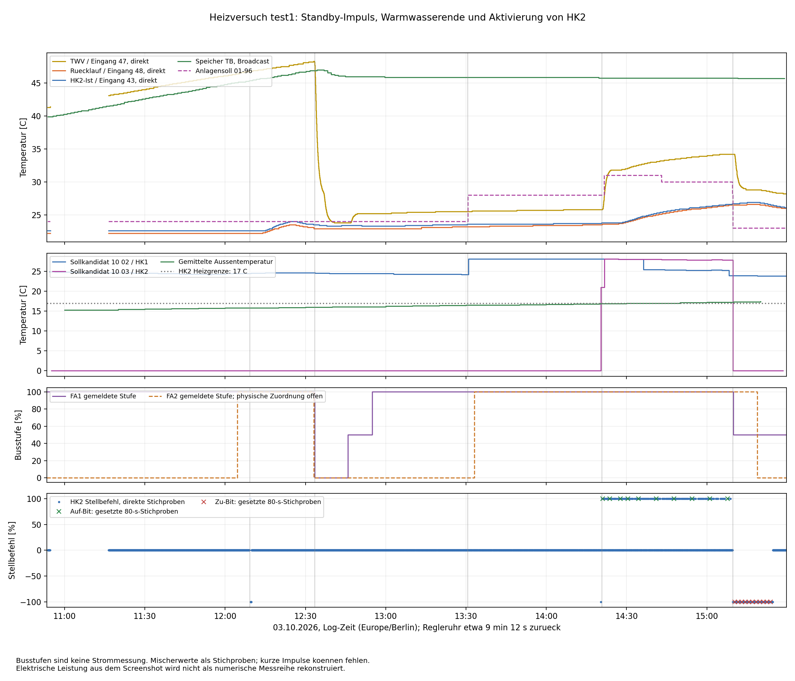
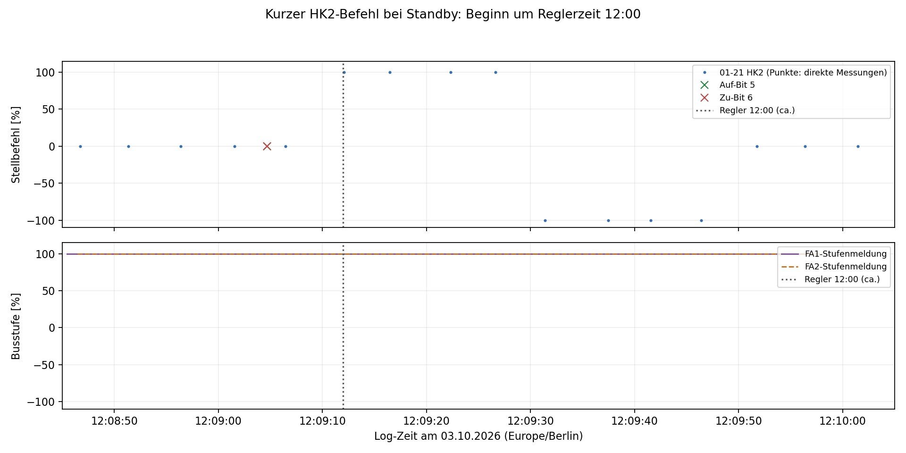
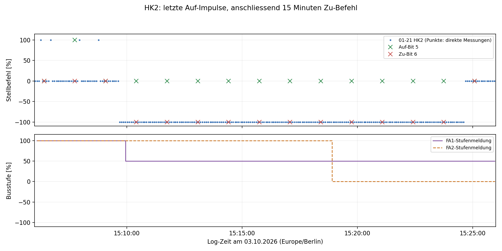

# Heizversuch test1 vom 03.10.2026

Grundlage: [Rohlog](../ebusd.test1.log),
[Einstellungen](../aktuelle_einstellungen2.txt), Betreiberbeschreibung und
Leistungsdiagramm im Gespräch. Die [bisherige Schaltungsanalyse](Heating-Terminal-Analysis-2026-10-03.md)
bleibt die Grundlage für elektrische Zuordnungen. Geschaltete Ausgänge 7/8 sind
laut Vor-Ort-Prüfung unbeschaltet; nur der N-Anschluss des Blocks 8 wird genutzt.
Es wurden ausschließlich Dateien ausgewertet, keine Einstellungen oder Buszustände verändert.

## Wichtigste Ergebnisse

1. **Der Eingriff gegen 12:09 passt auffällig gut zu einem Standschutzlauf.**
   HK2 sendet trotz Standby kurz Auf und Zu, exakt um 12:00 der um etwa
   9 min 12 s nachgehenden Regleruhr. Der Auf-Impuls könnte über KT15 die
   Sole-WP gestartet haben. FA1 bleibt dabei durchgehend auf 100 %.
2. **HK1-Behaglichkeit erhöht den Sollwert, aktiviert aber bei HK2-Standby
   keine anhaltenden HK2-Auf-Befehle.** Erst nach Aktivierung von HK2 folgen
   viele Auf-Impulse und ein deutlicher Temperaturanstieg. Das stützt die
   eigenständige Funktion von HK2 für den Solezweig.
3. **Ab 15:09:42 steht HK2 etwa 15 Minuten auf Zu.** Das bestätigt die
   Beobachtung „Zu“ um 15:16, widerspricht aber „Auf“ um 15:12, sofern beide
   Beobachtungen HK2 und die Log-Uhrzeit betreffen. Die Klärung bleibt offen.
4. **Kein belastbarer neuer M17-Istzustand oder M17-Schreibbefehl.** Die
   Quellenpumpen-/Lüfterkandidaten bleiben auch bei FA1-Stufe 0 aktiv.
   FA1-Stufenfreigabe, K1-Kontakt und tatsächlicher Lüfterstrom sind weiter
   getrennt zu betrachten.



## Datenbasis und Zeitbezug

Das Log umfasst **10:53:24.740–15:29:44.837**, 50.194 Zeilen und 48.968
Telegramme mit gültiger Master-CRC. 1.226 kurze Fragmente werden ausgeschlossen.
33.853 Telegramme enthalten eine gültige Slave-Antwort einschließlich CRC und ACK.
Direkte Parameterwerte werden nur aus so bestätigten Antworten übernommen.
Weitere Transportdetails: [bus-summary.json](../heating-test1-output/bus-summary.json).

Die direkten Abfragen von `01-21 HK2` kommen überwiegend etwa alle fünf Sekunden.
Zwischen 10:54:33 und 11:16:31 fehlt jedoch diese Messreihe; anschließend beträgt
ihre größte Lücke rund 10,2 s. Die Statusbroadcasts `11 00` und `11 01` kommen
jeweils nur etwa alle 80 s. Damit lassen sich kurze Stellimpulse verpassen.
„Durchgehend“ meint im Folgenden die verfügbaren Stichproben, keine lückenlose
elektrische Messung. Telegrammzeiten begrenzen Zustandswechsel, sind aber nicht
deren exakte physische Schaltzeitpunkte.

Alle folgenden Zeiten sind **Log-Zeiten**. Der Broadcast `07 00` zeigt z. B.:

| Log-Zeit / Zeile | Nutzdaten | Gesendete Reglerzeit |
|---|---|---|
| 12:09:10.432 / 11768 | `9a14 58 59 11 03 10 06 26` | 11:59:58 |
| 12:09:39.666 / 11863 | `9a14 27 00 12 03 10 06 26` | 12:00:27 |

Die Uhrzeitbytes sind BCD; daraus ergibt sich eine Abweichung von ungefähr
9 min 12 s. Das ist für den Mittagsimpuls entscheidend. Der Screenshot beginnt
früher als das Rohlog; sein früherer Abschnitt lässt sich damit nicht prüfen.
Die elektrische Leistung liegt nur als Screenshot vor, nicht als numerische
Zeitreihe. Insbesondere werden die vom Betreiber genannten Fremdverbraucher
ab 14:46 nicht der Wärmepumpe zugerechnet.

## Relevante Ausgangseinstellungen

Die Parameterdatei passt zu den Abfragen um 10:55. Sie beschreibt den Anfang,
nicht alle späteren Bedienänderungen.

| Parameter | Wert / Bedeutung für den Versuch |
|---|---|
| `03-50` | HK1 Programm 1, HK2 Standby |
| `07-05` | HK1 Typ 2 (Pumpenkreis), HK2 Typ 0 (Mischerkreis) |
| Behaglichkeit | Anfangs beide 0 |
| Normale Raumsolltemperatur | HK1 22 °C, HK2 23 °C |
| `03-21` Heizgrenze | HK1 18 °C, HK2 17 °C |
| `03-20` Außentemperaturmittelung | beide 10 h |
| `03-07` Raumkompensation | beide 0 |
| `07-01` Überhöhung | HK1 0 K, HK2 3 K |
| `07-03` Pumpennachlauf | beide 15 min |
| Warmwasser / `05-00` / `05-03` | 47 °C / Schaltdifferenz 5 K / Nachlauf 3 min |
| `05-02` Warmwasser-Ladefunktion | 0.1 = absoluter Parallelbetrieb
| `06-04`, `06-10`, `06-11` | WE-Überhöhung 10 K; Manager-Xp 6 K; Tn 20 min |
| `09-23` Mindeststillstand | WP 12 min; EH 60 min |
| `09-31`, `09-34` | Stufenzuschaltverzögerung bzw. Mindestlaufzeit WP jeweils 9 min |

Standby ist **nicht** gleichbedeutend mit dem Entfernen des Mischerkreises aus der Konfiguration.

## Ablauf und Interpretation

| Log-Zeit | Beobachtung | Aussage |
|---|---|---|
| Beginn | FA1 100 %, HK2-Sollkandidat 0, Warmwasserspeicher wird wärmer | Warmwasserbereitung bei HK2-Standby |
| 12:04:37 | FA2 meldet erstmals 100 % | Eigene Busstufe; kein Beweis für Soleverdichterlauf |
| 12:09:12–12:09:47 | HK2 kurz +100, dann −100; ab 12:09:52 wieder 0 | Mittags-/Standschutzkandidat; passt zum Beginn des beschriebenen Leistungsanstiegs |
| 12:33:31–12:33:33 | WP-Soll 50 → 34 °C; FA1 100 → 0 % | Ende der Warmwasser-Wärmeanforderung; Vorlauf fällt danach stark |
| 12:36:55 | DHW-Bit `11 00 B & 01` erstmals aus | Passt zu ungefähr 3 min Ladepumpennachlauf plus Broadcast-Abtastung |
| 12:45:57 / 12:55:01 | FA1 0 → 50 → 100 % | Rund 12 min Stillstand, danach rund 9 min bis zur zweiten Busstufe |
| 13:30:37 | FB1-Behaglichkeitskandidat +3 K | HK1-Soll steigt kurz darauf von etwa 24,2 auf 28,1 °C |
| 13:33:11 | FA2 wieder 100 % | Rund 60 min nach ihrem letzten Abschalten; tatsächlicher Verbraucher offen |
| 14:19:35–14:20:09 | FB2-Betriebsartwechsel; anschließend HK2-Soll ungleich 0 | Passt zur Umschaltung auf Programm 1 |
| ab 14:20:51 | Viele kurze HK2-Auf-Befehle | Wiederholtes Triggern von KT15 plausibel; TWV und Heizkreis-/Rücklaufwerte steigen |
| 14:35:57 | FB1-Kandidat +1 K | HK1-Soll fällt auf etwa 25,4 °C, HK2-Soll bleibt zunächst höher |
| 15:07:57 | FB1-Kandidat 0 K | HK1-Soll fällt auf etwa 23,9 °C |
| 15:09:28–15:09:57 | FB2-Kandidat 0 K; HK2-Soll 0; Anlage 28 → 23 °C; FA1 100 → 50 % | Ende der HK2-Wärmeanforderung, aber keine vollständige Abschaltung von HK1 |
| 15:09:42–15:24:42 | HK2-Stellbefehl −100, anschließend 0 | Etwa 15 min Zu-Nachlauf |

### Mittagsimpuls bei HK2-Standby



Direkt gelesene `01-21 HK2`-Werte:

| Zeit | Wert | Log-Zeile |
|---|---:|---:|
| 12:09:06.436 | 0 | 11760 |
| 12:09:12.091 | +100 | 11784 |
| 12:09:16.466 | +100 | 11796 |
| 12:09:22.325 | +100 | 11811 |
| 12:09:26.638 | +100 | 11826 |
| 12:09:31.387 | −100 | 11842 |
| 12:09:37.450 | −100 | 11857 |
| 12:09:41.544 | −100 | 11872 |
| 12:09:46.404 | −100 | 11888 |
| 12:09:51.763 | 0 | 11907 |

Das entspricht ungefähr 20 s Auf und 20 s Zu; ein exakter Impulsbeginn/-schluss
ist wegen der Stichproben nicht ablesbar. Der Auf-Befehl beginnt unmittelbar
am aus `07 00` ermittelten Regler-Mittag.

Die Herstelleranleitung des **verwandten HSC6001**, Abschnitt 1.2.15, beschreibt
einen täglichen Standschutz im Aus-Betrieb um 12:00: Pumpe 30 s, Mischer zunächst
10 s auf und danach 20 s zu. Das ist eine starke Erklärung für Zeitpunkt,
Richtung und Standby-Verhalten. Es ist **kein Nachweis der exakten SE6000-Firmware**:
die hier beobachtete Auf-Dauer ist länger als die dort beschriebenen 10 s.
Quelle: [Hautec HSC6001, Seite 29](https://hautec.eu/wp-content/uploads/2023/08/Bedienungsanleitung-Controller-HSC6001.pdf#page=29).

Über die geplante Kette **TEM 15 → KT15 Y1 → K3 → Solezweig/M3** könnte dieser
Impuls einen tatsächlichen Lauf auslösen, obwohl kein HK2-Heizbedarf besteht.
Damit erhält der im Screenshot beschriebene Leistungssprung eine konkrete
Erklärung. Die steigende Außentemperatur ist dafür nicht erforderlich.

Der 80-s-Broadcast `Status1a` erfasst diesen gesamten Auf-/Zu-Zyklus nicht.
FA1 meldet davor und danach 100 %, auch der WEZ-Kandidat bleibt gesetzt.
Das ist ein anschaulicher Gegenbeleg zu „FA1 100 % bedeutet Sole-WP läuft“.

**Offene Zeitrelaisfrage:** Bei angenommenen 1000 s Ausschaltverzögerung und
dauerhafter Versorgung müsste KT15 nach dem letzten Auf-Signal ungefähr bis
**12:26:07–12:26:11** halten. Der beschriebene elektrische Leistungsanstieg endet
aber bereits gegen **12:19**. Das passt zeitlich eher zu etwa zehn Minuten,
beweist jedoch keine 600-s-Einstellung. Möglich sind eine andere tatsächliche
Zeitrelais-Einstellung/-Funktion, eine unterbrochene Freigabekette oder eine
abweichende Zuordnung des Leistungssprungs. Der Bus bestätigt die Spannung an
KT15 nicht. Die frühere 1000-s-Ablesung bleibt dokumentiert, ist mit diesem
Lauf aber nicht widerspruchsfrei erklärt.

### Warmwasserende und anschließendes Warten

Der Speicher erreicht um 12:33–12:34 etwa 47 °C; TWV steigt zuvor bis etwa
48,2 °C. Mit der Sollwertabsenkung und FA1-Stufe 0 fällt TWV innerhalb weniger
Minuten auf etwa 24 °C. Das DHW-Bit folgt mit Verzögerung. Das stützt weiterhin
die Interpretation als Lade-/Nachlaufstatus, unterscheidet aber **TEM 11/K11
und TEM 13/M5 nicht eindeutig**.

Der FA1-Neustart folgt 12 min 24 s nach der ersten Nullmeldung; die nächste
Stufe folgt nach 9 min 5 s. Beides passt gut zu den parametrierten Sperr- und
Stufenzeiten, einschließlich Telegrammverzögerungen. Trotz FA1 100 % ab 12:55
bleibt HK2 ohne Auf-Befehle und TWV nahe 25 °C. Eine Busstufe allein öffnet
den Solezweig nach dem Schaltplan also nicht zwingend.

### HK1-Behaglichkeit und HK2-Aktivierung

Die FB1-Antworten auf Selektor `21 01` ändern das erste Wort nach `31 01`:
`0000 → 1e00` (+3 K) um 13:30:36.525, `0a00` (+1 K) um 14:35:57.469 und
`0000` um 15:07:56.732. Diese Interpretation entspricht den bisher vermuteten
Fernbedienungsfeldern und wird durch die zeitnahen Sollwertänderungen gestützt.
Die Bedienänderungen erscheinen in Fernbedienungsantworten; es wird daraus
kein direktes Schreibtelegramm an einen Leistungsaktor abgeleitet.

Die Anhebung allein führt zunächst zu **Anlagensoll 24 → 28 °C**, nicht zu
wiederholten HK2-Auf-Befehlen. Nach dem Betriebsartwechsel von FB2 wird dagegen
der Sollkandidat `10 03` aktiv, zunächst 21,0 °C, dann etwa 28,1 °C.
Anlagensoll steigt auf 31 °C; das ist konsistent mit einem HK2-Soll von rund
28 °C plus 3 K Überhöhung (`07-01`). Das WP-Soll folgt mit weiteren 10 K
(`06-04`). Die genaue Auswahl-/Rundungsregel ist daraus noch nicht bewiesen.

Es gibt zusätzlich eine **ungeklärte HK2-Bedienänderung**: FB2 antwortet auf
`21 0b` um 14:20:08.269 mit `310b1400…`, um 15:09:27.593 mit `310b0000…`.
Analog zu FB1 wäre das Behaglichkeit **+2 K → 0 K**. Ob HK2 tatsächlich
mitverstellt wurde oder die Felddeutung ergänzt werden muss, ist beim Betreiber
nachgefragt und noch offen. Diese Kandidatenwerte werden nicht als bestätigte
Bedienhandlungen ausgegeben.

Die gemittelte Außentemperatur steigt von 16,9 °C um 14:20 auf 17,0 °C um
14:30 und 17,3 °C um 15:10. Zusammen mit HK2-Heizgrenze 17 °C und dem
gleichzeitigen FB2-Wertwechsel ist eine Heizgrenzenabschaltung plausibel.
Welche Änderung den Ausschlag gibt, lässt sich nicht isolieren. HK1 hat eine
höhere Heizgrenze von 18 °C und weiterhin einen Sollwert von etwa 23,9 °C.

### Mischeranzeigen um 15:12 und 15:16



Letztes direkt beobachtetes Auf: **15:08:46.726**; letzter gesetzter
Auf-Broadcast: **15:07:44.939**. Ab **15:09:41.978** zeigen die direkten
Messungen −100, ab **15:10:24.817** steht Status-A auf `c0` (Zu plus Bit 7).
Erstes direktes 0 danach: **15:24:41.571**. Das sind knapp 900 s zwischen
den ersten beobachteten Zustandswechseln und passt zu `07-03 = 15 min`.
Auch die verwandte Herstelleranleitung beschreibt Mischerbefehle während
des Pumpennachlaufs (Abschnitt 1.2.14 derselben Quelle).

Um **15:12 und 15:16** melden beide verfügbaren Datenwege somit **Zu**.
Die Beobachtung „Auf um 15:12“ wird ausdrücklich nicht als neue Bestätigung
von Bit 5 übernommen. Zu klären sind die verwendete Uhr und die Fernbedienung.
Auch die bekannte Uhrabweichung allein beseitigt diesen Widerspruch nicht:
15:12 Reglerzeit läge etwa bei 15:21 Log-Zeit, ebenfalls im Zu-Abschnitt.

## Vergleich der eBUS-Kandidaten

Hier sind A/B die Statusbytes p4/p5 einschließlich der zwei Selektorbytes
im Payload; Bitnummern beginnen bei 0. Stufenvergleiche verwenden die jeweils
nächste passende FA-Meldung innerhalb von 10 s.

| Feld | Ergebnis in test1 | Folgerung |
|---|---|---|
| `Status0a.Bit1`, `11 00 A & 02` | 207/207 Vergleiche mit FA1-Stufe > 0 stimmen | Stärkt erste Stufenfreigabe / TEM-24-Kandidat; kein gemessener K1-Kontakt |
| `Status0a.Bit2`, `11 00 A & 04` | 207/207 mit FA1-Stufe 100 stimmen | Stärkt WEZ-/TEM-26-Kandidat; keine direkte Sole-Laufmeldung |
| `Status0a.Bit3`, `11 00 A & 08` / FA1 `uwp` | Alle 207 Broadcasts und 2073 FA1-Stichproben gesetzt, auch in der Stufe-0-Pause | Keine neue Unterscheidung des tatsächlichen M17-Betriebs |
| `Status0a.Running`, `11 00 A & 80` | Stets gesetzt | Mit weiter aktivem HK1 vereinbar; keine neue Klemmenvalidierung |
| DHW `11 00/11 01 B & 01` | Fällt rund 3 min nach Anforderungsende ab | Nachlaufdeutung gestützt; K11 versus M5 weiter offen |
| `Status1a.Flag5/Mixer_Close`, `11 01 A & 20/40` | 178/191 nächste direkte Stichproben innerhalb von 10 s stimmen; 13 Abweichungen bei kurzen Impulsen | Richtungsdeutung plausibel, aber keine genaue Flanken-/Laufzeiterfassung |
| **`Status0a.Bit10`, `11 00 B & 04`** | **207/207** mit FA2-Stufe 100 stimmen, maximal 7,844 s Abstand | Neuer starker Kandidat für **FA2-Stufenstatus**, physischer Aktor offen |
| `Status1a.Bit2`, `11 01 B & 04` | 205/207 mit nächster FA2-Meldung; zwei Übergänge passen zur vorherigen | Wahrscheinlich parallele FA2-Statusdarstellung |
| `Status1a.Flag7`, `11 01 A & 80` | Aktiv ab HK2-Heizphase bis zum Ende des 15-min-Nachlaufs | Kandidat für logische HK2-Pumpe/-Aktivität; TEM 8 ist physisch unbeschaltet |

Von den 191 Mischerpaaren sind 165 ruhende 0/0, elf Zu/−100 und zwei
Auf/+100. Acht zeigen Auf-Bit bei direktem 0, fünf kein Richtungsbit bei
direktem +100. Die Abweichungen liegen bereits bei ungefähr 1,7 s Zeitversatz;
Pulsbetrieb oder unterschiedliche Aktualisierung sind plausibel, nicht bewiesen.
16 frühe Broadcasts haben keine direkte Vergleichsmessung innerhalb von 10 s.
Die guten früheren 105/105 Vergleiche in cool6/8/9/10 betrafen überwiegend
stabile Zustände und belegen daher keine sekundengenaue Ausgangsmeldung.

FA2 schaltet etwa um 12:04 und 13:33 ein; diese Zeiten sind **nicht** die
beschriebenen Sole-Starts um 12:09 und 14:20. Seine 60-min-Pause passt zwar
zum EH-Parameter, beweist aber keinen realen Heizstabbetrieb. Die Zusatzheizung
wird hier nicht weiter untersucht und dieses Bit nicht als M17-Bit umgedeutet.

## Konsequenzen für M17 und die Ein-Heizkreis-These

Nach Schaltplan erhält M17 Strom über **TEM 3 UND K1-Kontakt 31–34**. K1 hängt
seinerseits an TEM 24 und der K4/K7-Freigabekette. `uwp` beziehungsweise Bit 3
bildet allenfalls einen Teil dieser Kette ab. Dass es während FA1-Stufe 0
weiter 1 bleibt, liefert keine Grundlage für einen allein daraus abgeleiteten M17-Status.
Auch `Bit1 && Bit3` bleibt nur ein Kandidat für eine logische Freigabe.
Es bestätigt weder K1-Stellung noch Lüfterstrom und ist durch zeitversetzte
Broadcasts zusätzlich unscharf. Ein validierter M17-Schreibbefehl wurde nicht gefunden.

Der Versuch stützt den Bedarf für **zwei Reglerfunktionen im vorhandenen
Schaltplan**: HK1 kann Wärme anfordern, während HK2-Standby die regelmäßig
erneuerte KT15-Ansteuerung verhindert. Nach HK2-Aktivierung entstehen diese
Impulse und die Heiztemperaturen steigen. Er beweist nicht, dass jede
denkbare Ein-Kreis-Regelung unmöglich ist. Eine alternative Steuerung müsste
die KT15-/Solefreigabe ersetzen; bloß HK2 abzuschalten ist nicht gleichwertig.
Zudem kann Standby den Mittagsimpuls offenbar weiterhin zulassen. Ein Test
mit deaktiviertem HK2-Kreis-Typ wurde nicht durchgeführt.

## Gezielt noch zu erfassende Signale

1. **M17:** synchron zu `05 03` und `11 00` den Lüfterstrom beziehungsweise
   einen geeigneten Betriebs-/Drehzahlkontakt erfassen; zusätzlich die Zustände
   TEM 3 und K1 31–34. So lassen sich Freigabe, tatsächliche Versorgung und
   Motorbetrieb auseinanderhalten. Elektrische Messungen an Netzspannung
   gehören in fachkundige Hände.
2. **KT15/Mittagslauf:** tatsächliche Funktion und Zeiteinstellung ablesen und
   bei einem natürlichen Mittagslauf TEM 26, Y1, KT15 15–18 und K3 zeitgleich
   aufzeichnen. Damit lässt sich zwischen etwa 600 s, 1000 s und einem früheren
   Wegfall der Versorgung unterscheiden. Die aus dem Bus abgeleitete
   WEZ-Freigabe ersetzt diese Messung nicht.
3. **Warmwasser-Umschaltung:** TEM 11/K11 und TEM 13/M5 beim Ende einer
   Warmwasserladung getrennt erfassen. Ein gemeinsamer DHW-Broadcast kann
   beide Funktionen bisher nicht unterscheiden.
4. **Zeitliche Zuordnung:** Log-/Diagrammuhr und Regleruhr gemeinsam notieren;
   für die Anzeigen um 15:12/15:16 HK-Nummer und Uhrbezug klären. Zusätzlich
   bestätigen, ob HK2-Behaglichkeit ebenfalls verändert wurde.

Für weitere Versuche bleiben direkte `01-21 HK2`-Abfragen hilfreicher als nur
die 80-s-Broadcasts. Selbst fünfsekündige Stichproben können kurze Impulse
verpassen; für exakte Schaltzeiten ist ein synchrones Ausgangssignal nötig.

## Reproduktion und Dateien

```sh
python3 scripts/analyze_heating_test1.py
python3 scripts/plot_heating_test1.py
```

Der Plot benötigt Matplotlib. Rohmessreihen:
[bus-values.csv](../heating-test1-output/bus-values.csv),
[parameter-values.csv](../heating-test1-output/parameter-values.csv).
Ausgewählte Uhr-/Bedien-Telegramme:
[telegram-evidence.json](../heating-test1-output/telegram-evidence.json).
Zustandswechsel und quantitative Kandidatenvergleiche:
[observations.json](../heating-test1-output/observations.json).
Die Diagramme liegen zusätzlich als SVG im selben Verzeichnis.
Ergänzte `.tsp`-Kommentare dokumentieren die Kandidaten und ihre Grenzen;
Decoder-Namen, Bitpositionen und Schreibmöglichkeiten bleiben unverändert.
