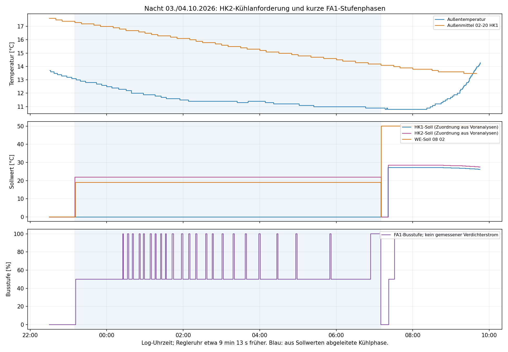

# Ungewollte Nachtkühlung am 03./04.10.2026

Grundlage: [aktuelle_einstellungen3.txt](../aktuelle_einstellungen3.txt) und
[ebusd.test2.log](../ebusd.test2.log). Ausschließlich Offline-Auswertung;
keine Anlagenparameter geändert und keine Busbefehle gesendet.

## Ergebnis und Empfehlung

Die nächtliche Kühlanforderung ist HK2 zuzuordnen. Beginn und Ende passen
auffällig genau zu 23:00–07:00 der Regleruhr. Die sehr starke HK2-Absenkung
von 23 auf 10 °C ist der wichtigste Verdacht für eine unerwartet niedrige
wirksame Kühlgrenze. Die interne Grenzberechnung ist allerdings nicht
ausgelesen; eine bestimmte Formel oder ein Firmwarefehler ist damit nicht bewiesen.

Für das ausdrücklich gewünschte Abschalten der Kühlung ist der passende
Einsteller **07-14 „Heizkreisfunktion im Kühlbetrieb“: HK1 und HK2 jeweils
von 2 auf 0**. Die lokale Programmiercheckliste ordnet ihn am Bedienteil
**7-9** zu. Auf den Funktionstext achten, da TEM-Kennung und Menüposition
verschieden sind. Der lokale Original-Hilfetext bezeichnet 0 als
„Mischer für Heizbetrieb ohne Kühlbetrieb“, 2 als „Mischer auf im Kühlbetrieb“.
[Parameterbeschreibung](../ste-output/Parameter.md#datensatz-106),
[Menüzuordnung](../input/Checkliste_Regler_Programmierung.CSV).

Nach der Änderung beide Werte zurücklesen und beim nächsten Übergang in
die Nachtabsenkung prüfen, dass kein Kühlsymbol und keine erneute HK2-
Kühlanforderung auftreten. Dies ist die dokumentierte Funktion des Einstellers,
aber noch keine an dieser Sonderbeschaltung überprüfte Abschaltung.
Ein Zu-Befehl beim Umschalten oder ein Pumpennachlauf ist allein keine
erneute Kühlanforderung. Heizen und Warmwasser anschließend auf normale
Funktion beobachten. 07-05 (Heizkreistyp) dafür nicht verändern.

## Verlauf aus den Rohdaten

Alle Zeiten sind Log-Zeiten. Die Regleruhr geht ungefähr 9 min 13 s nach.

| Zeitpunkt | Beobachtung | Rohlog-Zeile |
|---|---|---:|
| 03.10. 23:09:10.916 | Broadcast-Reglerzeit 22:59:58 | 2058 |
| 03.10. 23:09:40.213 | Broadcast-Reglerzeit 23:00:27 | 2082 |
| 03.10. 23:10:00.582 | Gemittelte Außentemperatur 02-20 HK1 = 17,3 °C | 2102 |
| 03.10. 23:10:05.953 | HK2-Sollkandidat 10 03 erstmals 22 °C statt 0 | 2105 |
| 03.10. 23:10:45.226 | HK2-Auf-Bit erstmals gesetzt | 2137 |
| 03.10. 23:11:00.193 | WE-Soll im Broadcast 08 02: 0 → 19 °C | 2152 |
| 03.10. 23:11:26.582 | FA1: 0 → 50 % | 2174 |
| 04.10. 00:25:17.365 | Erste kurze FA1-100-%-Phase | 6055 |
| 04.10. 05:51:57.650 | Ende der 22. kurzen 100-%-Phase | 23316 |
| 04.10. 06:53:45.565 | Warmwasserbit erstmals zusätzlich gesetzt | 26549 |
| 04.10. 07:09:20.206 | Broadcast-Reglerzeit 07:00:07 | 27372 |
| 04.10. 07:09:55.735 | HK2-Auf → Zu in den Statusstichproben | 27398 |
| 04.10. 07:10:36.229 | HK2-Soll erstmals wieder 0 °C | 27439 |
| 04.10. 07:10:40.187 | WE-Soll im Broadcast 08 02: 50 °C | 27443 |
| 04.10. 07:21:06 / 07:21:16 | HK1/HK2-Heizsollwerte 27,3 / 28,6 °C | 27988 / 27996 |

HK1-Soll bleibt während der nächtlichen Phase bei 0; HK2-Soll bleibt
bei 22 °C. Zusammen mit 19 °C WE-Soll, dauerhaftem HK2-Auf-Signal,
sinkenden Vorlaufwerten und dem vom Betreiber beobachteten Kühlbetrieb
ist dies ein starker Beleg für HK2 als anfordernden Kreis.
Die HK-Zuordnung der Broadcast-Sollfelder stützt sich auf die bisherigen
Bedienversuche im Projekt, nicht auf eine neu vorhandene Protokollspezifikation.

Die aktuelle Außentemperatur beträgt am Beginn etwa 13,1 °C und sinkt
bis zum Morgen auf rund 10,9 °C. Der direkt gelesene Außenmittelwert HK1
fällt von 17,3 auf 14,1 °C. Eine Erwärmung über eine feste 26-°C-Grenze
liegt somit nicht vor. Für HK2 gibt es keine eigene direkte Außenmittelreihe;
beide Zeitkonstanten sind mit 10 h eingestellt, beide Außenbroadcasts
zeigen praktisch dieselben aktuellen Temperaturen.



## Ursache: was belegt ist und was offenbleibt

- 07-14 = 2 lässt beide Kreise am Kühlbetrieb teilnehmen; es sperrt ihn nicht.
- 03-35 = 10 K ist lediglich ein Abstand zur **aktuellen Heizgrenze**.
  Der STE-Hilfetext nennt Kühlbeginn oberhalb dieser Summe und Kühlende
  1 K darunter. 03-43 = 22 °C bezeichnet dagegen die Heizkreistemperatur
  während des Kühlens, keine Außen- oder Raum-Einschaltschwelle.
  [Hilfetexte](../ste-output/Parameter.md#datensatz-51).
- Beginn kurz nach Regler-23:00 und Ende kurz nach Regler-07:00 sprechen
  stark für das Zeitprogramm. Das aktive Tag-/Nacht-Signal bzw. eine
  vollständig ausgewertete HK2-Wochenschalttabelle liegt hier nicht vor.
- HK2 hat 23 °C Tag- und 10 °C Nacht-Soll; diese Werte sind schon um
  22:30 in der gültigen FB2-Antwort `30 0b e600 6400 ...` enthalten.
  HK1 hat 22/18 °C. Eine Änderung dieser Sollwerte während der Nacht
  ist in den wiederholten Antworten nicht zu sehen.
- Um 02:11 bestätigen die HK2-Parameterblöcke zudem 22 °C Kühltemperatur,
  10 K Abstand und 16/16 °C Heizgrenzen. Die vollständige Parameterabfrage
  erfolgt erst um 09:41–09:42; die Einstellungsdatei ist kein durchgehender
  Nachweis aller Nachtparameter. Es gibt nur eine erfasste 06-23-Schreibung:
  die Expertfreigabe um 09:41:38, keine Kühl-Parameteränderung.

**Plausibles, aber unbestätigtes Rechenmodell:** Falls die Firmware die
Kühlgrenze mit dem aktuellen Raumsoll verschiebt, könnte sich für HK2
16 + (10 − 23) + 10 = **13 °C** ergeben. Damit wären 17,3 °C Außenmittel
beim Nachtbeginn oberhalb der Grenze und selbst 14,1 °C morgens noch
nicht unter der zugehörigen 12-°C-Ausschaltschwelle. Für HK1 ergäben sich
entsprechend 16 + (18 − 22) + 10 = 22 °C, also keine Kühlanforderung.
Dieses Modell erklärt die Asymmetrie, ist aber **keine nachgewiesene
SE6000-Reglergleichung**.

Ein verwandter TEM-Regler beschreibt zwar eine raumsollabhängige
Heizgrenzenverschiebung, bezeichnet die Heizgrenze im zeitgesteuerten
Absenkbetrieb jedoch ausdrücklich als absoluten Wert. Diese Quelle erlaubt
deshalb gerade keine sichere Übertragung des obigen Rechenmodells:
[Scheer IT 5711 Fachmannanleitung, S. 28](https://www.scheer-heizsysteme.de/media/produkt_pdf/Anleitungen/IT_5711_Regler_Fachmannanleitung.pdf#page=28).
Nimmt man die eingestellten 16 °C auch nachts unverändert an, ergibt
16 + 10 = 26 °C keine Erklärung für das beobachtete Einschalten.
Ob eine andere interne Grenzbildung oder ein Firmwarefehler vorliegt,
bleibt offen. Die direkte Kühlabschaltung über 07-14 erfordert diese
Unterscheidung nicht.

## Kurze Schaltphasen

Zwischen 00:25:17 und 05:51:57 liegen **22 vollständig aufgezeichnete
FA1-100-%-Phasen**, jeweils anschließend wieder 50 %. Dauer anhand der
ersten beobachteten Zustandsmeldungen: **56–136 s**, Median **120 s**.
Die längere Phase ab 06:53 fällt mit der zusätzlichen Warmwasseranforderung
zusammen und wird nicht zu diesen kurzen Kühlphasen gezählt.
[Einzelphasen mit Belegzeilen](../overnight-test2-output/cycles.csv).

Es sind also wiederholte Stufenwechsel innerhalb einer anhaltenden
HK2-Kühlanforderung, nicht 22 gesonderte wetterbedingte Eintritte in den
Kühlmodus. Die Rohdaten belegen keine elektrischen Verdichterstarts,
keinen konkreten Verschleiß und keinen bereits entstandenen Schaden.
Bei der in früheren Versuchen beschriebenen Kopplung an reale kurze
Verdichterläufe ist das Abschalten der ungewollten Kühlanforderung sinnvoll.

09-23 = 12 min und 09-31 = 9 min verhindern diese Busstufenwechsel
offensichtlich nicht; ihr Geltungsbereich für die reale Schaltung ist
nicht abschließend geklärt. Diese Zeiten, 09-35 oder die globalen
Leistungsreglerwerte sind deshalb kein Ersatz für eine Kühlfreigabesperre.
Auch höhere Kühltemperatur oder veränderte Außenmittelung schalten die
Kühlfunktion nicht grundsätzlich ab.

## Reproduzierbarkeit

35.824 Logzeilen, 35.678 Telegramme mit gültiger Master-CRC;
146 kurze Fragmente ausgeschlossen. Direkte Parameterwerte nur aus
vollständigen Antworten mit gültiger Slave-CRC und ACK.
FA1-Stufenmeldungen im Mittel ungefähr alle 8 s, maximaler Abstand
12,625 s; die HK-Sollwert-/Statusblöcke ungefähr alle 80 s.
Daher sind die angegebenen Zeitpunkte erste Beobachtungen und keine
exakten physischen Schaltzeitpunkte.

```sh
python3 scripts/analyze_overnight_test2.py
python3 scripts/plot_overnight_test2.py
```

Ergebnisse einschließlich Prüfsummenstatistik, bestätigten Parameterwerten,
Statusflanken und Telegrammbelegen liegen in `overnight-test2-output/`.
